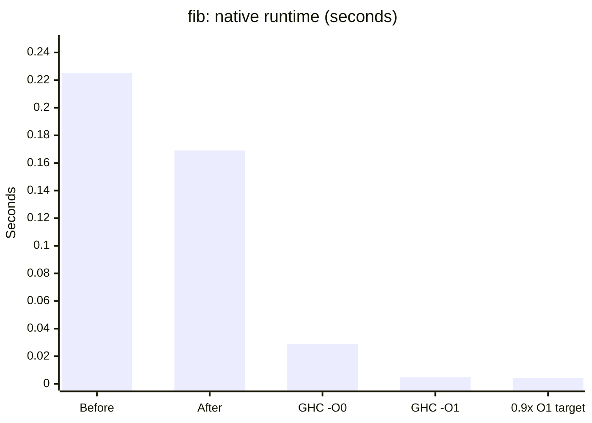
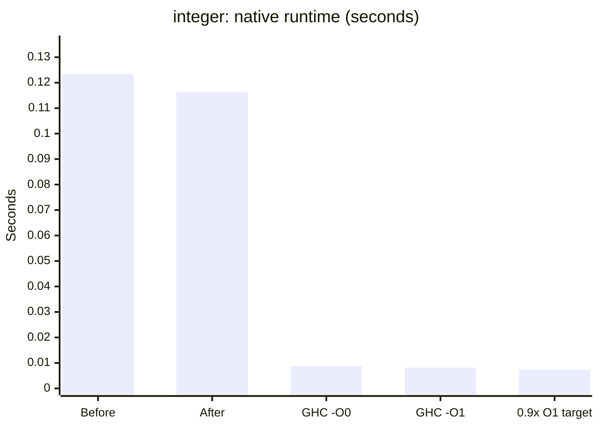
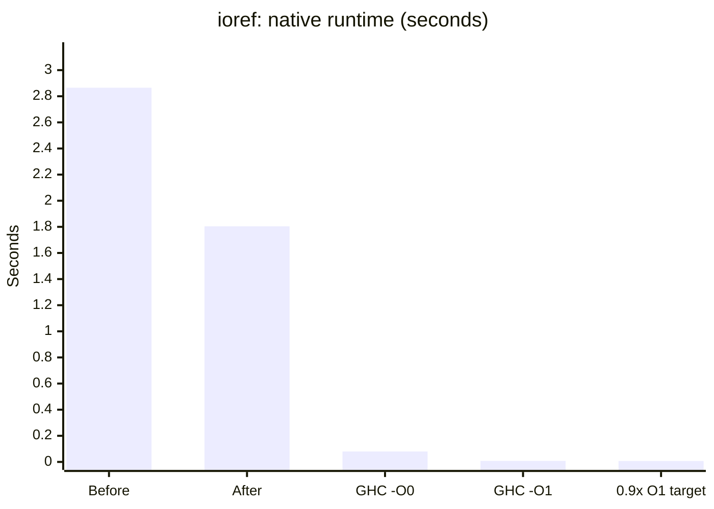
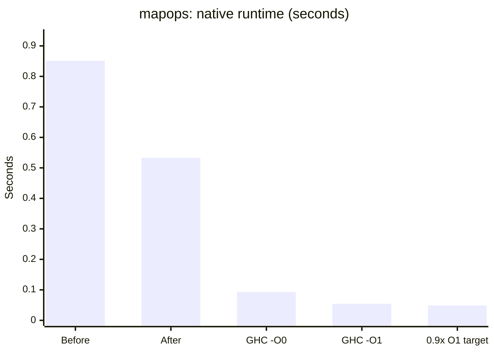
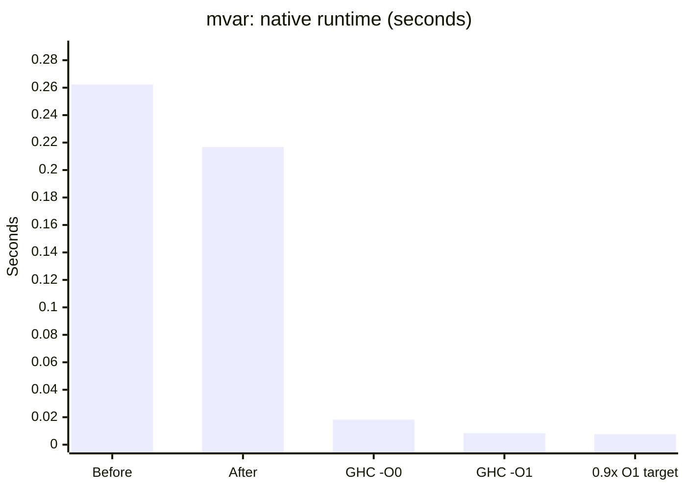
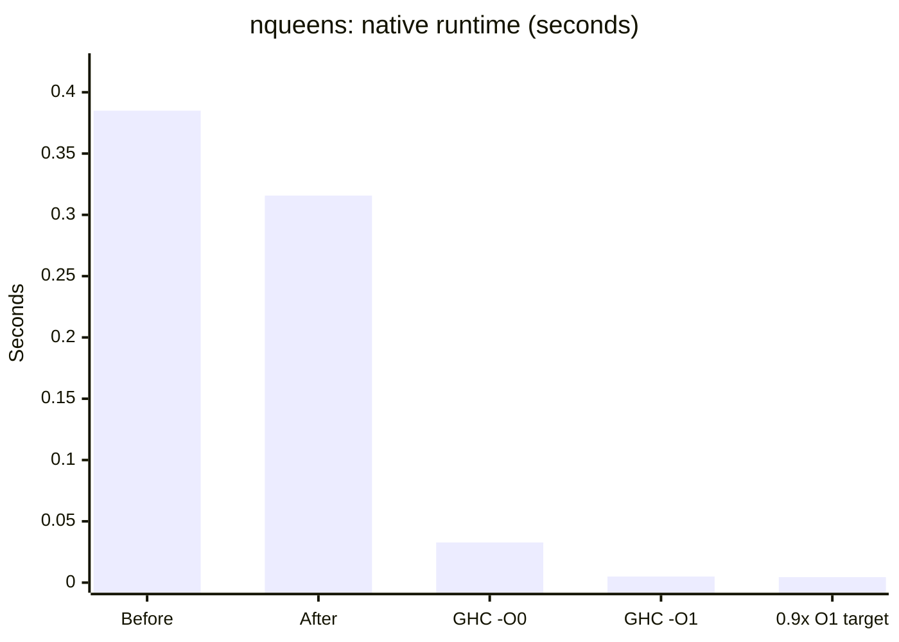
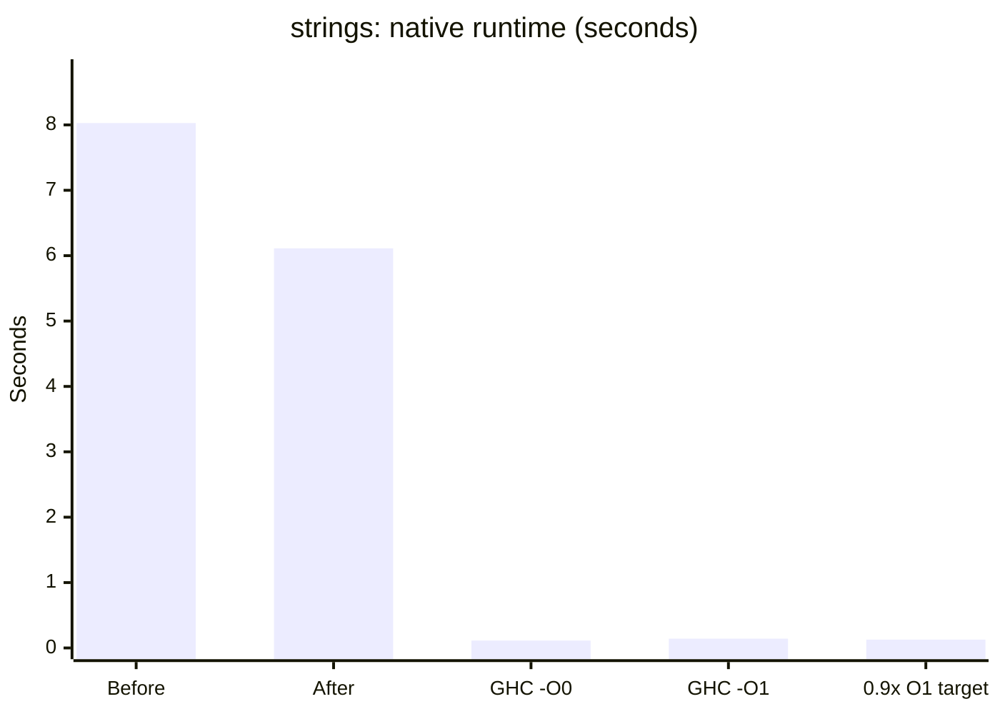
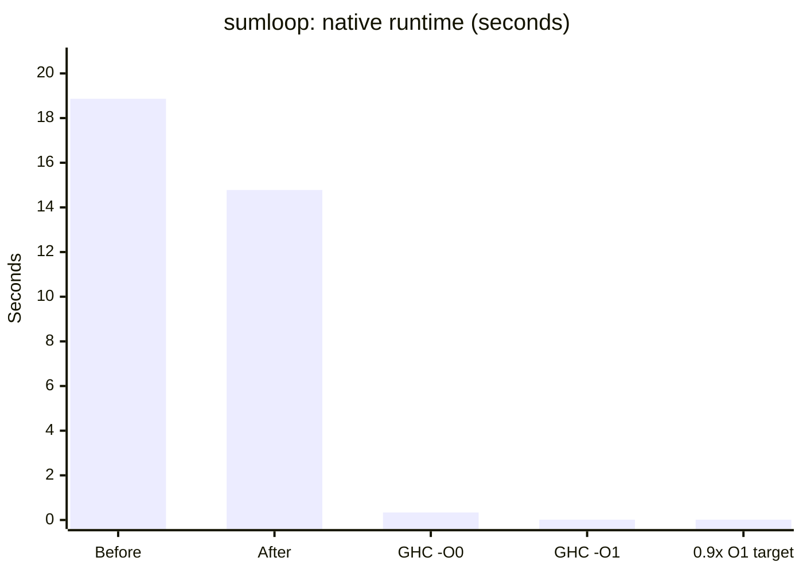

# Local variable-alias thunks: native runtime

Raw samples, commands and metadata: [runtime-alias-thunks.json](runtime-alias-thunks.json).

[Hosted run](https://github.com/billyedmoore/shit-haskell/actions/runs/43740944344); AMD EPYC 7763 64-Core Processor, CPU 0, Rust 1.92.0 release, GHC 9.12.2.
Before `01c36cf1dab6089353a3db0b5384e3d99821276d`, after `4d5f3db1192ff90b5b43b5709d41cbb6d63797e3`.

Native runtime; median of 3 alternating samples, 1 untimed correctness warmups per build.
Builds excluded; process startup included. Every stdout/stderr/exit result agrees.
CPU affinity: 0. GHC uses default RTS settings.

| Program | Before ms | After ms | GHC -O0 ms | GHC -O1 ms | 0.9×O1 ms |
|---|---:|---:|---:|---:|---:|
| fib | 225.211 | 169.073 | 28.944 | 4.811 | 4.330 |
| integer | 123.492 | 116.416 | 8.690 | 8.169 | 7.352 |
| ioref | 2865.224 | 1804.312 | 80.040 | 7.670 | 6.903 |
| mapops | 850.951 | 532.875 | 92.902 | 54.231 | 48.808 |
| mvar | 262.330 | 216.720 | 18.280 | 8.487 | 7.638 |
| nqueens | 384.994 | 315.725 | 32.721 | 4.997 | 4.497 |
| strings | 8027.980 | 6111.663 | 112.681 | 142.335 | 128.101 |
| sumloop | 18864.813 | 14778.604 | 337.084 | 16.463 | 14.817 |

Eight-program geometric-mean speedup: 1.313647×. Every paired median improved; the 0.9× GHC -O1 target remains unmet. This runner differs from earlier reports; compare paired columns within each report.

Reproduce with `tools/runtimebench.py --before /path/to/before/hsc --after /path/to/after/hsc --ghc ghc --cpu 0 --runs 3`. Use common vendored sources through `HSC_LIBDIR`; builds and correctness warmups are untimed.
