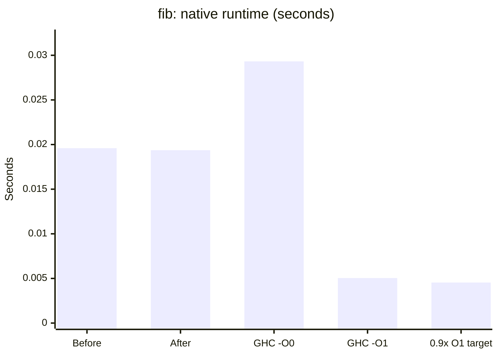
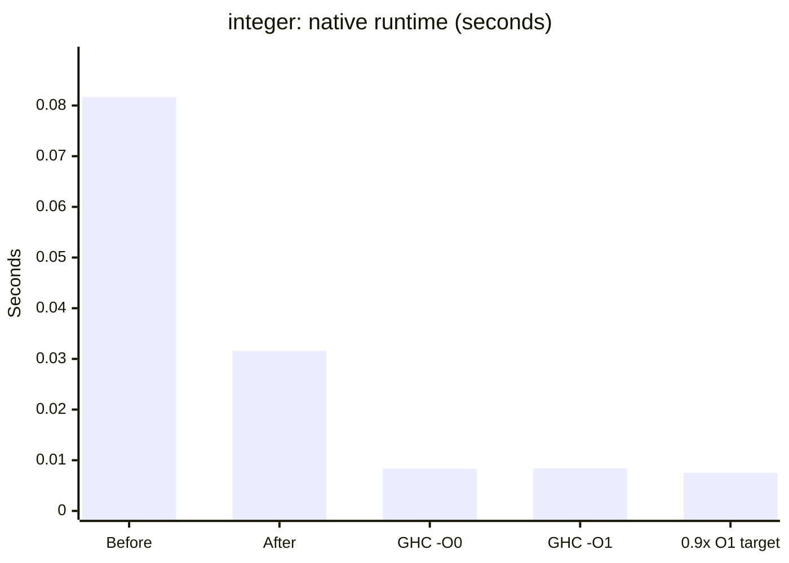
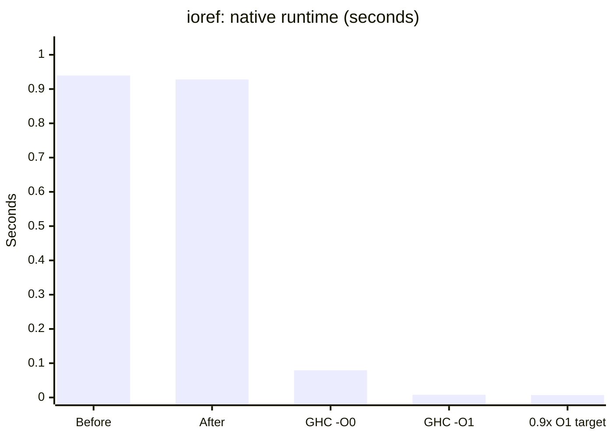
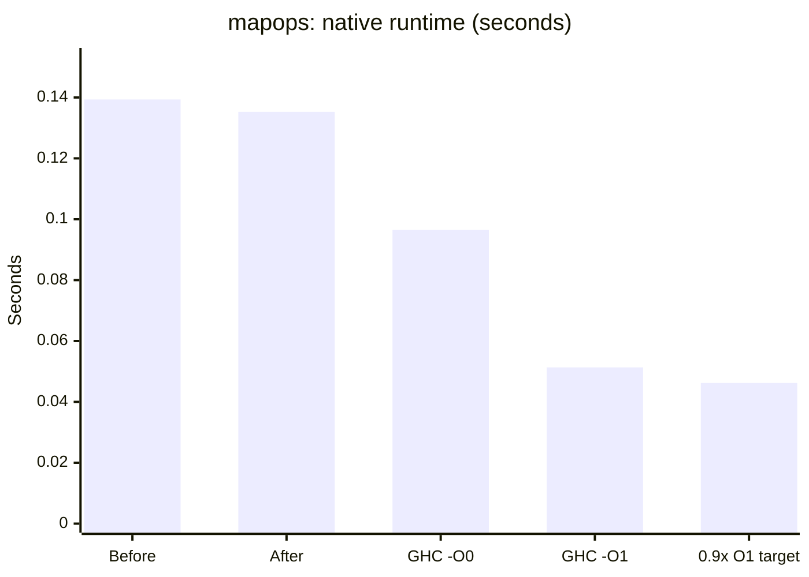
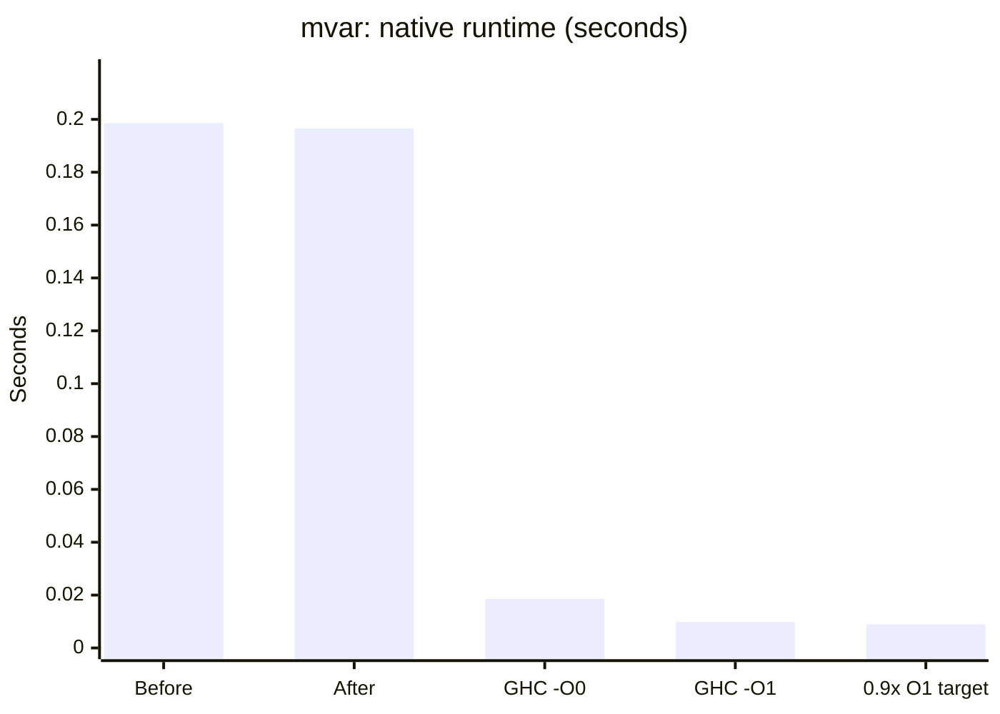
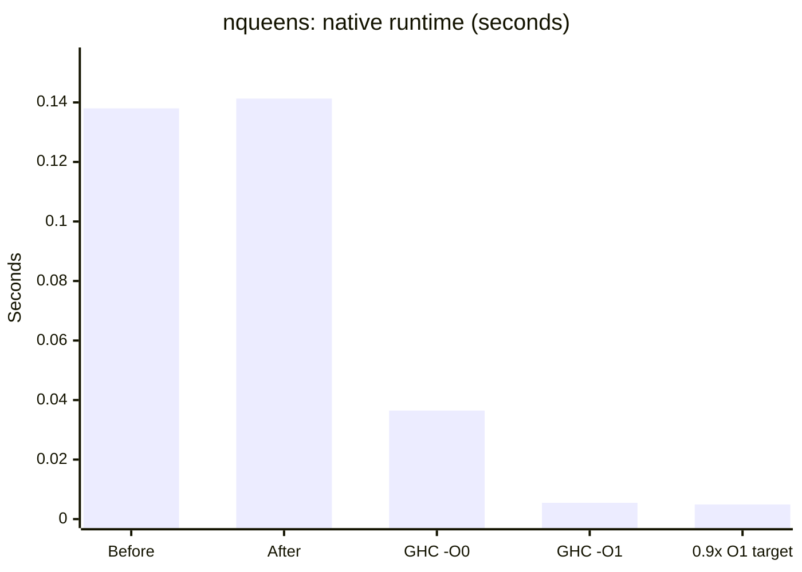
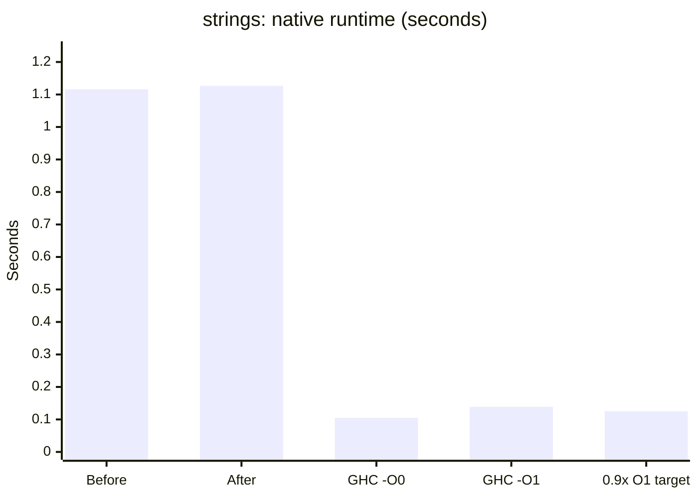
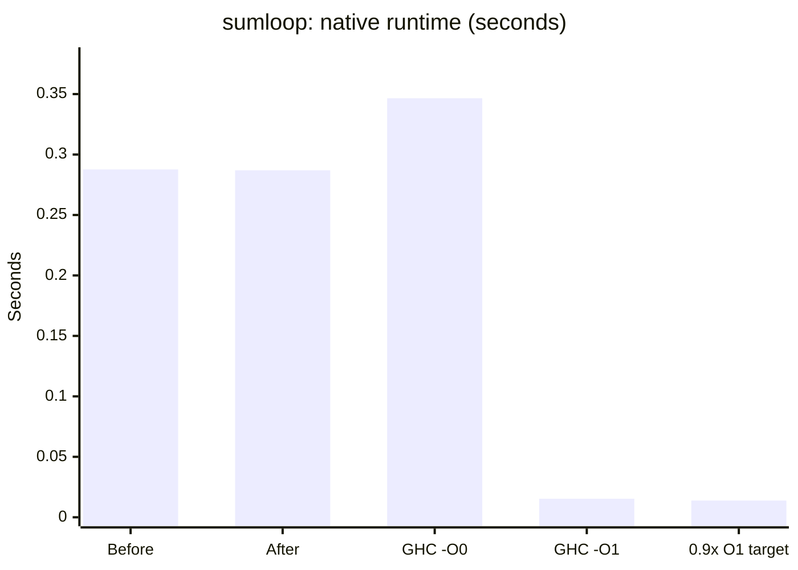

# Algorithm D for Integer division; integer hasher for scheduler maps: native runtime

[Raw samples, commands and metadata](runtime-bigint-division.json).

[Hosted run](https://github.com/billyedmoore/shit-haskell/actions/runs/43851625909); AMD EPYC 7763 64-Core Processor, CPU 0, Rust 1.92.0 release, GHC 9.12.2.
Before `2397e01de627da542986dd6afd6b9166eaccd3e4`, after `9c2527922964b551986225c4c3ed995d1f38030b`.

Native runtime; median of 3 alternating samples, 1 untimed correctness warmups per build.
Builds excluded; process startup included. Every stdout/stderr/exit result agrees.
CPU affinity: 0. GHC uses default RTS settings.

| Program | Before ms | After ms | GHC -O0 ms | GHC -O1 ms | 0.9×O1 ms |
|---|---:|---:|---:|---:|---:|
| fib | 19.591 | 19.369 | 29.320 | 5.047 | 4.543 |
| integer | 81.672 | 31.574 | 8.358 | 8.368 | 7.531 |
| ioref | 939.532 | 927.972 | 79.538 | 7.988 | 7.189 |
| mapops | 139.349 | 135.277 | 96.470 | 51.334 | 46.201 |
| mvar | 198.603 | 196.498 | 18.547 | 9.892 | 8.903 |
| nqueens | 138.002 | 141.286 | 36.472 | 5.470 | 4.923 |
| strings | 1115.698 | 1126.626 | 104.888 | 138.784 | 124.906 |
| sumloop | 287.689 | 286.962 | 346.555 | 15.359 | 13.823 |

