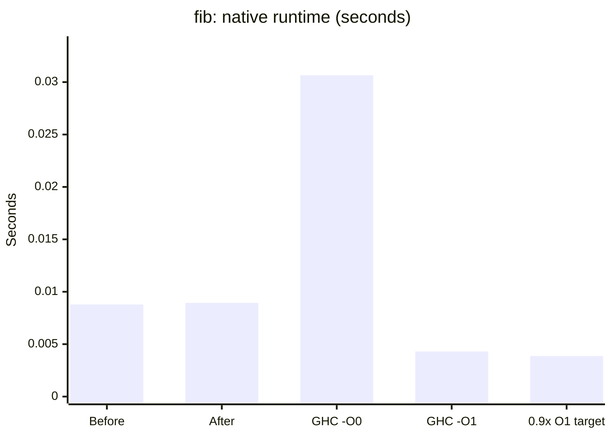
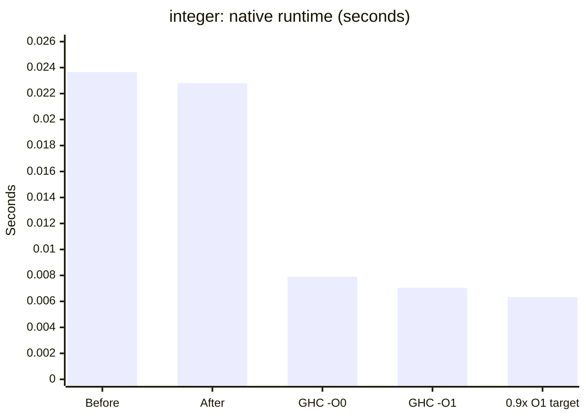
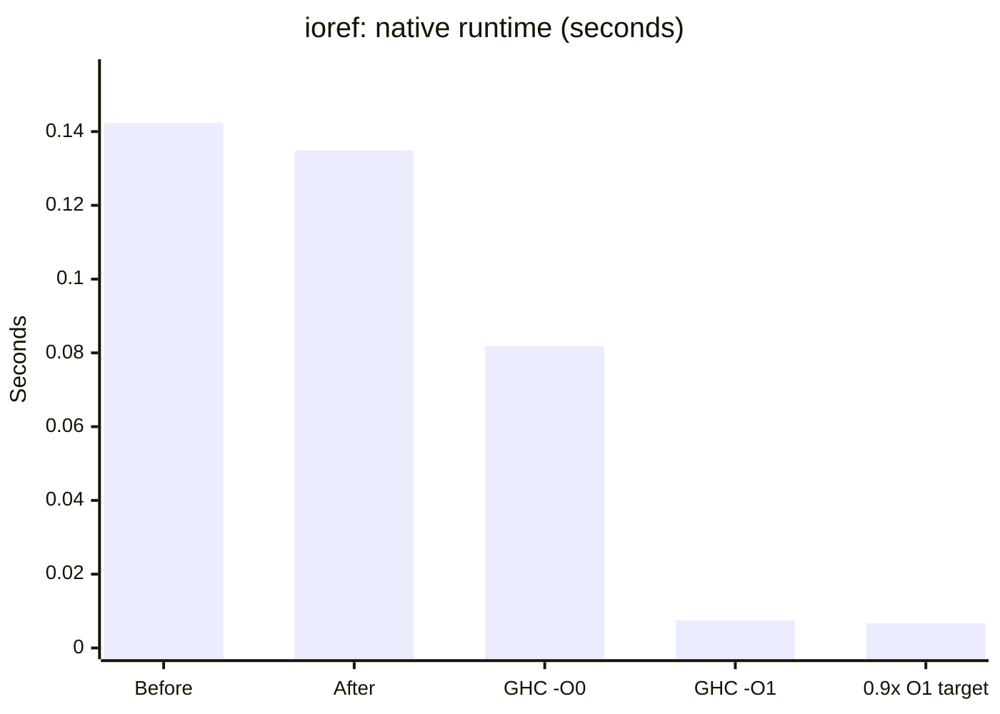
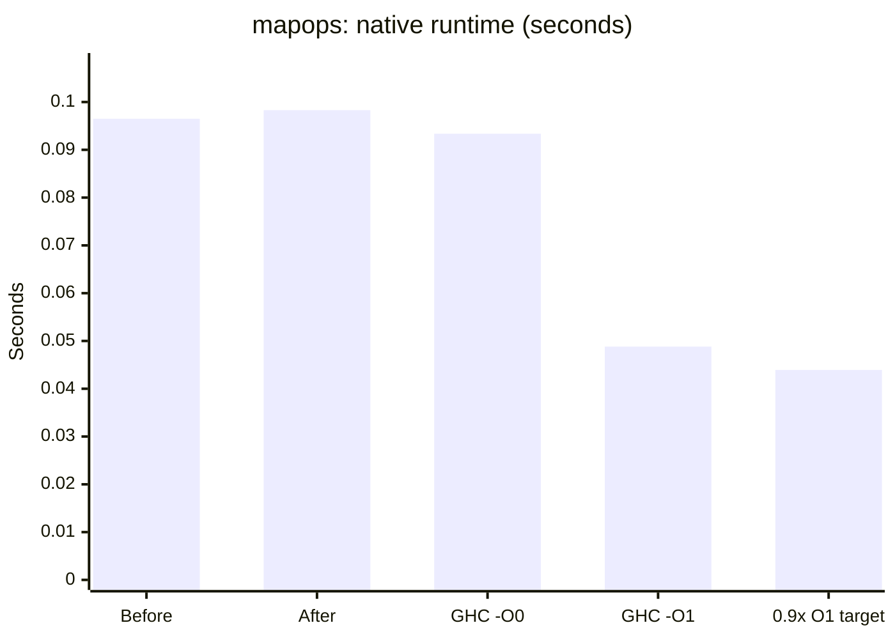
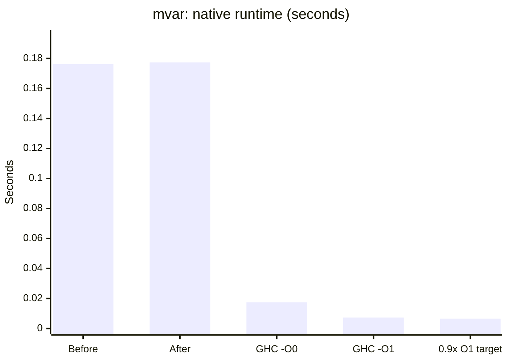
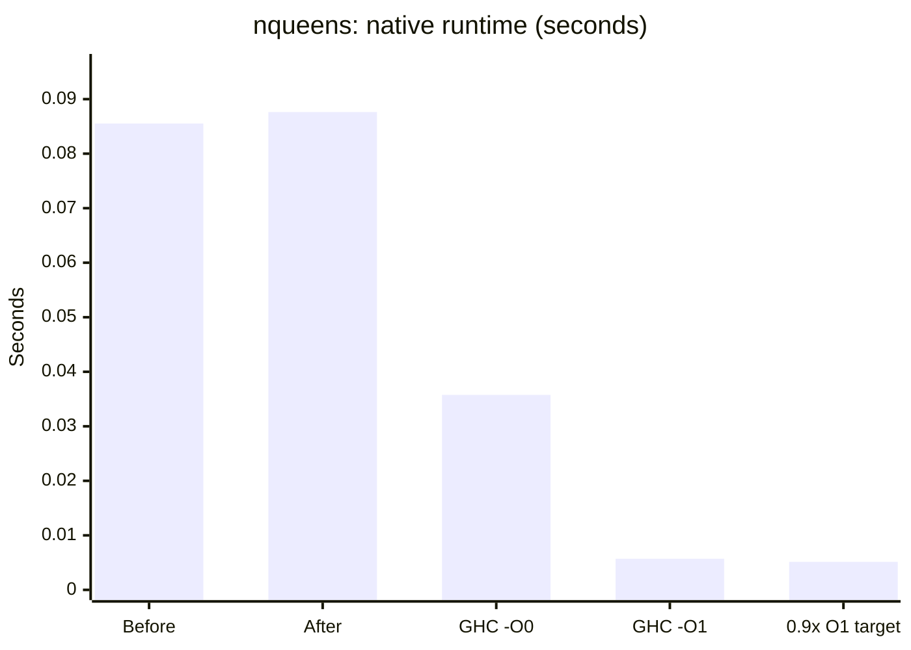
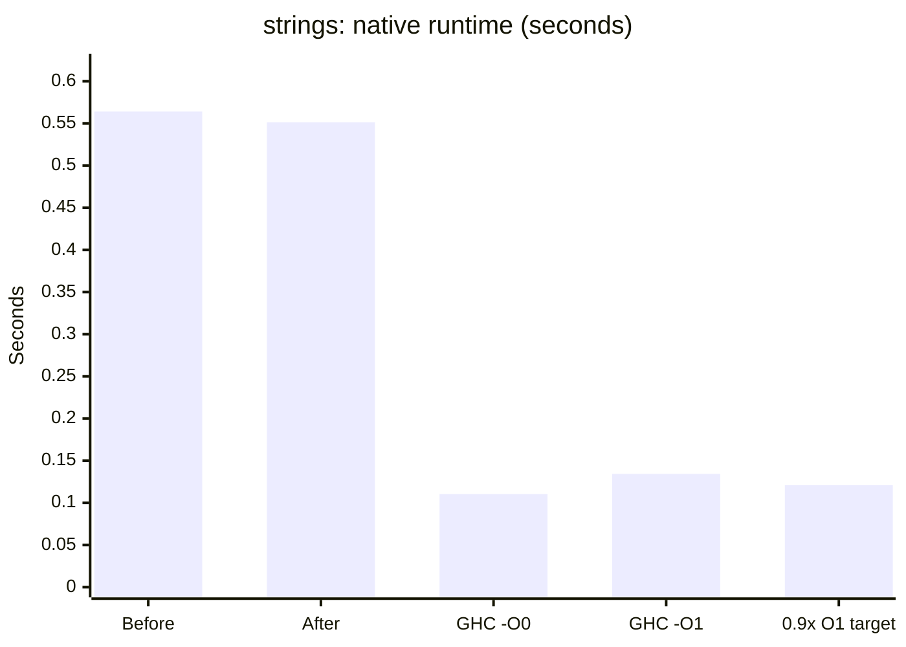
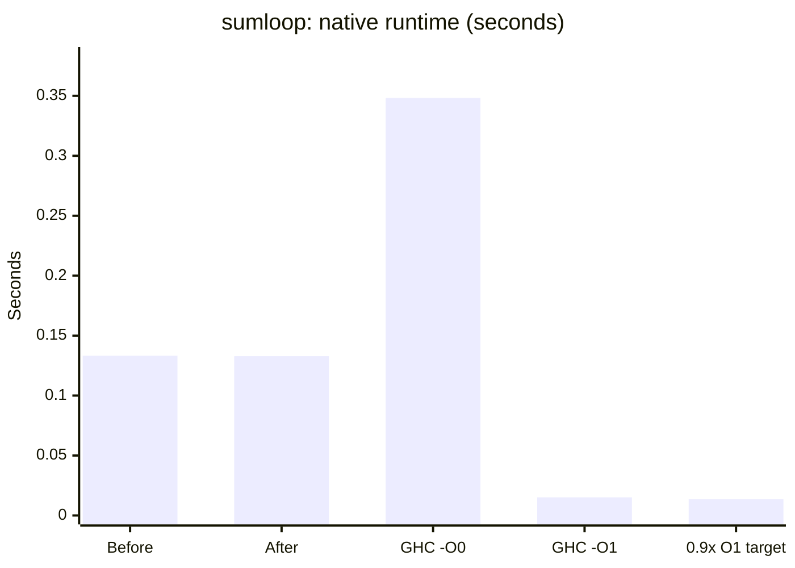

# Case-of-case into several results; local calls by value: native runtime

[Raw samples, commands and metadata](runtime-case-of-case.json).

[Hosted run](https://github.com/billyedmoore/shit-haskell/actions/runs/44028297830); AMD EPYC 7763, Rust 1.92.0 release, GHC 9.12.2.
Before `c33d82f3496fd7532d44afebe7d69e8237424b1b`, after `625f8ec4ef94880c6a3da894e67d9784e8d4e4f5`.
This runner is slower than #59's (every program, GHC's too, takes 1.5–2× as long), so compare
before with after, not with earlier runs. No benchmark here has a fused local loop (the change's
target: `sum (map (\x -> x * x) [1 .. 10^6])` takes 483 → 138 M instructions); the
geometric mean of after/before is 0.99, every program within noise.

Native runtime; median of 3 alternating samples, 1 untimed correctness warmups per build.
Builds excluded; process startup included. Every stdout/stderr/exit result agrees.
CPU affinity: 0. GHC uses default RTS settings.

| Program | Before ms | After ms | GHC -O0 ms | GHC -O1 ms | 0.9×O1 ms |
|---|---:|---:|---:|---:|---:|
| fib | 8.786 | 8.936 | 30.646 | 4.301 | 3.871 |
| integer | 23.656 | 22.809 | 7.900 | 7.038 | 6.334 |
| ioref | 142.303 | 134.878 | 81.784 | 7.456 | 6.710 |
| mapops | 96.498 | 98.300 | 93.368 | 48.824 | 43.941 |
| mvar | 176.263 | 177.364 | 17.442 | 7.287 | 6.559 |
| nqueens | 85.521 | 87.633 | 35.757 | 5.704 | 5.134 |
| strings | 564.116 | 551.234 | 110.371 | 134.345 | 120.910 |
| sumloop | 133.211 | 132.849 | 348.284 | 15.102 | 13.592 |

