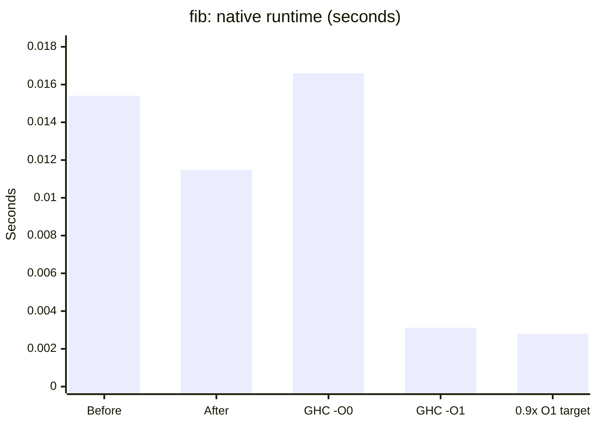
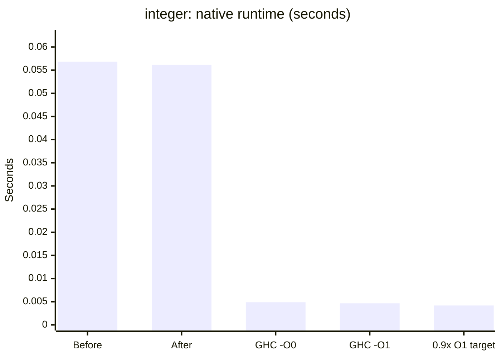
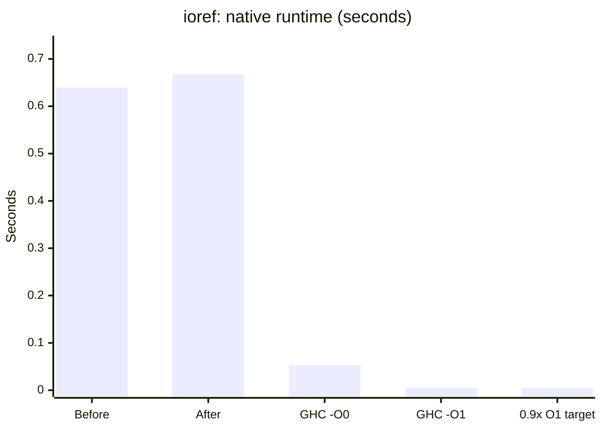
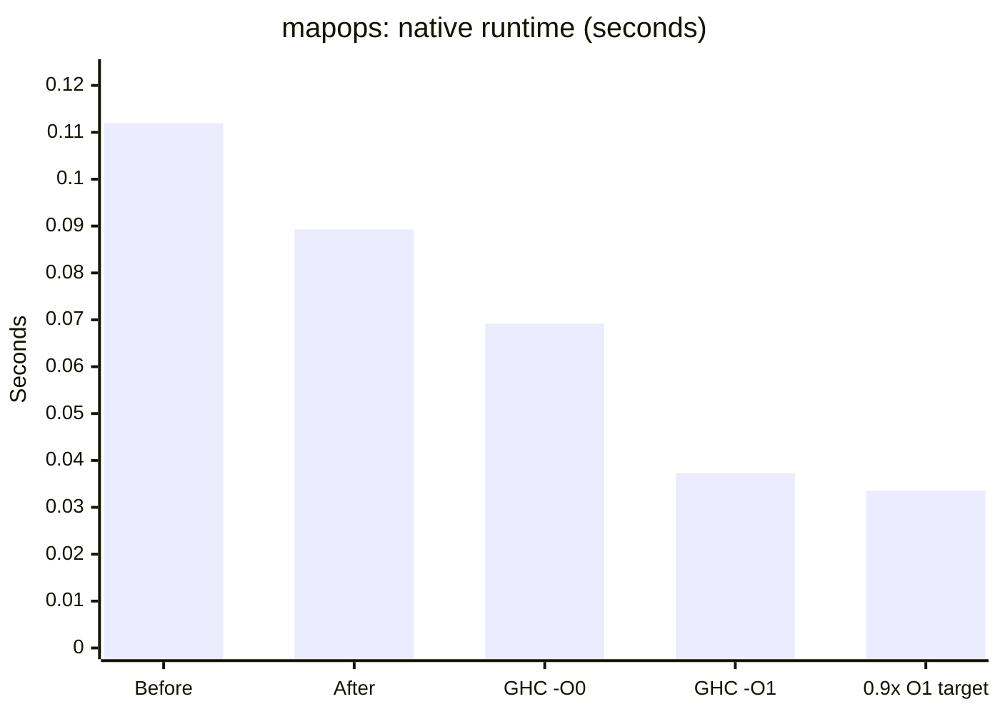
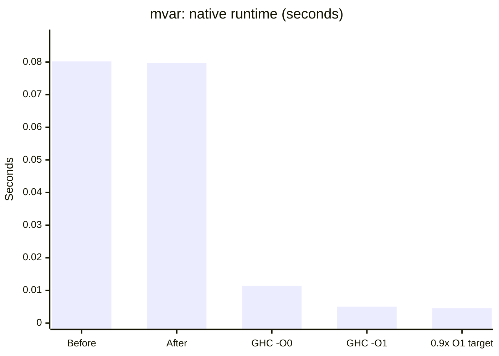
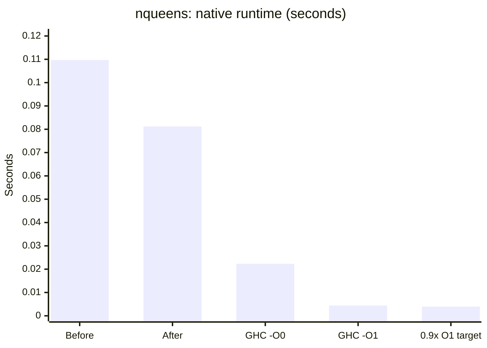
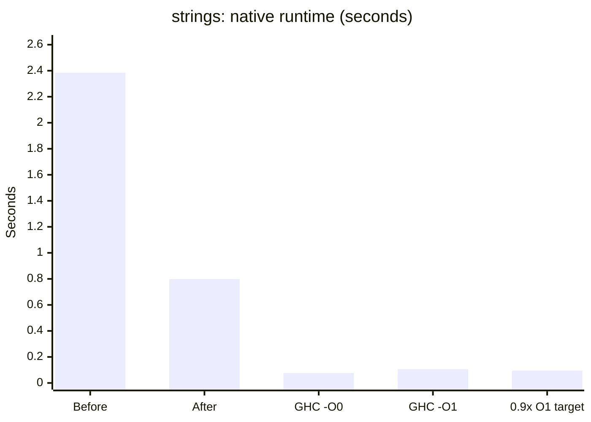
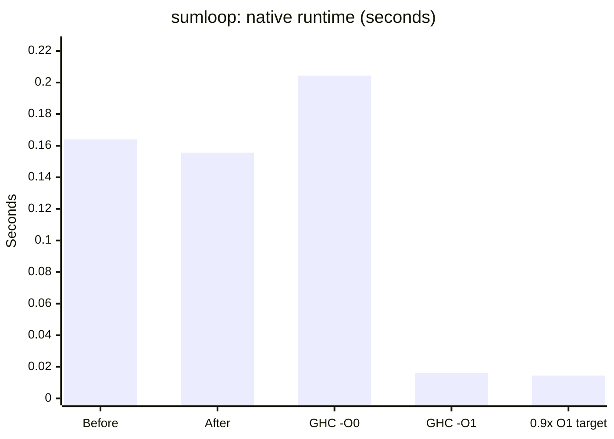

# Inline Char#/Word#/tagToEnum# and static small Integer literals: native runtime

[Raw samples, commands and metadata](runtime-char-word-integer.json).

[Hosted run](https://github.com/billyedmoore/shit-haskell/actions/runs/43849023490); Intel(R) Xeon(R) 6975P-C, CPU 0, Rust 1.92.0 release, GHC 9.12.2.
Before `5aaec4fb4536f72198528ea4b24968bb6b171320`, after `c013e6228441340940bebb005cbf6dd57fec8b96`.

Native runtime; median of 3 alternating samples, 1 untimed correctness warmups per build.
Builds excluded; process startup included. Every stdout/stderr/exit result agrees.
CPU affinity: 0. GHC uses default RTS settings.

| Program | Before ms | After ms | GHC -O0 ms | GHC -O1 ms | 0.9×O1 ms |
|---|---:|---:|---:|---:|---:|
| fib | 15.406 | 11.483 | 16.589 | 3.112 | 2.801 |
| integer | 56.820 | 56.163 | 4.883 | 4.653 | 4.188 |
| ioref | 639.862 | 667.896 | 52.753 | 5.562 | 5.006 |
| mapops | 111.970 | 89.287 | 69.184 | 37.275 | 33.547 |
| mvar | 80.202 | 79.724 | 11.416 | 5.021 | 4.519 |
| nqueens | 109.709 | 81.195 | 22.332 | 4.397 | 3.957 |
| strings | 2384.350 | 798.630 | 76.236 | 105.622 | 95.060 |
| sumloop | 164.017 | 155.628 | 204.355 | 16.055 | 14.449 |

