# Direct known global calls: native runtime

Raw samples, build/run commands and runner metadata: [runtime-direct-calls.json](runtime-direct-calls.json).

[Hosted run](https://github.com/billyedmoore/shit-haskell/actions/runs/43767101651); AMD EPYC 9V74, CPU 0, Rust 1.92.0 release, GHC 9.12.2.
Before `811abe64cad2fa25b178050088497004f80dd71a`, after `f1b44e1e4d4a9814ddbe282f763ebc9ee5a4dd71`.

Native runtime; median of 3 alternating samples, 1 untimed correctness warmups per build.
Builds excluded; process startup included. Every stdout/stderr/exit result agrees.
CPU affinity: 0. GHC uses default RTS settings.

| Program | Before ms | After ms | GHC -O0 ms | GHC -O1 ms | 0.9×O1 ms |
|---|---:|---:|---:|---:|---:|
| fib | 145.829 | 127.986 | 18.412 | 3.624 | 3.262 |
| integer | 92.922 | 90.986 | 6.739 | 5.824 | 5.242 |
| ioref | 1391.113 | 1383.231 | 56.307 | 6.300 | 5.670 |
| mapops | 404.827 | 399.779 | 69.857 | 40.280 | 36.252 |
| mvar | 188.603 | 187.429 | 14.002 | 6.567 | 5.910 |
| nqueens | 227.693 | 221.288 | 21.984 | 4.327 | 3.895 |
| strings | 4836.985 | 4841.417 | 81.351 | 105.751 | 95.176 |
| sumloop | 10540.299 | 10494.385 | 200.342 | 13.956 | 12.561 |

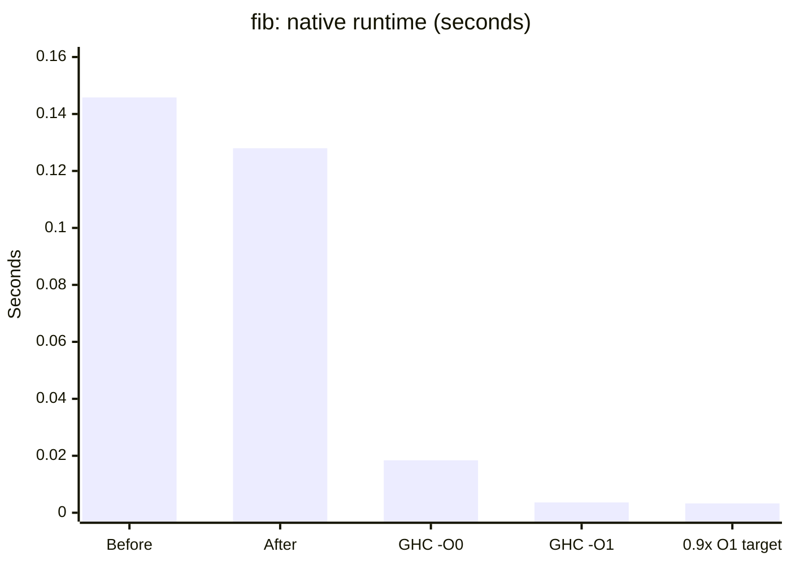

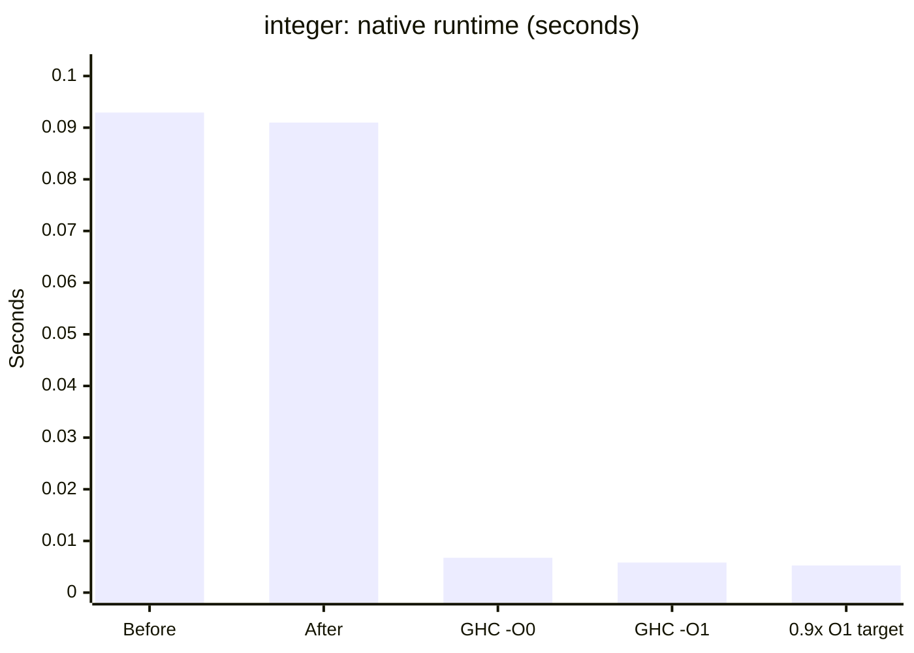

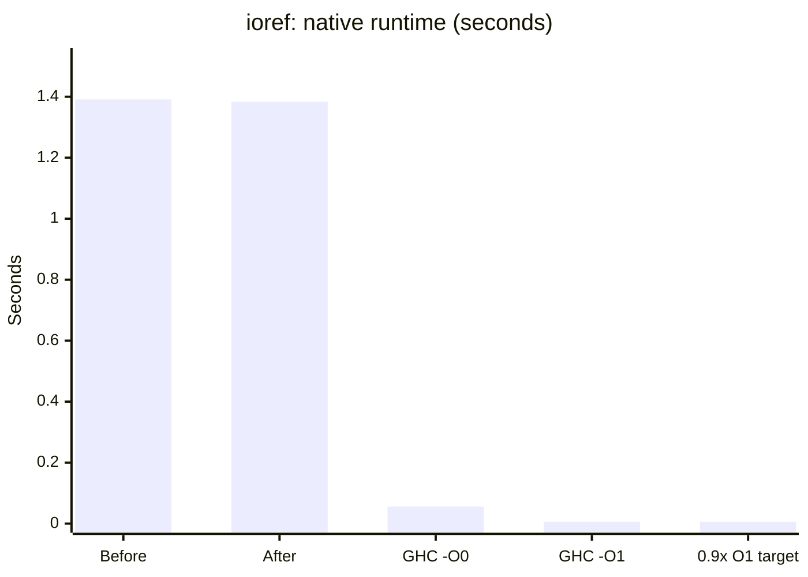

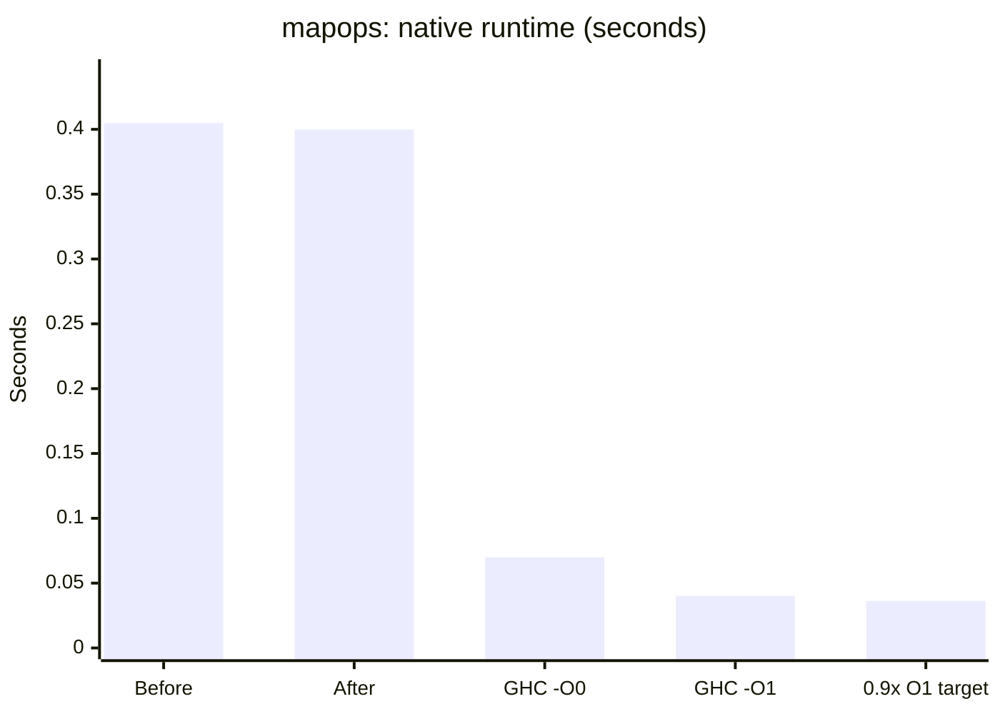

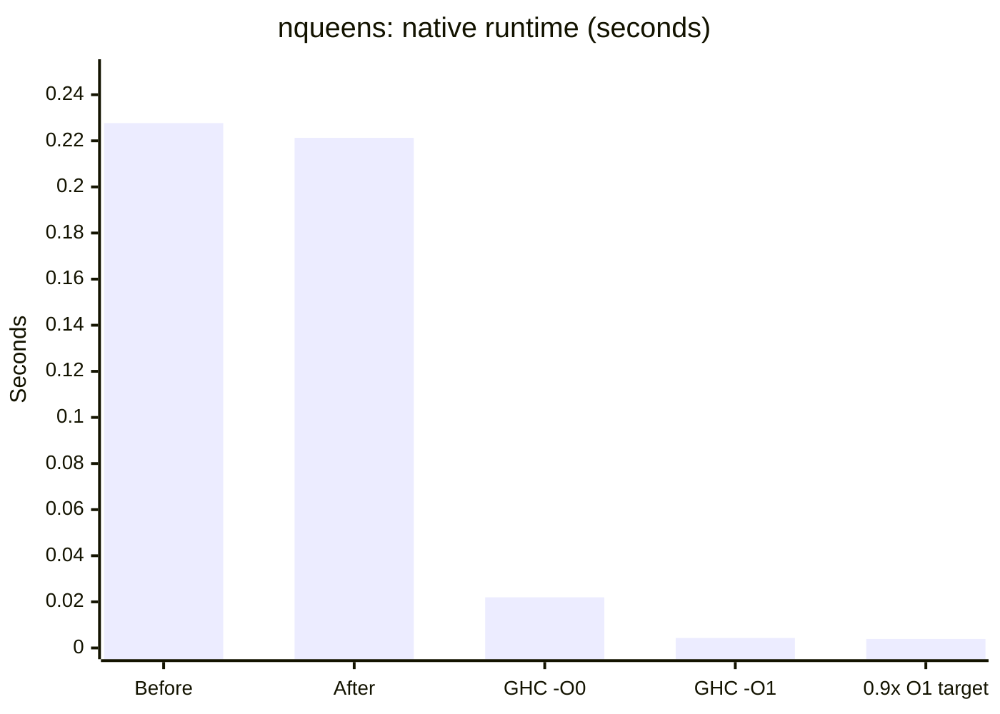

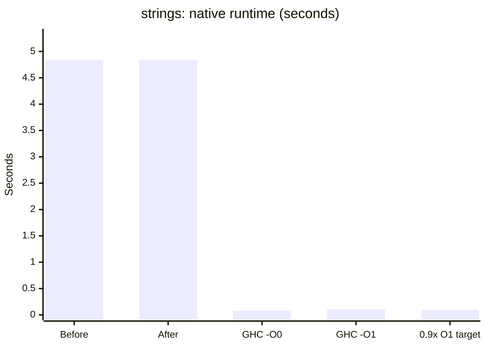

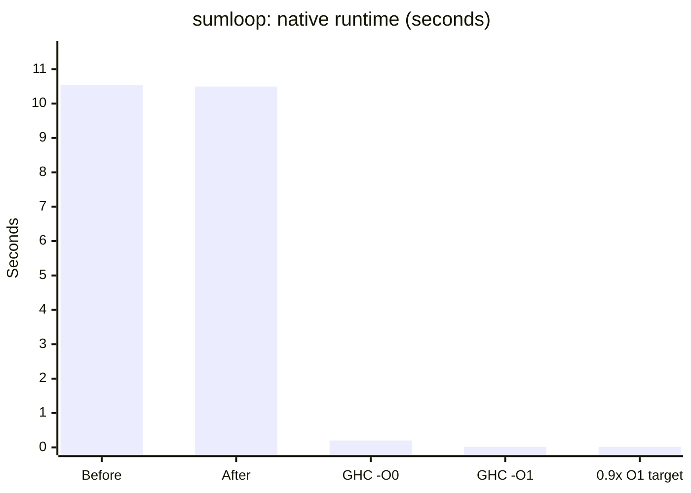

Geometric-mean speedup: 1.026×. Fib improves most; other differences are small and strings is slightly slower. All GHC runtime targets remain unmet. Both corpora pass 230/230 and all 58 unit tests pass.

## Verification run

[Hosted rerun](https://github.com/billyedmoore/shit-haskell/actions/runs/43768317428), with the same implementation and a documentation-only head update. [Raw samples and metadata](runtime-direct-calls-verification.json).

Native runtime; median of 3 alternating samples, 1 untimed correctness warmups per build.
Builds excluded; process startup included. Every stdout/stderr/exit result agrees.
CPU affinity: 0. GHC uses default RTS settings.

| Program | Before ms | After ms | GHC -O0 ms | GHC -O1 ms | 0.9×O1 ms |
|---|---:|---:|---:|---:|---:|
| fib | 125.183 | 121.117 | 22.101 | 3.892 | 3.502 |
| integer | 76.951 | 89.883 | 5.085 | 4.878 | 4.391 |
| ioref | 1135.031 | 1116.198 | 62.247 | 7.073 | 6.366 |
| mapops | 355.861 | 345.864 | 71.190 | 39.948 | 35.953 |
| mvar | 108.285 | 107.177 | 12.775 | 5.345 | 4.811 |
| nqueens | 219.466 | 213.295 | 22.591 | 3.931 | 3.538 |
| strings | 4083.654 | 4129.325 | 76.974 | 96.200 | 86.580 |
| sumloop | 9597.177 | 9644.746 | 221.409 | 17.749 | 15.974 |

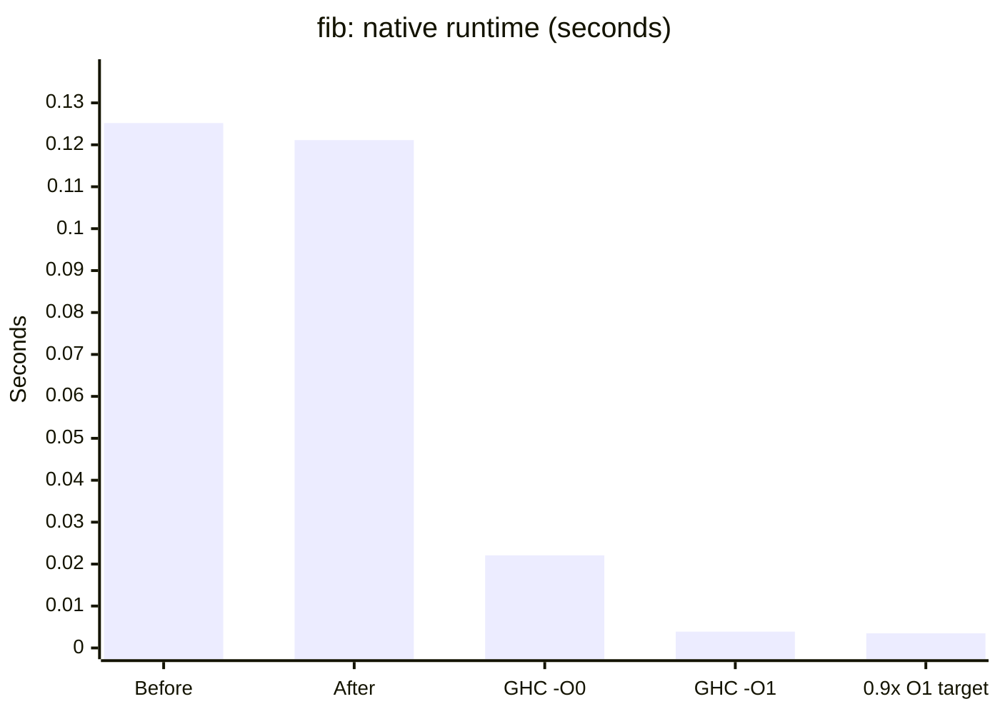

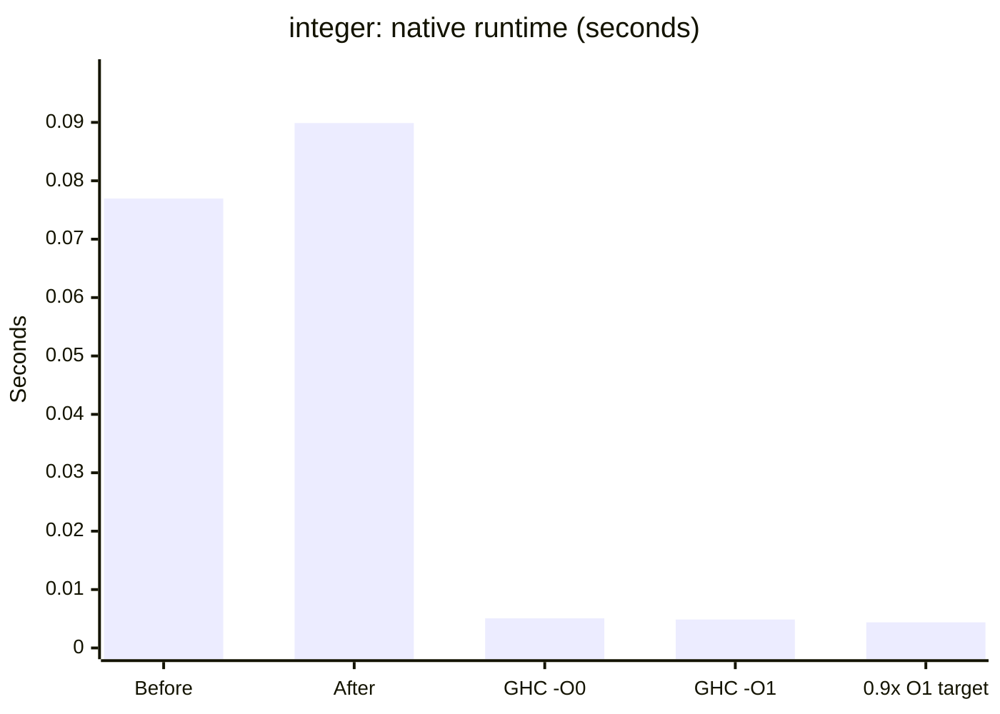

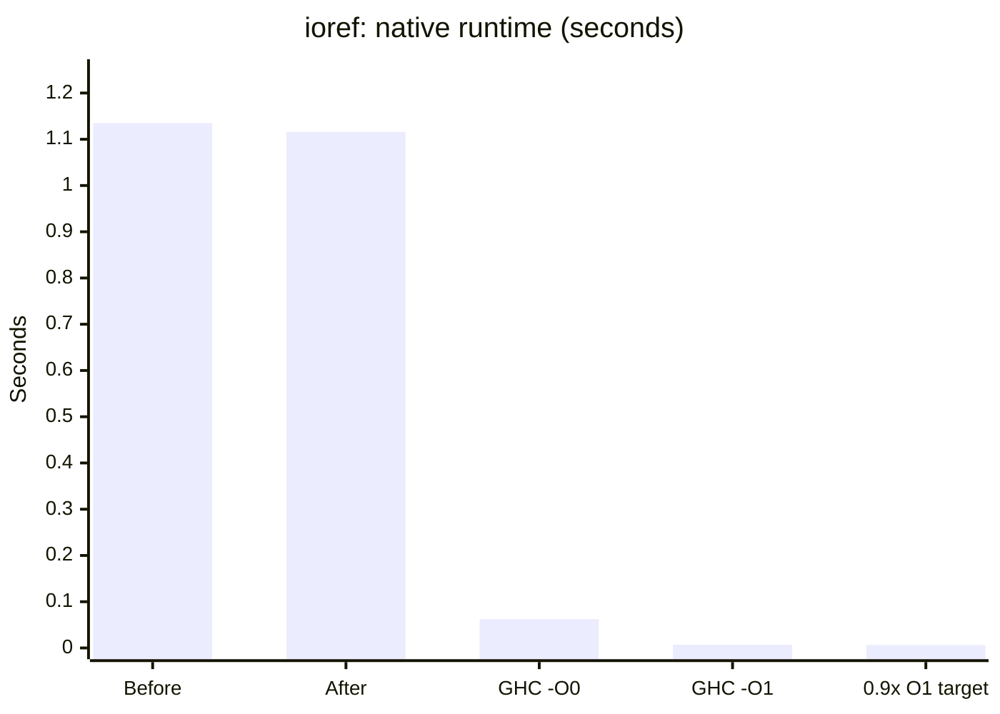

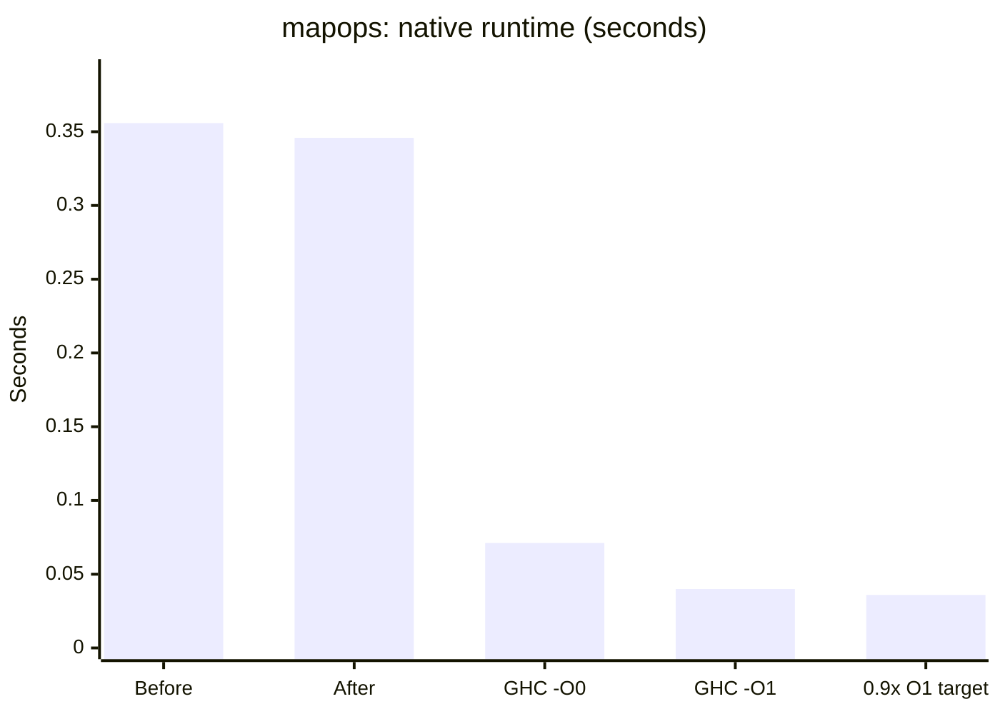

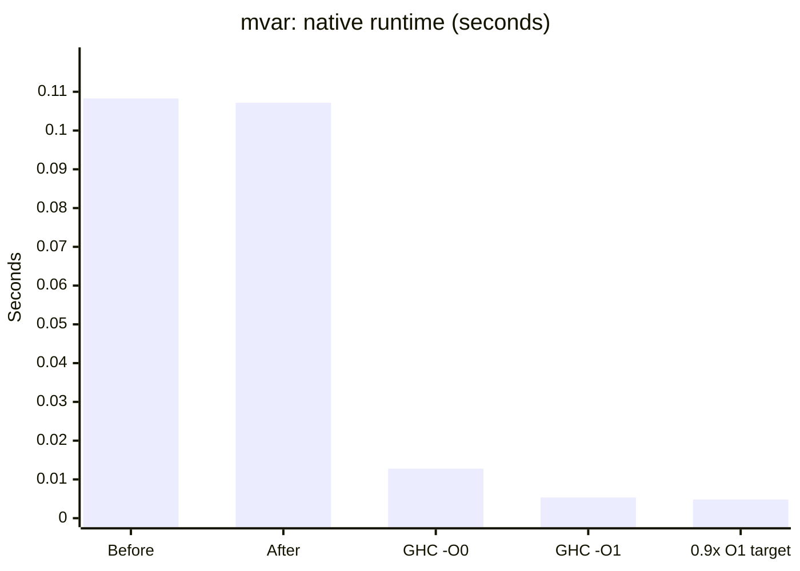

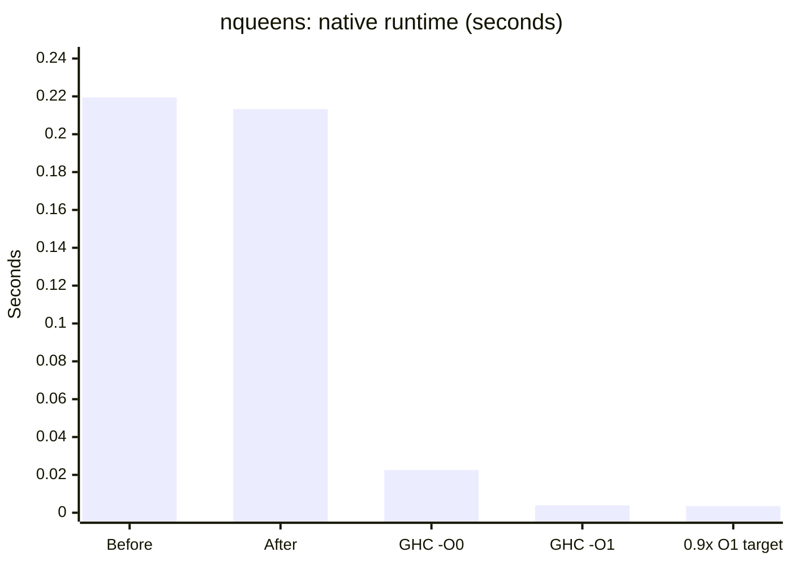

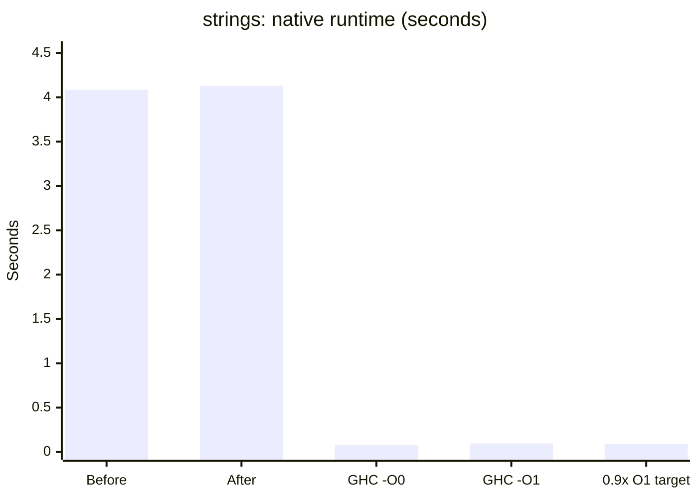

Geometric-mean speedup: 0.993×. Integer regresses in this run; the two runs do not establish a consistent overall speedup. Fib improves in both runs. All runtime targets remain unmet.
