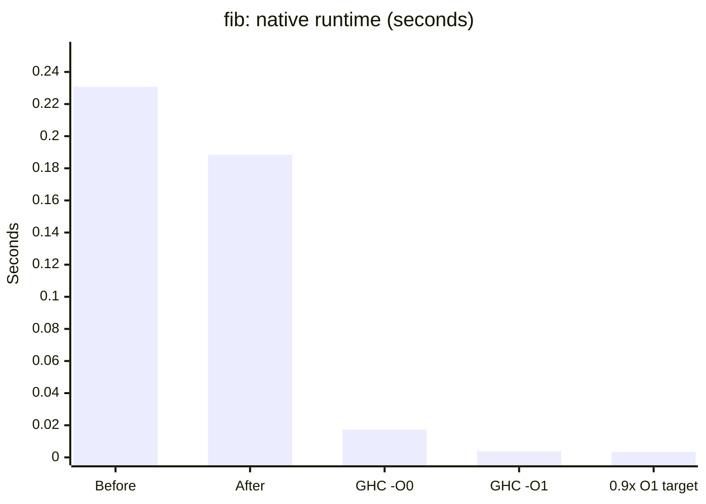
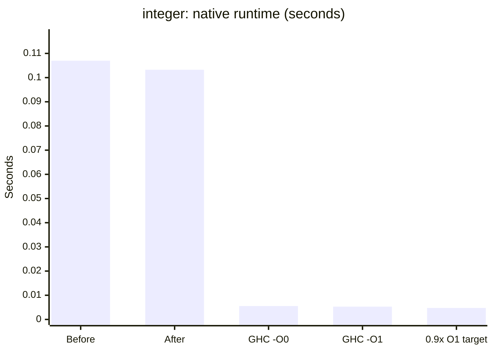
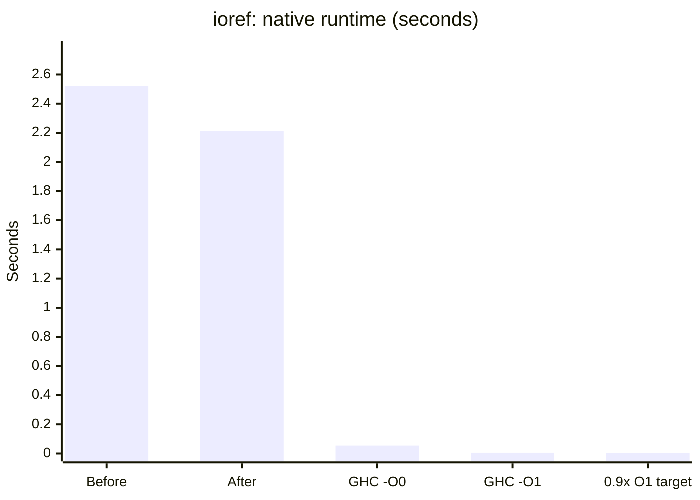
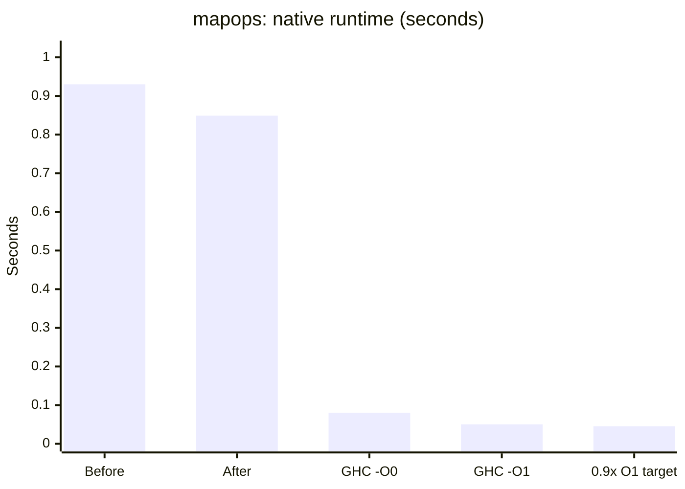
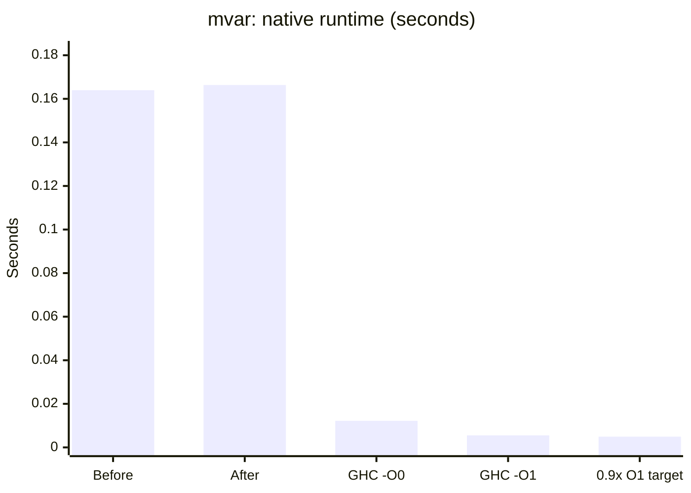
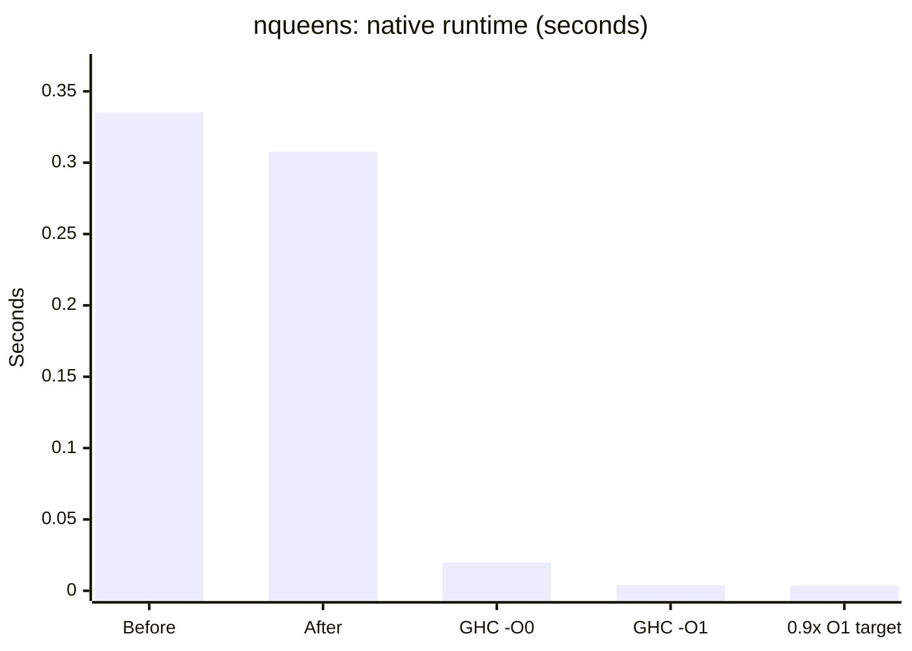
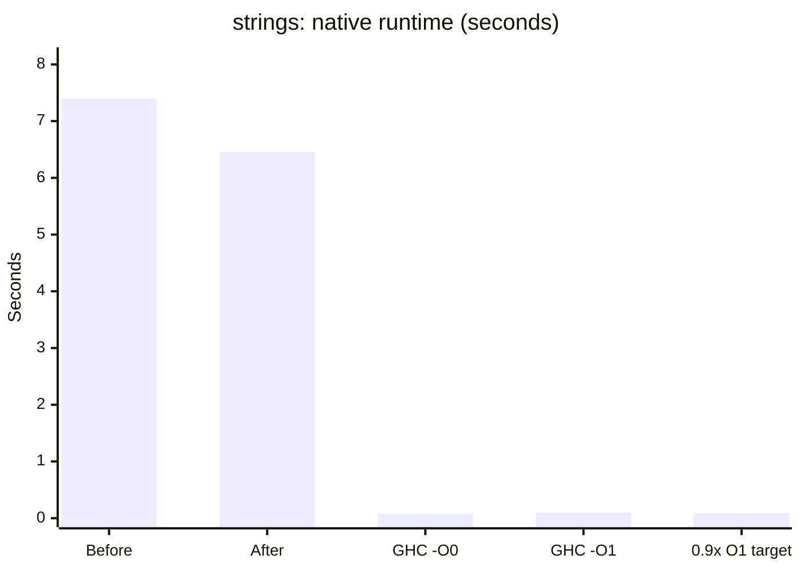
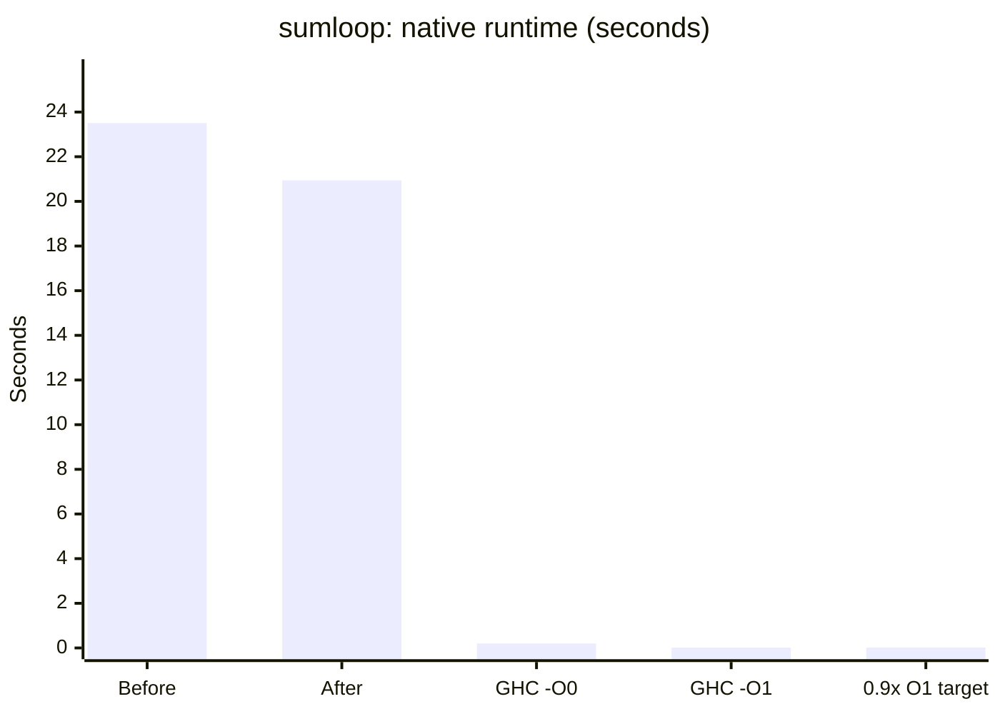

# Primitive dispatch runtime measurements

Raw samples and normalized commands: [runtime-dispatch.json](runtime-dispatch.json).

Native runtime; median of 3 alternating samples, 1 untimed correctness warmups per build.
Builds excluded; process startup included. Every stdout/stderr/exit result agrees.
CPU affinity: 0. GHC uses default RTS settings.

| Program | Before ms | After ms | GHC -O0 ms | GHC -O1 ms | 0.9×O1 ms |
|---|---:|---:|---:|---:|---:|
| fib | 230.701 | 188.379 | 17.291 | 3.780 | 3.402 |
| integer | 107.000 | 103.236 | 5.539 | 5.280 | 4.752 |
| ioref | 2521.493 | 2211.243 | 54.354 | 5.349 | 4.814 |
| mapops | 930.193 | 848.991 | 80.466 | 50.332 | 45.299 |
| mvar | 163.967 | 166.357 | 12.200 | 5.501 | 4.951 |
| nqueens | 335.361 | 307.606 | 19.792 | 3.925 | 3.533 |
| strings | 7400.412 | 6458.716 | 76.723 | 100.196 | 90.176 |
| sumloop | 23506.639 | 20941.389 | 201.086 | 17.627 | 15.864 |

















The eight-program geometric-mean speedup is 1.103×. This is a new paired run;
compare the Before and After columns here rather than timings from earlier sessions.
The 0.9× GHC -O1 target remains unmet on every program.

MVar is variable: the primary three-pair median is 1.5% slower; a seven-pair
same-binary follow-up is 190.894 → 175.126 ms (8.3% faster). Both sets of raw samples
are retained; no consistent MVar gain is claimed.

Reproduce from the repository root, with no competing local builds/tests/profiles:

```sh
HSC_LIBDIR="$PWD/libs" python3 tools/runtimebench.py \
  --before /path/to/before/hsc --after /path/to/after/hsc \
  --ghc /path/to/ghc-9.12.2 --cpu 0 --runs 3 --work target/runtime-dispatch
```

hsc uses release builds of the before commit and this change. GHC uses its default
RTS settings. Every warmup and timed sample agrees on stdout, stderr and exit status.
