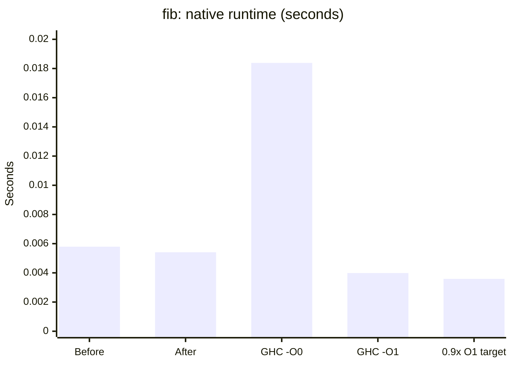
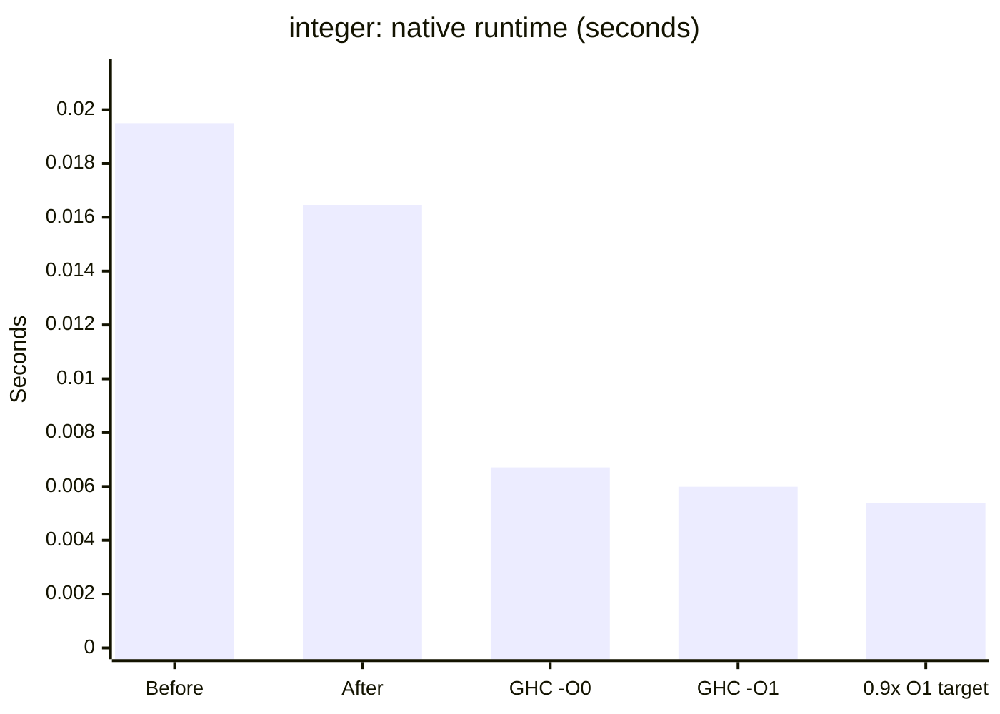
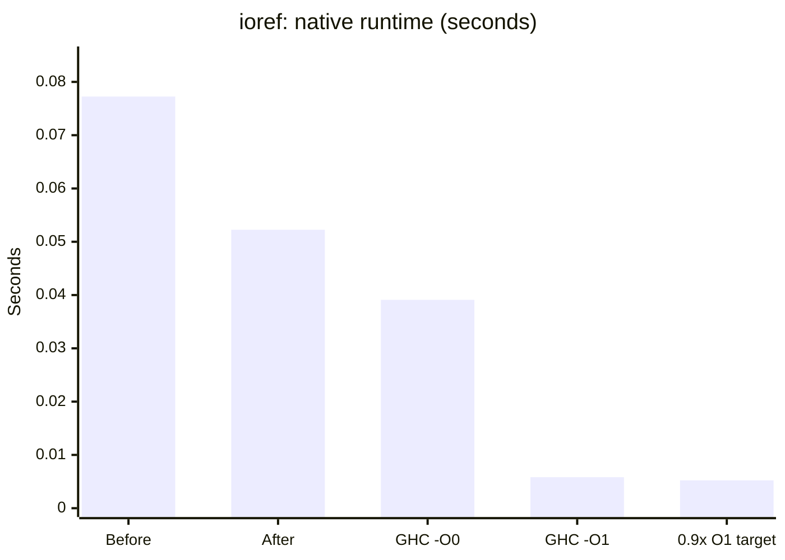
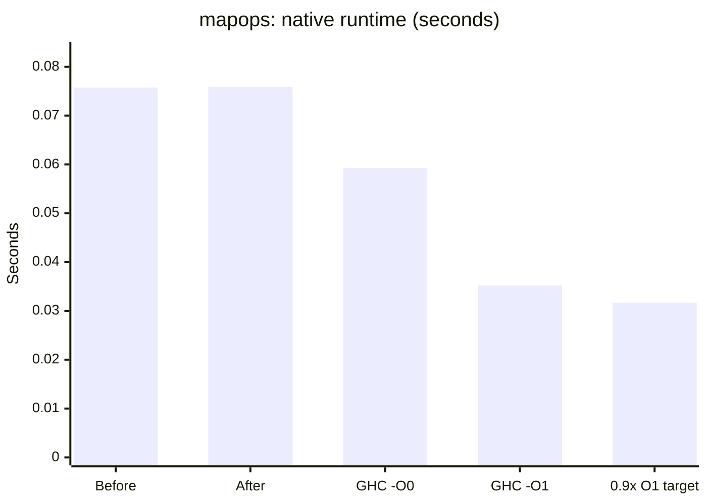
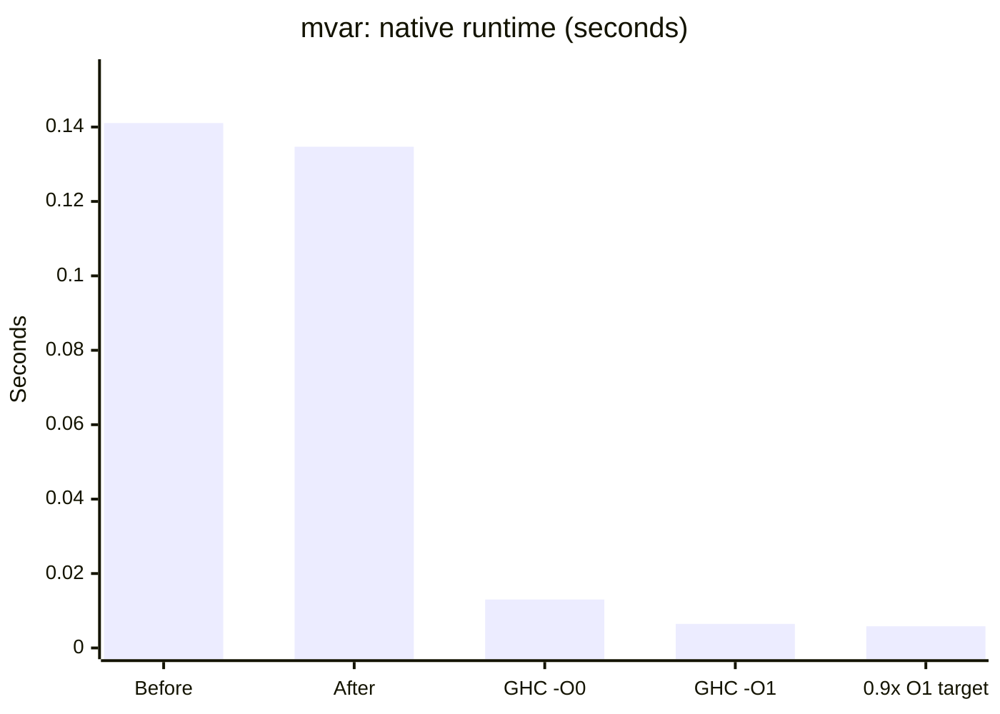
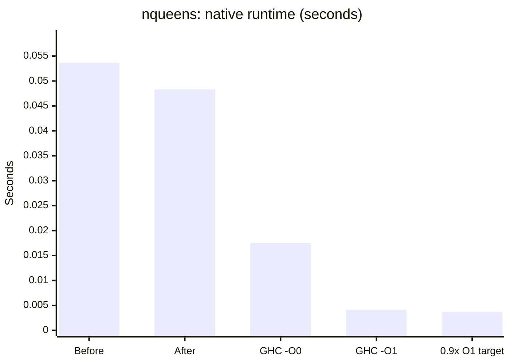
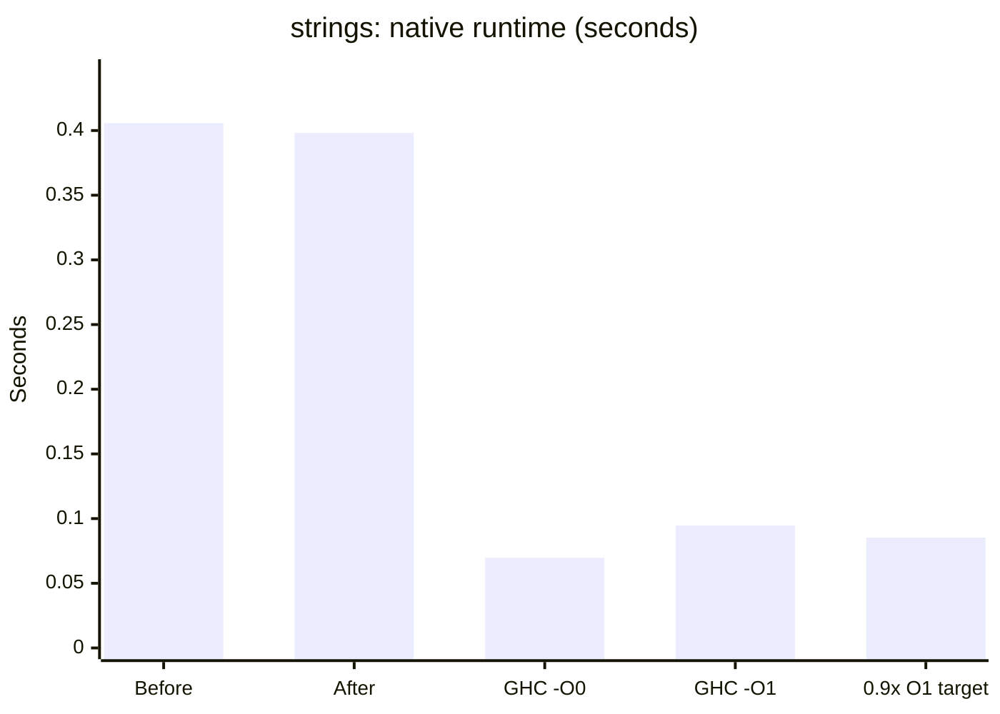
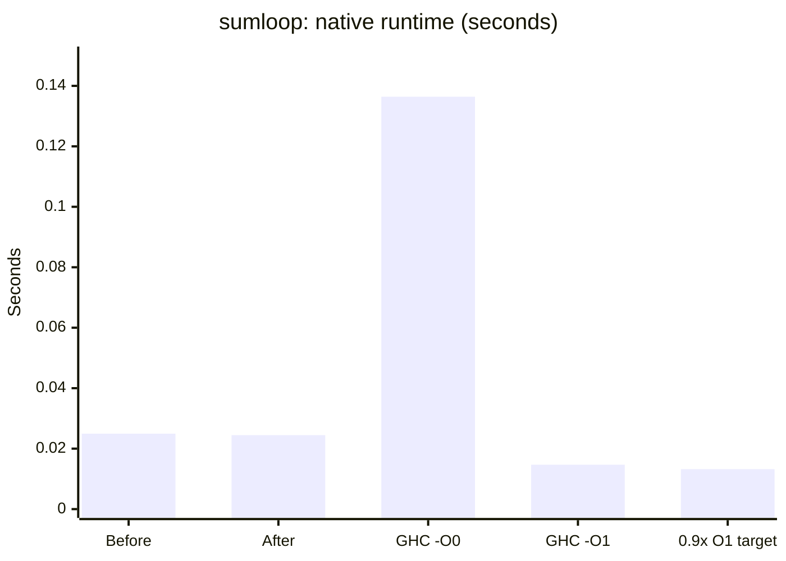

# Eta-expansion, constructor fields as globals: native runtime

[Raw samples, commands and metadata](runtime-eta-expansion.json).

[Hosted run](https://github.com/billyedmoore/shit-haskell/actions/runs/44050640988); AMD EPYC 9V45, Rust 1.92.0 release, GHC 9.12.2.
Before `c2abcf9`, after `e00ab36`. ioref 77.3 → 52.2 ms, nqueens 53.7 → 48.3 ms, integer
19.5 → 16.5 ms, mvar 141 → 135 ms, fib 5.8 → 5.4 ms; the rest within noise.

Native runtime; median of 3 alternating samples, 1 untimed correctness warmups per build.
Builds excluded; process startup included. Every stdout/stderr/exit result agrees.
CPU affinity: 0. GHC uses default RTS settings.

| Program | Before ms | After ms | GHC -O0 ms | GHC -O1 ms | 0.9×O1 ms |
|---|---:|---:|---:|---:|---:|
| fib | 5.793 | 5.412 | 18.383 | 3.987 | 3.588 |
| integer | 19.502 | 16.460 | 6.710 | 5.990 | 5.391 |
| ioref | 77.255 | 52.248 | 39.099 | 5.812 | 5.231 |
| mapops | 75.764 | 75.894 | 59.240 | 35.208 | 31.688 |
| mvar | 141.062 | 134.705 | 13.023 | 6.474 | 5.827 |
| nqueens | 53.665 | 48.328 | 17.529 | 4.129 | 3.716 |
| strings | 405.762 | 398.167 | 69.737 | 94.723 | 85.251 |
| sumloop | 24.953 | 24.471 | 136.417 | 14.679 | 13.211 |

