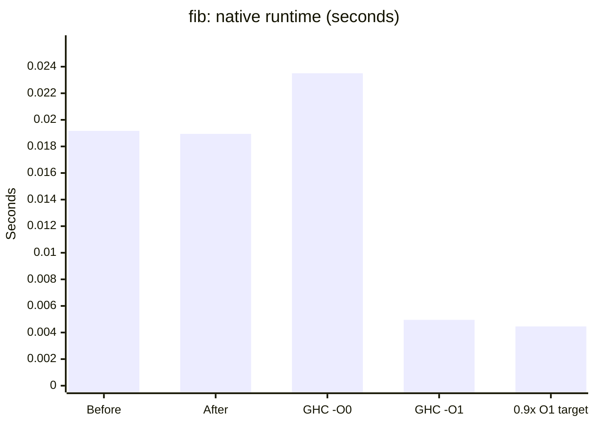
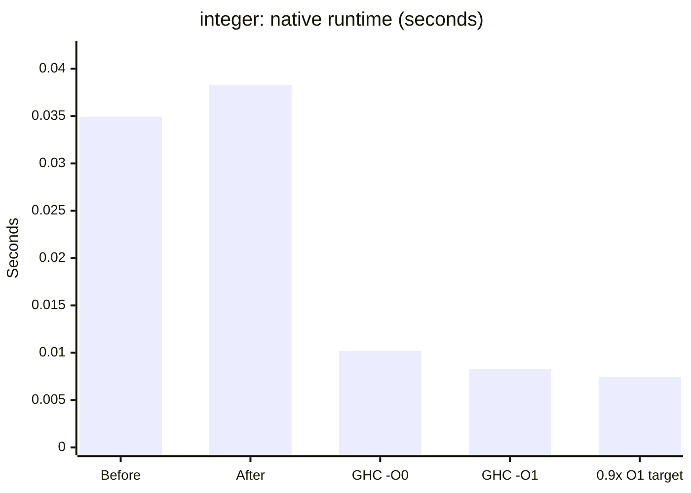
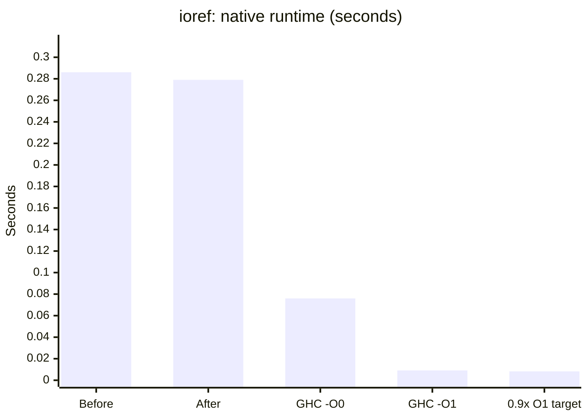
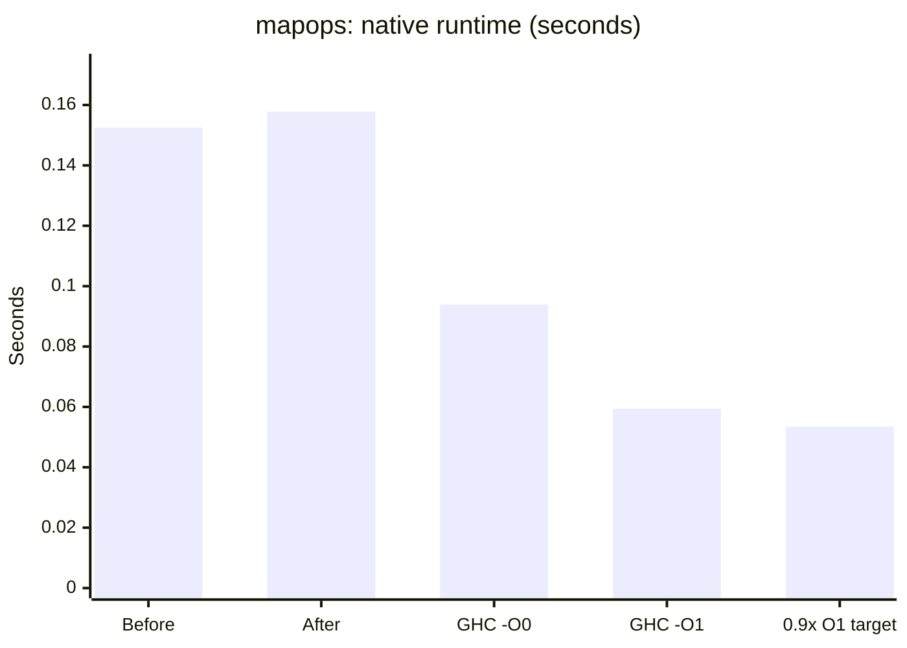
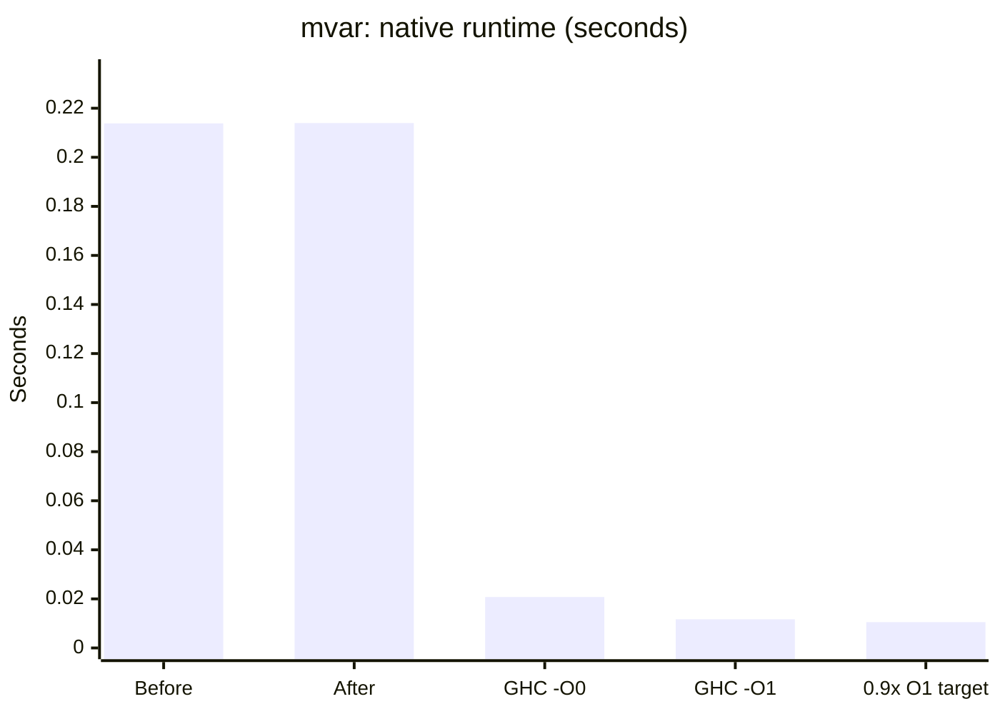
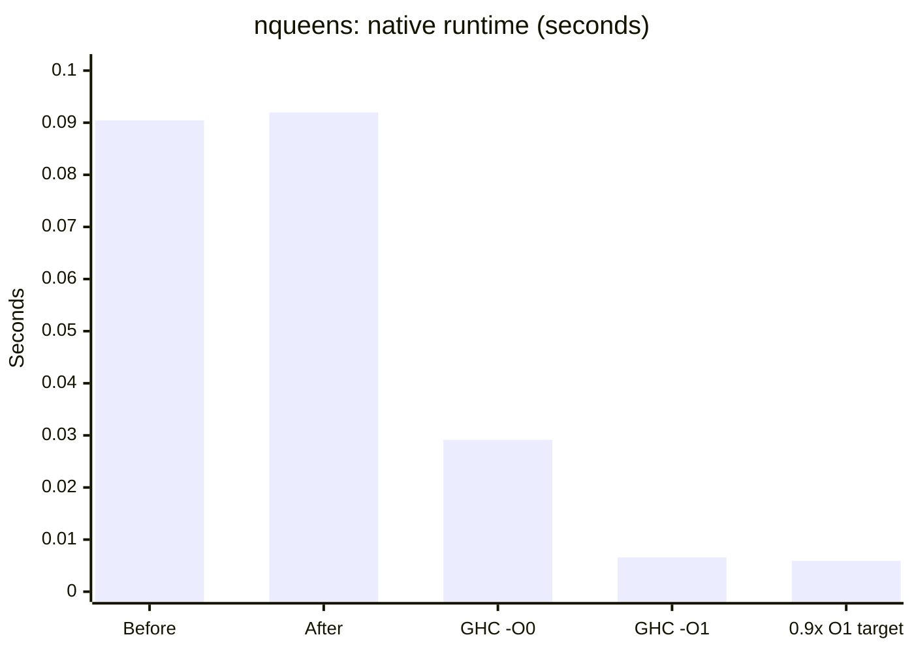
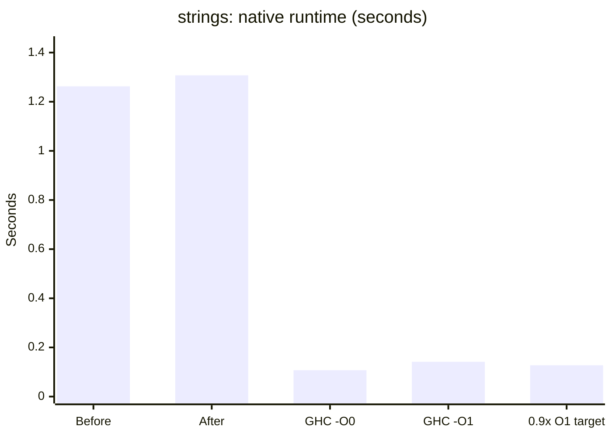
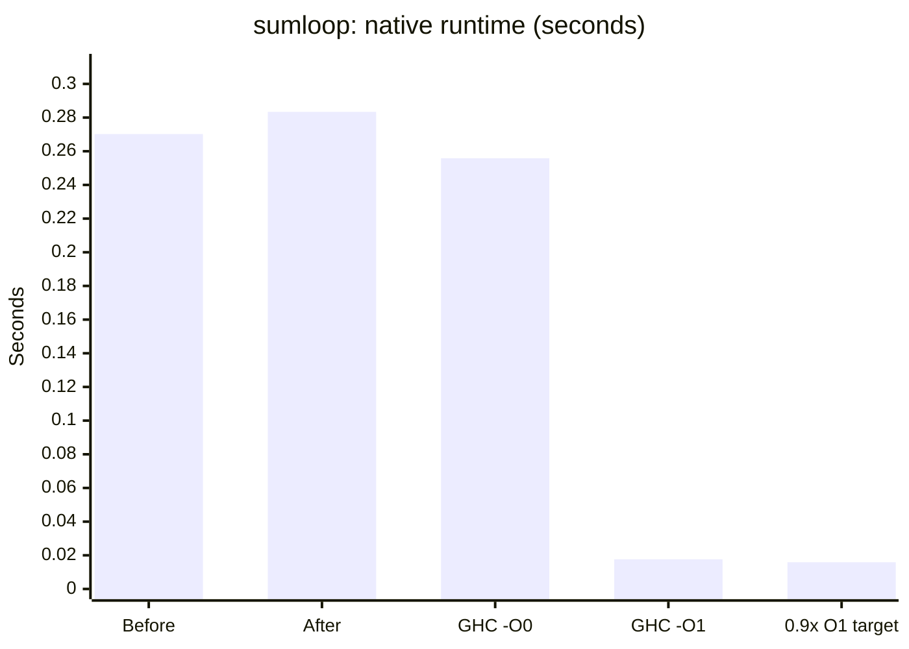

# Evaluated scrutinees skip hsc_eval; PAP and over-application in asm: native runtime

[Raw samples, commands and metadata](runtime-eval-apply-paths.json).

[Hosted run](https://github.com/billyedmoore/shit-haskell/actions/runs/43891530934); AMD EPYC 9V74 80-Core Processor, CPU 0, Rust 1.92.0 release, GHC 9.12.2.
Before `13c0c02c289c587ed014e876c5fc669fee9b14e4`, after `61b2ddd61ced2ce98cc809115c4e27783230160d`.

Native runtime; median of 3 alternating samples, 1 untimed correctness warmups per build.
Builds excluded; process startup included. Every stdout/stderr/exit result agrees.
CPU affinity: 0. GHC uses default RTS settings.

| Program | Before ms | After ms | GHC -O0 ms | GHC -O1 ms | 0.9×O1 ms |
|---|---:|---:|---:|---:|---:|
| fib | 19.172 | 18.945 | 23.505 | 4.953 | 4.458 |
| integer | 34.942 | 38.284 | 10.180 | 8.254 | 7.428 |
| ioref | 286.099 | 279.025 | 76.001 | 9.142 | 8.228 |
| mapops | 152.542 | 157.786 | 93.927 | 59.411 | 53.470 |
| mvar | 213.832 | 213.947 | 20.764 | 11.682 | 10.514 |
| nqueens | 90.455 | 91.983 | 29.142 | 6.578 | 5.920 |
| strings | 1262.559 | 1307.456 | 107.315 | 141.598 | 127.438 |
| sumloop | 270.211 | 283.391 | 255.856 | 17.633 | 15.870 |

