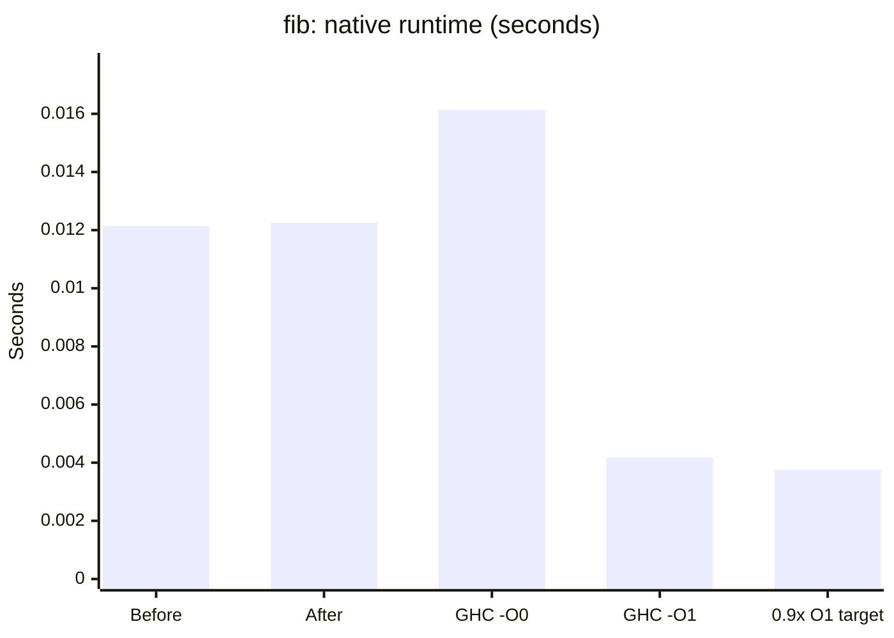
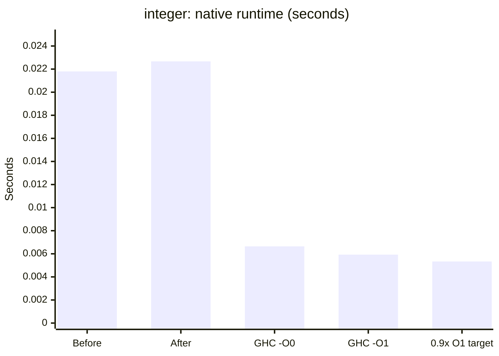
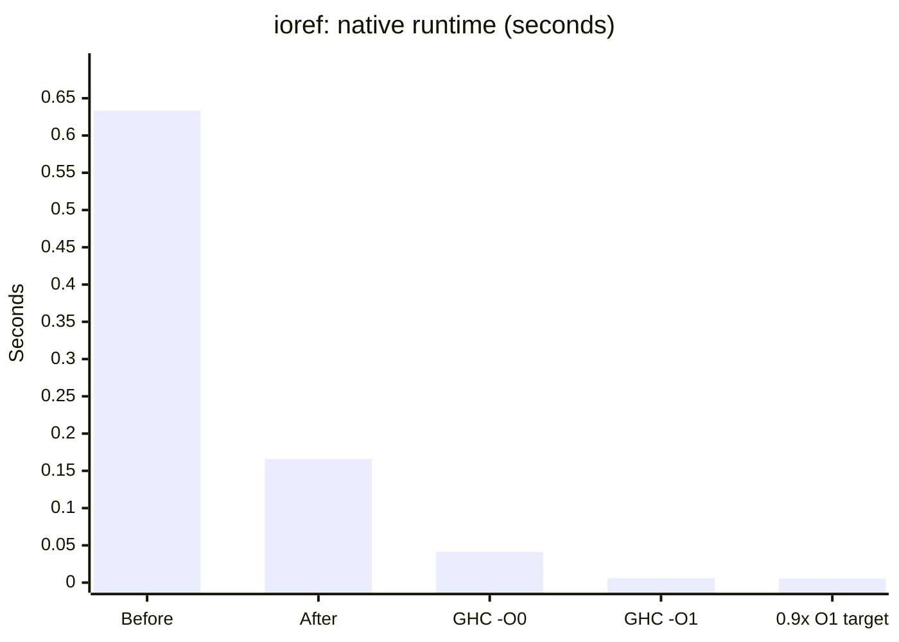
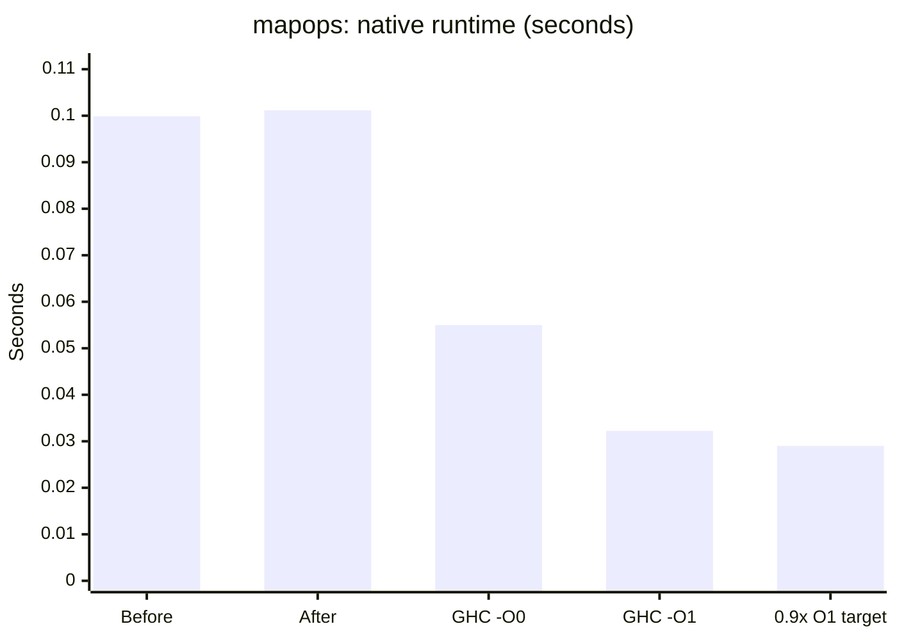
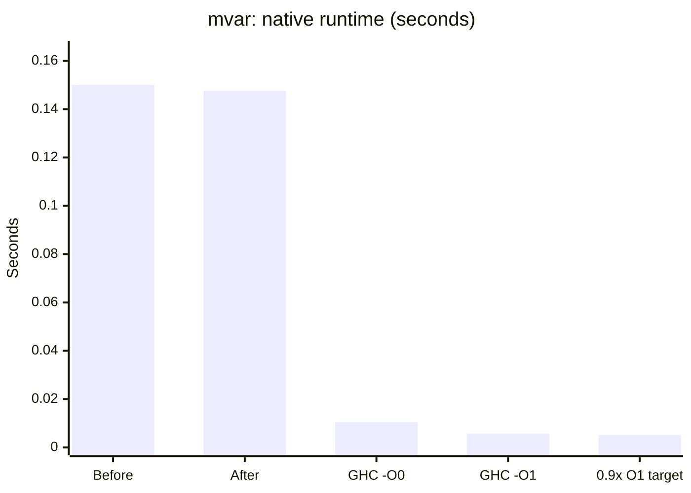
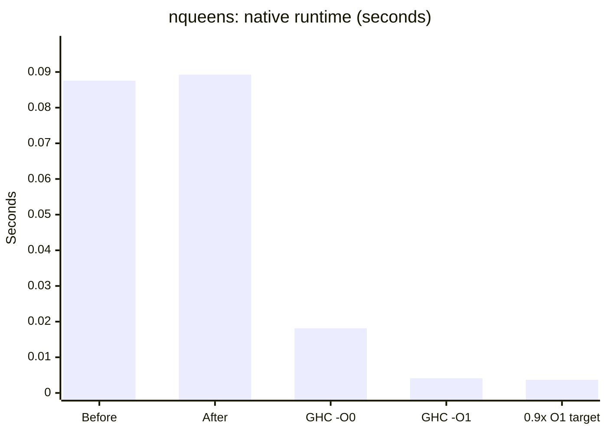
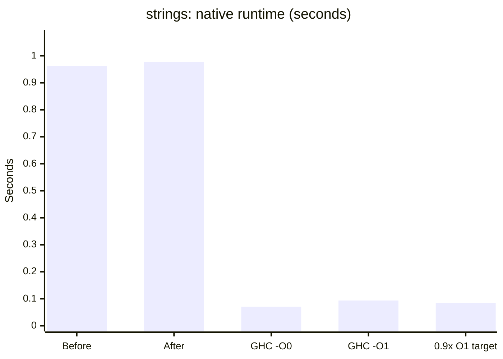
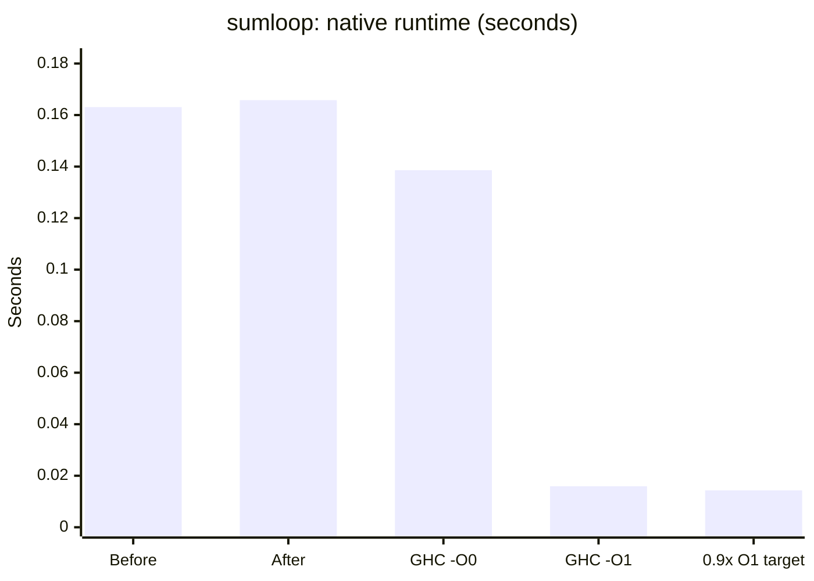

# Clearing dead frame slots around scrutinee calls: native runtime

[Raw samples, commands and metadata](runtime-frame-liveness.json).

[Hosted run](https://github.com/billyedmoore/shit-haskell/actions/runs/43855566066); AMD EPYC 9V45 96-Core Processor, CPU 0, Rust 1.92.0 release, GHC 9.12.2.
Before `4e09a2785f380688658ec53c4a4684464bc2b18d`, after `2e47ab653b10ac433af9437677bdd1ae7f0fb804`.

Native runtime; median of 3 alternating samples, 1 untimed correctness warmups per build.
Builds excluded; process startup included. Every stdout/stderr/exit result agrees.
CPU affinity: 0. GHC uses default RTS settings.

| Program | Before ms | After ms | GHC -O0 ms | GHC -O1 ms | 0.9×O1 ms |
|---|---:|---:|---:|---:|---:|
| fib | 12.144 | 12.255 | 16.133 | 4.179 | 3.761 |
| integer | 21.802 | 22.670 | 6.642 | 5.930 | 5.337 |
| ioref | 633.358 | 165.971 | 41.193 | 5.987 | 5.388 |
| mapops | 99.880 | 101.163 | 54.976 | 32.232 | 29.009 |
| mvar | 150.011 | 147.699 | 10.475 | 5.718 | 5.146 |
| nqueens | 87.570 | 89.259 | 18.128 | 4.119 | 3.707 |
| strings | 963.368 | 977.533 | 70.469 | 93.599 | 84.239 |
| sumloop | 163.079 | 165.784 | 138.613 | 15.892 | 14.303 |

