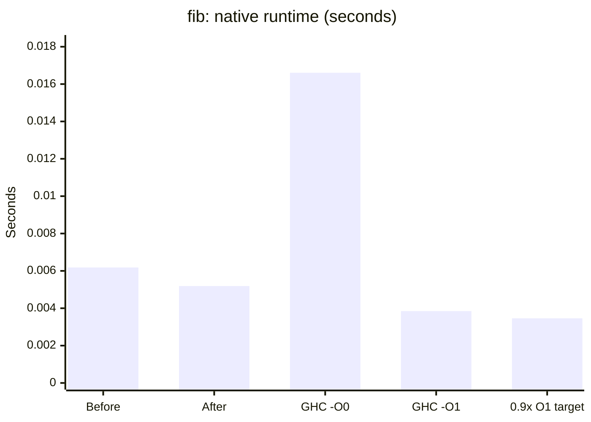
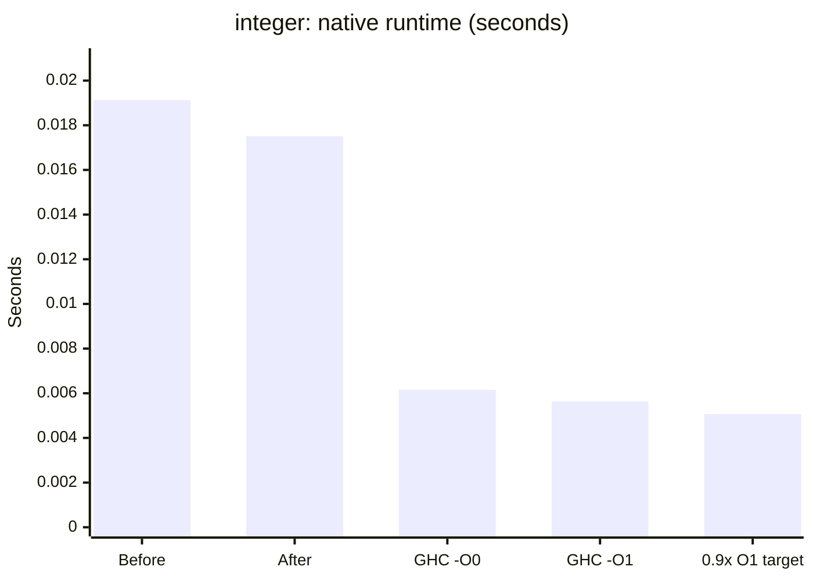
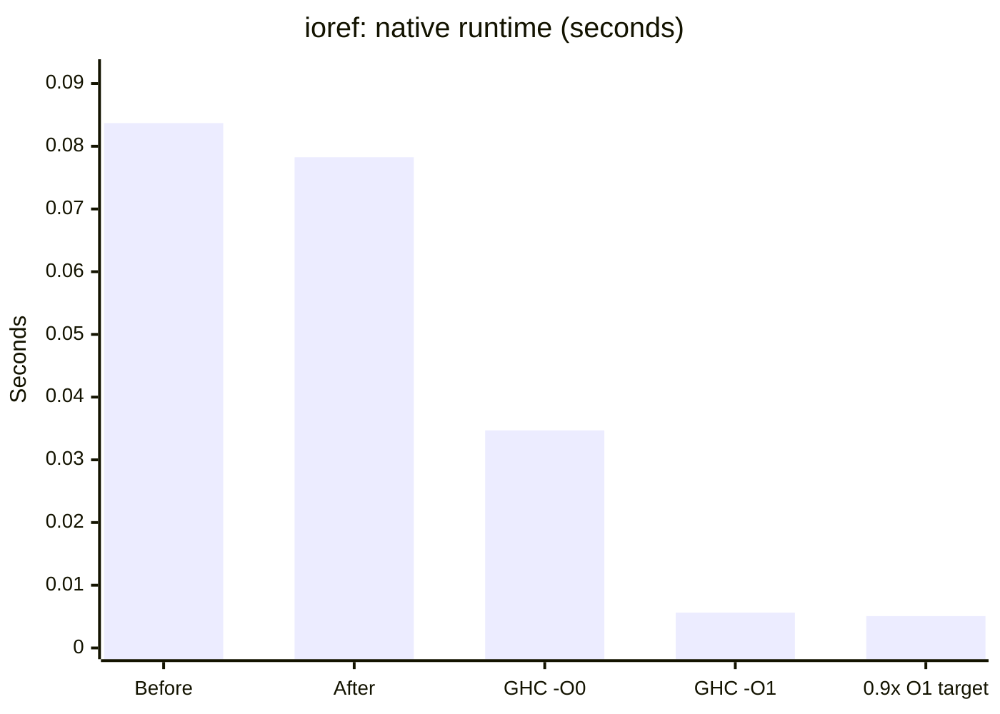
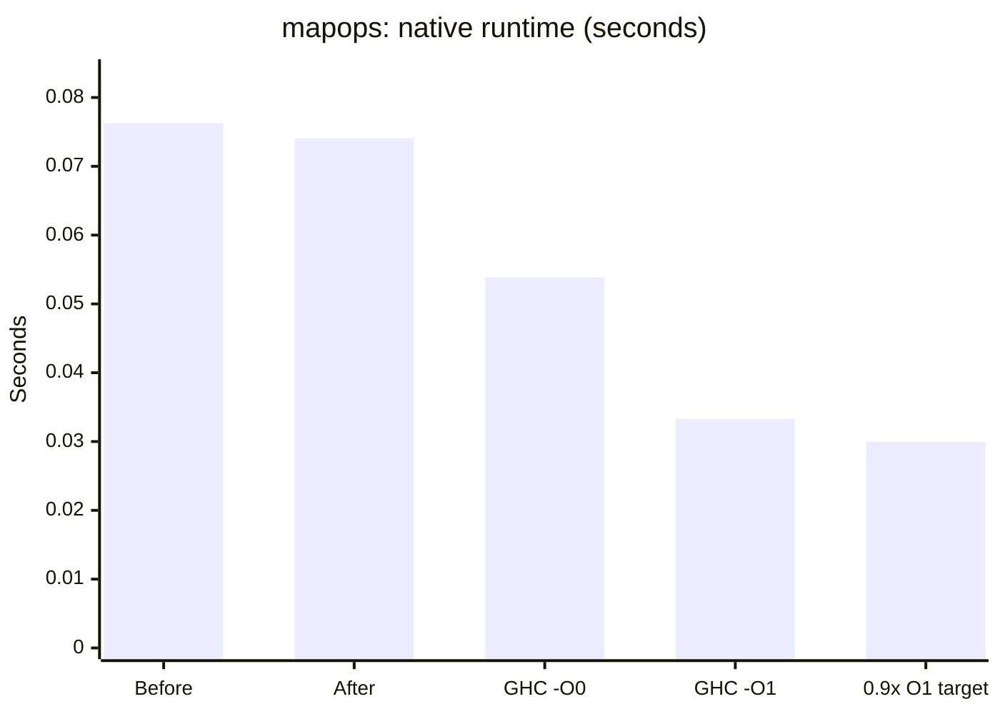
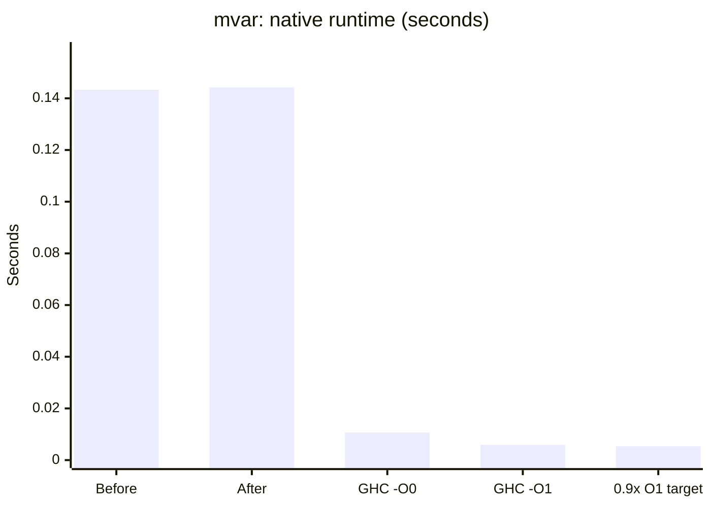
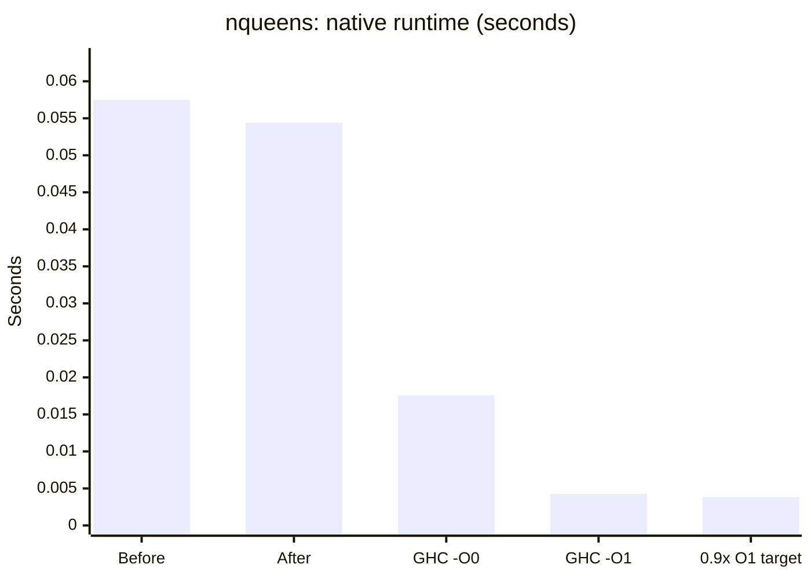
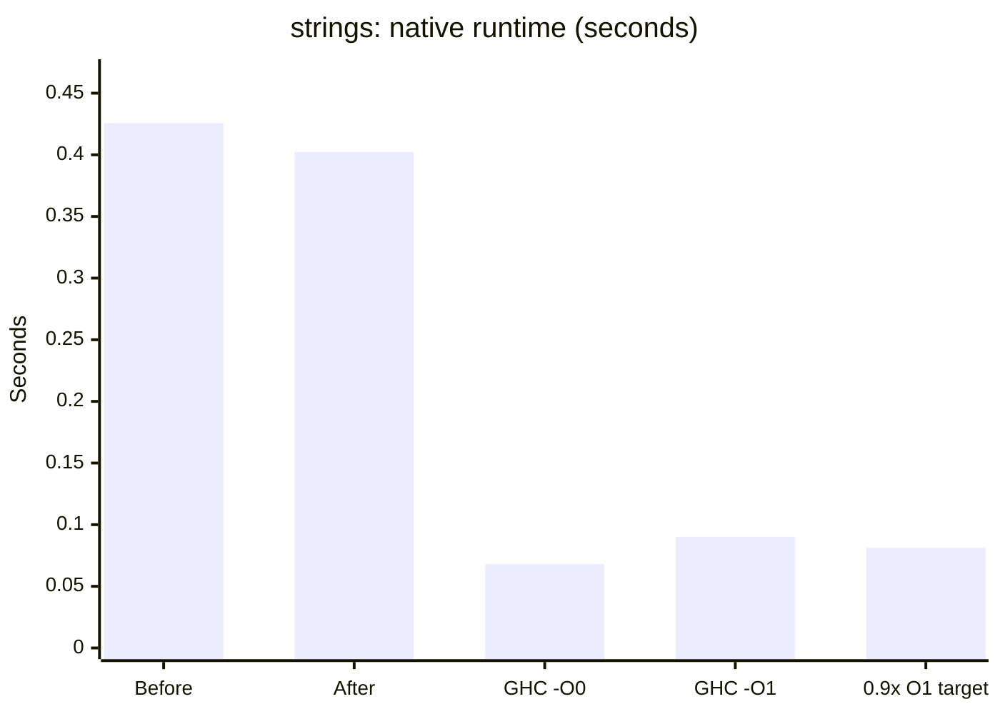
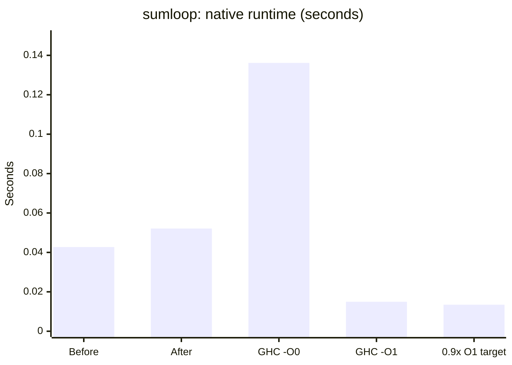

# List fusion (RULES on by default): native runtime

[Raw samples, commands and metadata](runtime-fusion.json).

[Hosted run](https://github.com/billyedmoore/shit-haskell/actions/runs/43987035197); AMD EPYC 9V45 96-Core Processor, CPU 0, Rust 1.92.0 release, GHC 9.12.2.
Before `337ed00be3793d6d7db69e2b20c8872404e89a60`, after `f13d173333ef9feb0c3fb5dee1821b4051360aa4`.

Native runtime; median of 3 alternating samples, 1 untimed correctness warmups per build.
Builds excluded; process startup included. Every stdout/stderr/exit result agrees.
CPU affinity: 0. GHC uses default RTS settings.

| Program | Before ms | After ms | GHC -O0 ms | GHC -O1 ms | 0.9×O1 ms |
|---|---:|---:|---:|---:|---:|
| fib | 6.182 | 5.190 | 16.607 | 3.846 | 3.461 |
| integer | 19.125 | 17.514 | 6.156 | 5.633 | 5.069 |
| ioref | 83.699 | 78.250 | 34.694 | 5.643 | 5.079 |
| mapops | 76.283 | 74.030 | 53.851 | 33.276 | 29.949 |
| mvar | 143.316 | 144.225 | 10.695 | 5.928 | 5.335 |
| nqueens | 57.499 | 54.394 | 17.594 | 4.266 | 3.840 |
| strings | 425.747 | 402.304 | 67.952 | 90.143 | 81.129 |
| sumloop | 42.722 | 52.106 | 136.157 | 14.955 | 13.459 |

