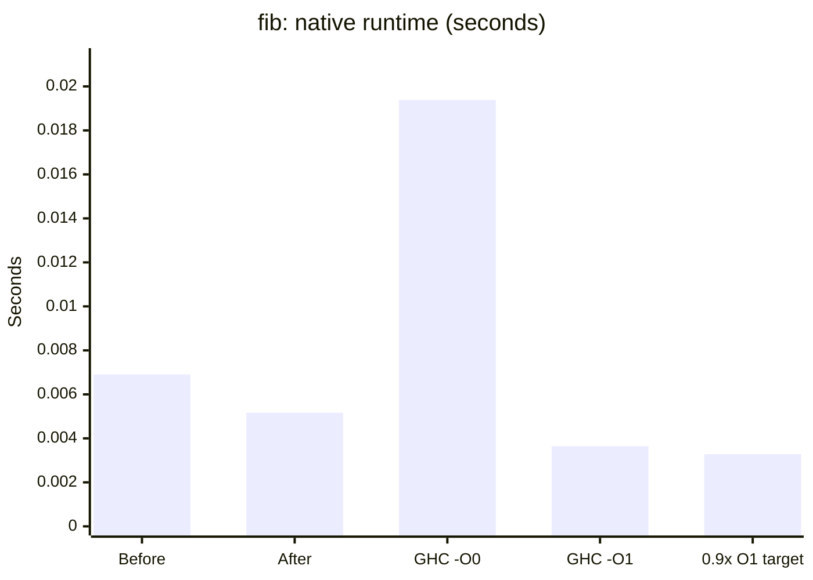
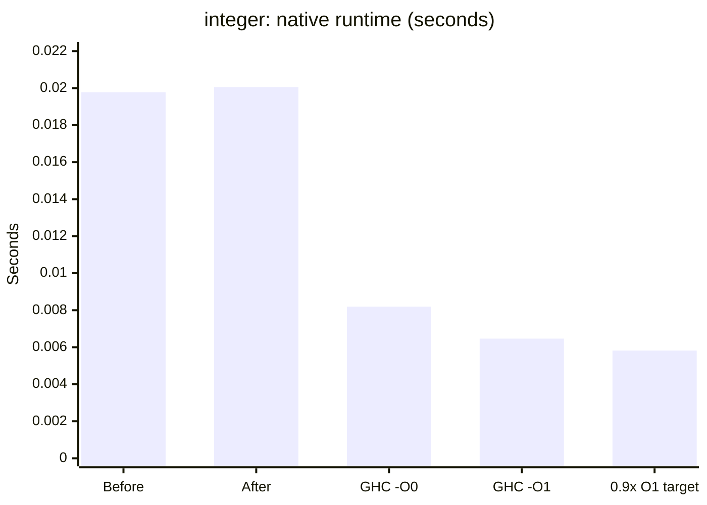
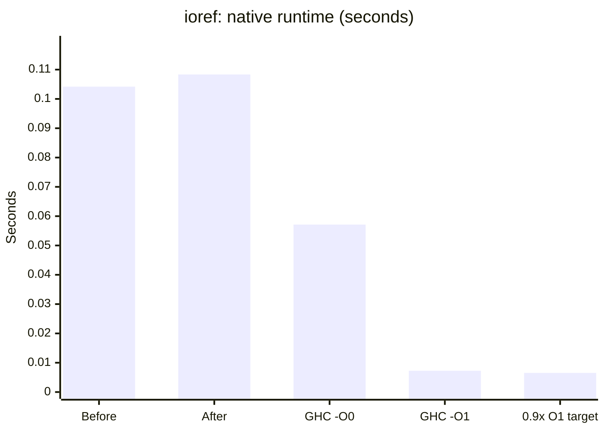
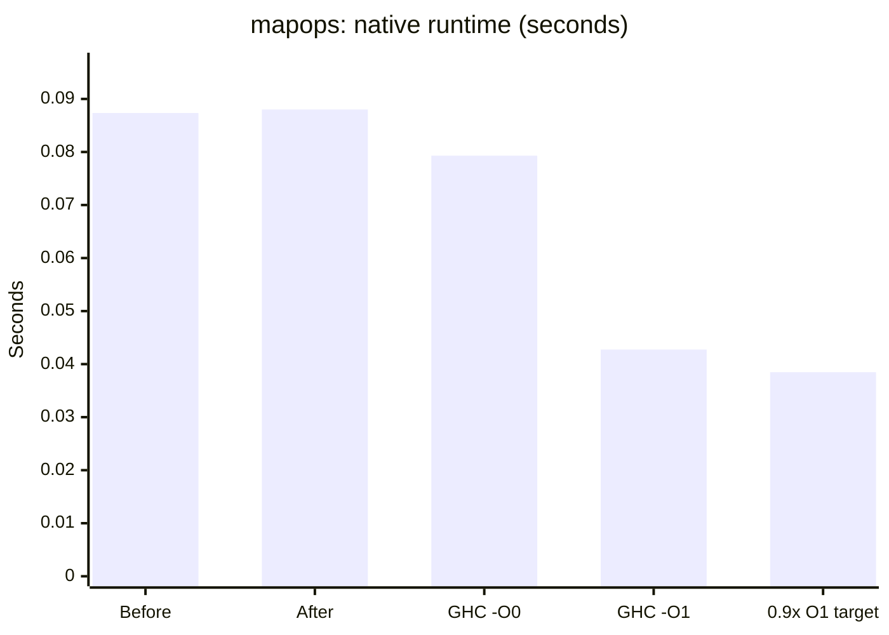
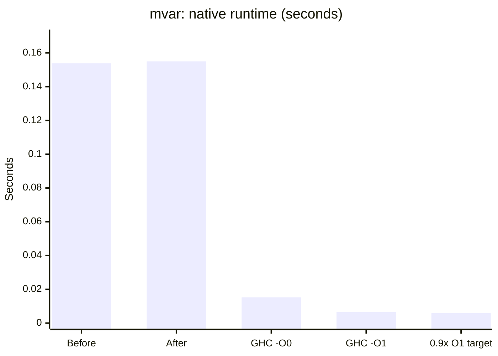
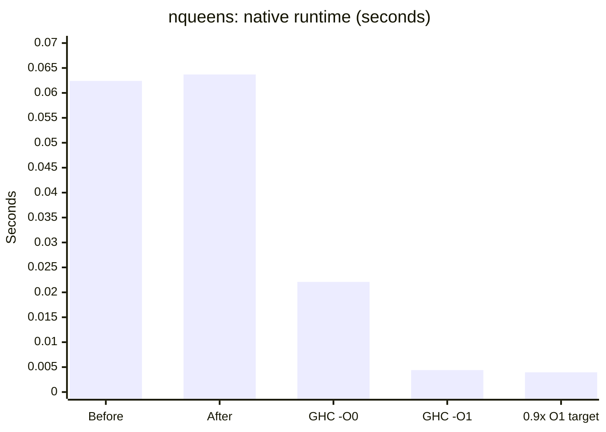
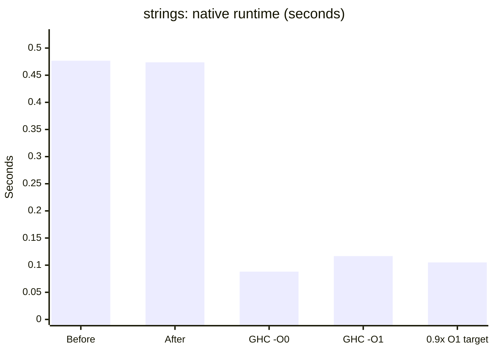
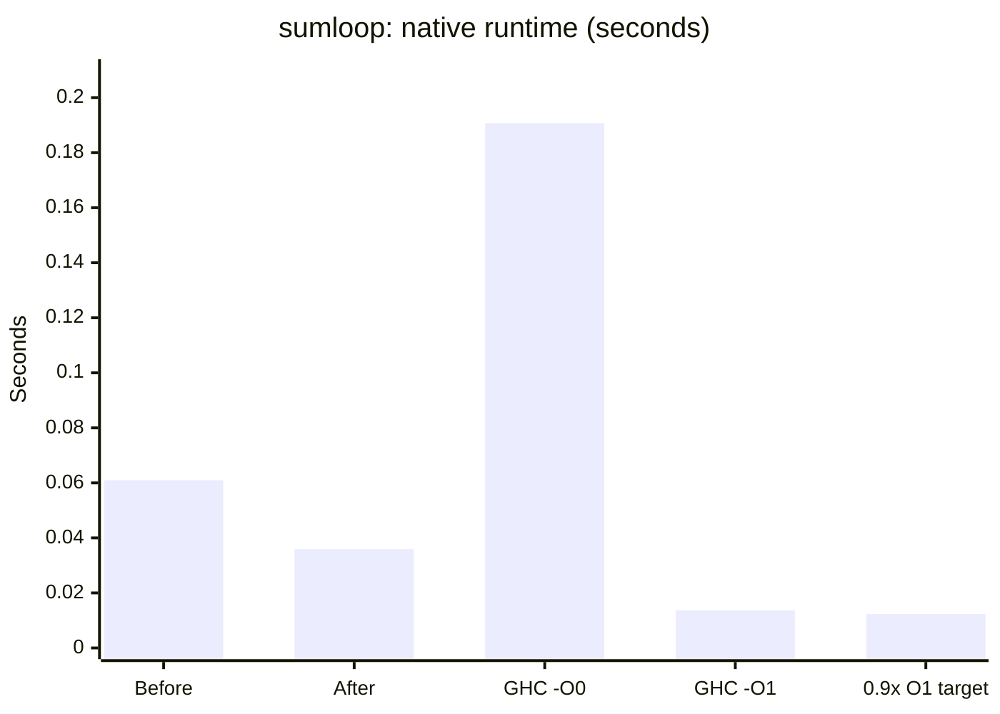

# INLINE/NOINLINE pragmas, prim identities, preemption at function entry: native runtime

[Raw samples, commands and metadata](runtime-inline-pragmas.json).

[Hosted run](https://github.com/billyedmoore/shit-haskell/actions/runs/44038880568); AMD EPYC 9V74, Rust 1.92.0 release, GHC 9.12.2.
Before `a584e1d`, after `87eecaa`. sumloop 60.9 → 35.9 ms (its `mod` inlines), fib 6.9 → 5.2 ms;
ioref 104 → 108 ms (a check at each function's entry); the rest within noise.

Native runtime; median of 3 alternating samples, 1 untimed correctness warmups per build.
Builds excluded; process startup included. Every stdout/stderr/exit result agrees.
CPU affinity: 0. GHC uses default RTS settings.

| Program | Before ms | After ms | GHC -O0 ms | GHC -O1 ms | 0.9×O1 ms |
|---|---:|---:|---:|---:|---:|
| fib | 6.908 | 5.166 | 19.383 | 3.647 | 3.282 |
| integer | 19.783 | 20.060 | 8.191 | 6.466 | 5.820 |
| ioref | 104.188 | 108.344 | 57.128 | 7.248 | 6.523 |
| mapops | 87.343 | 88.018 | 79.302 | 42.745 | 38.470 |
| mvar | 153.800 | 154.991 | 15.222 | 6.514 | 5.863 |
| nqueens | 62.403 | 63.700 | 22.090 | 4.398 | 3.958 |
| strings | 476.772 | 473.789 | 88.081 | 116.768 | 105.091 |
| sumloop | 60.948 | 35.913 | 190.771 | 13.670 | 12.303 |

