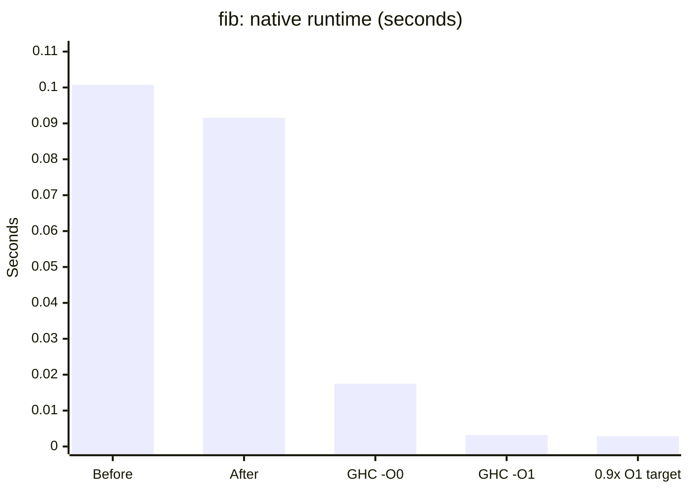
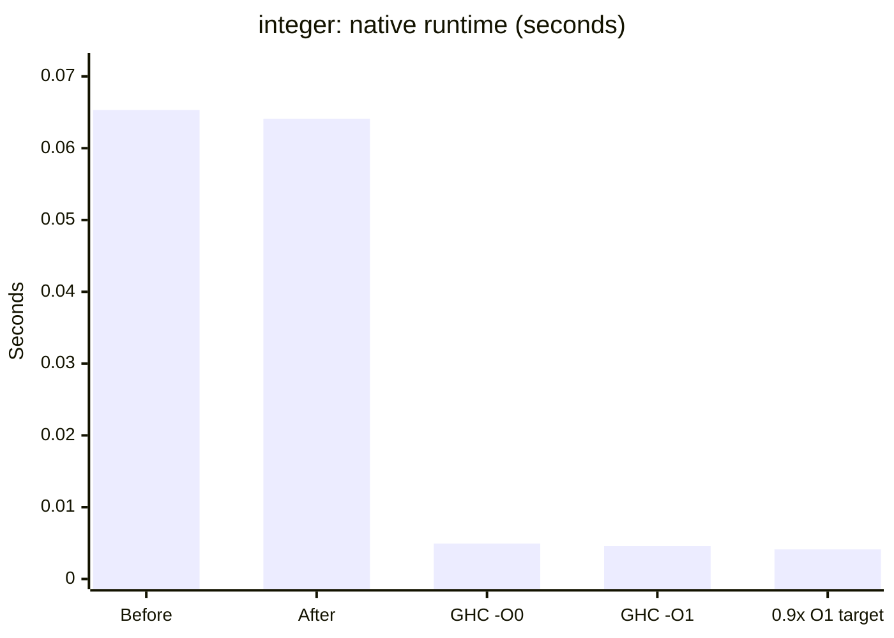
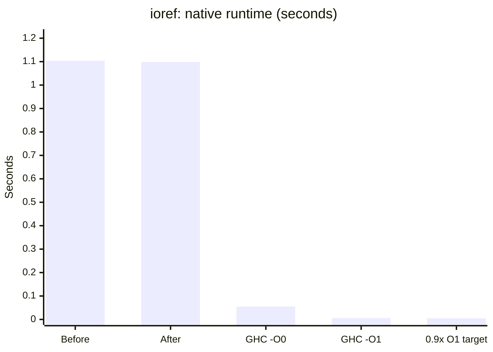
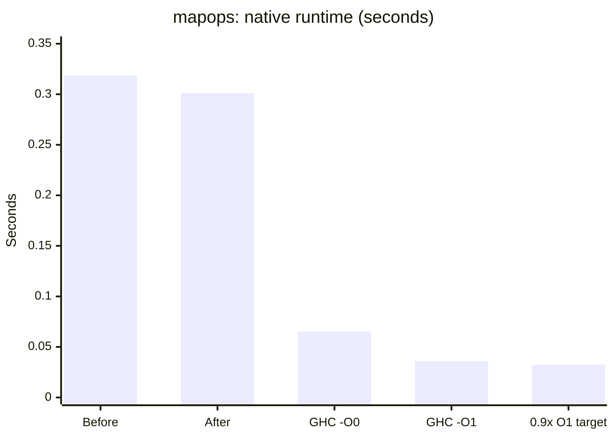
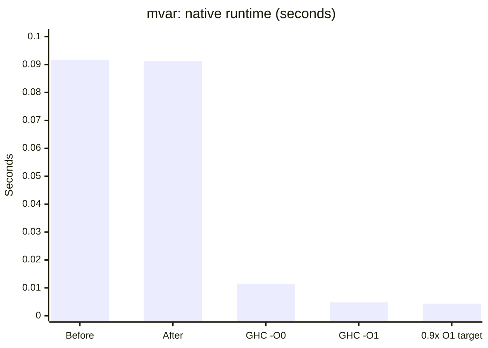
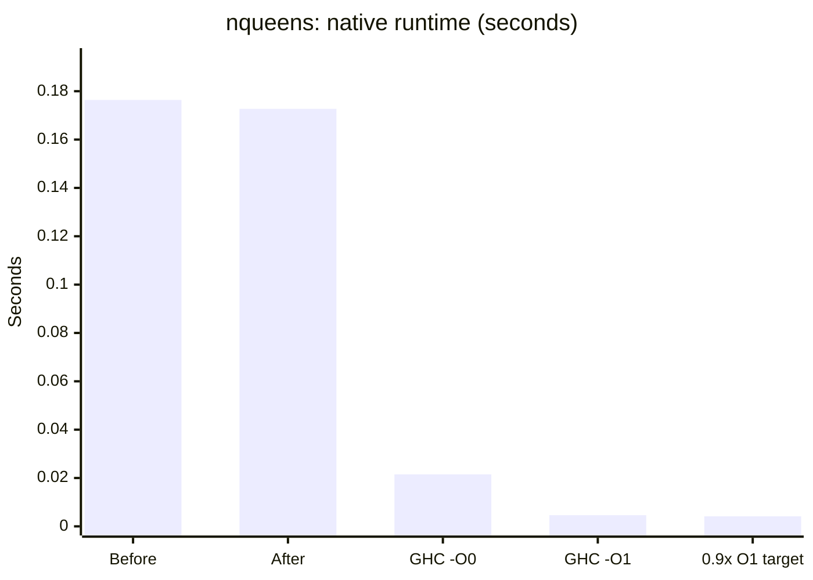
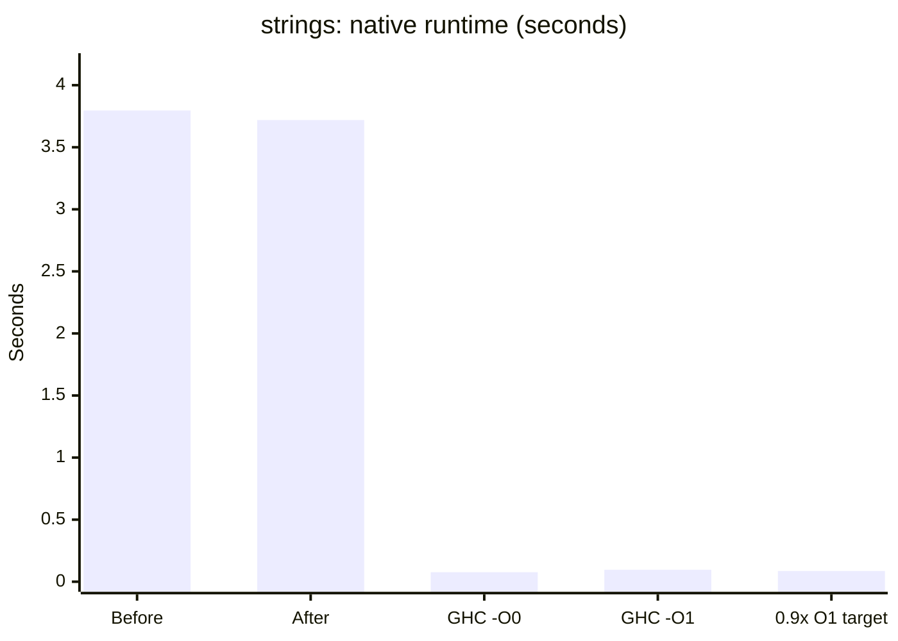
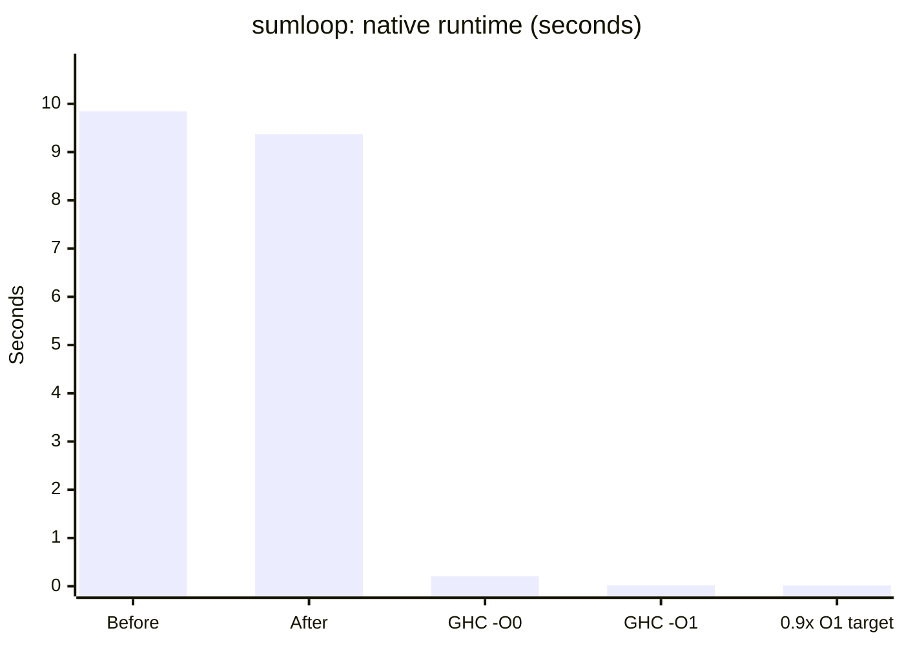

# Classified Int operations: native runtime

[Raw samples, commands and metadata](runtime-int-operations.json).

[Hosted run](https://github.com/billyedmoore/shit-haskell/actions/runs/43825152879); Intel(R) Xeon(R) 6975P-C, CPU 0, Rust 1.92.0 release, GHC 9.12.2.
Before `1462b18faeed86efc8d77a11b7b8fd1d68c62e2b`, after `9ff079a2d138fce3b6f14075f5a37437af068fc8`.

Native runtime; median of 3 alternating samples, 1 untimed correctness warmups per build.
Builds excluded; process startup included. Every stdout/stderr/exit result agrees.
CPU affinity: 0. GHC uses default RTS settings.

| Program | Before ms | After ms | GHC -O0 ms | GHC -O1 ms | 0.9×O1 ms |
|---|---:|---:|---:|---:|---:|
| fib | 100.744 | 91.551 | 17.464 | 3.194 | 2.875 |
| integer | 65.325 | 64.106 | 4.936 | 4.578 | 4.121 |
| ioref | 1104.141 | 1098.826 | 55.188 | 5.796 | 5.217 |
| mapops | 318.564 | 301.135 | 65.263 | 36.024 | 32.422 |
| mvar | 91.632 | 91.255 | 11.284 | 4.819 | 4.337 |
| nqueens | 176.376 | 172.706 | 21.510 | 4.620 | 4.158 |
| strings | 3796.114 | 3718.966 | 76.740 | 96.300 | 86.670 |
| sumloop | 9844.301 | 9370.250 | 205.355 | 16.514 | 14.863 |

Geometric-mean speedup: 1.034× in this three-pair run. All eight medians improve, but small differences may be noise. All GHC runtime targets remain unmet. Both corpora pass 231/231 and all 59 unit tests pass.
