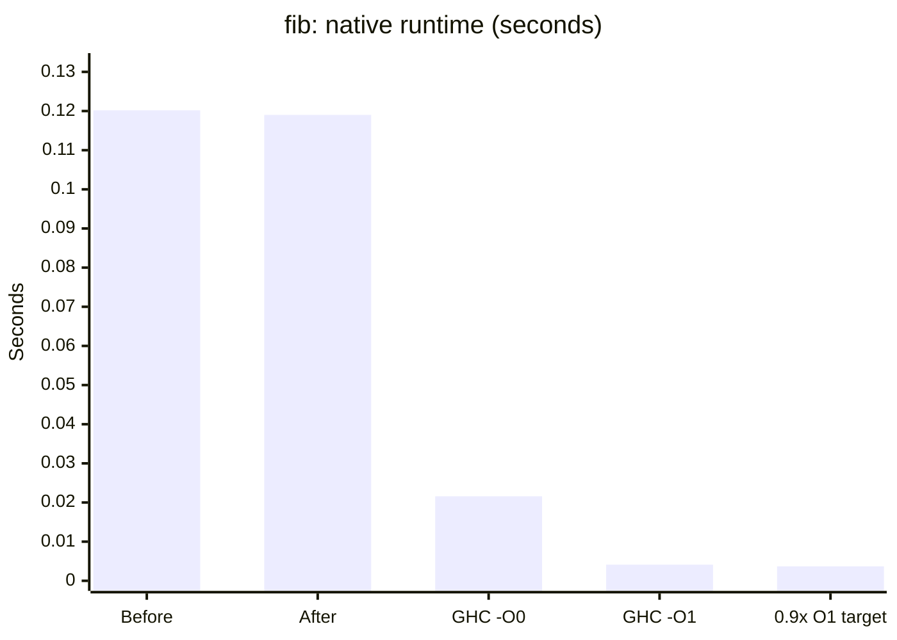
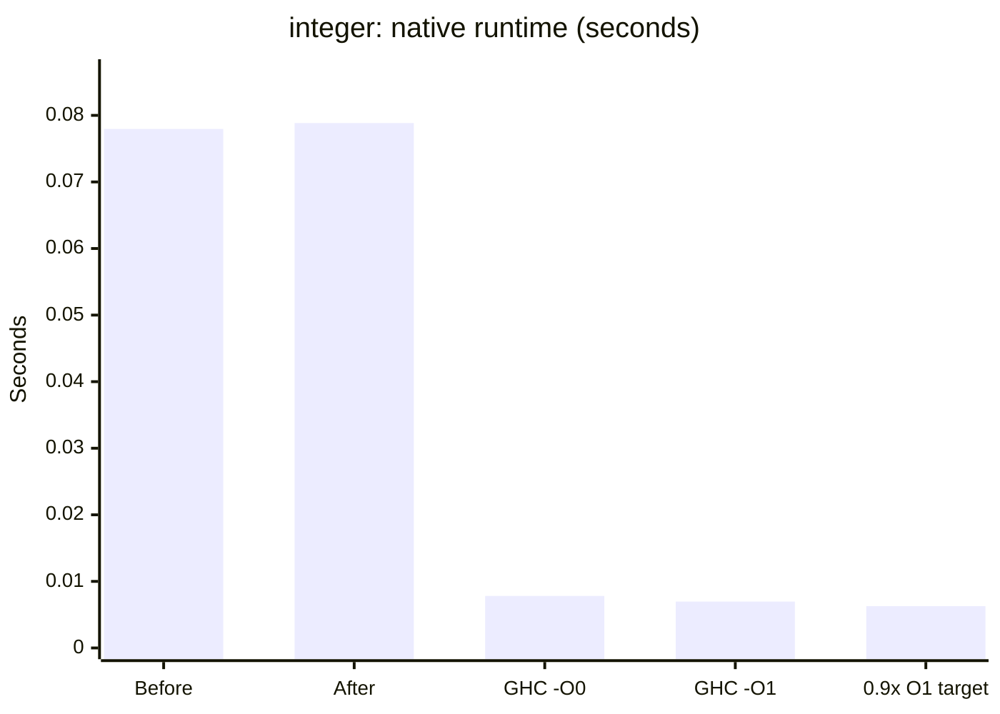
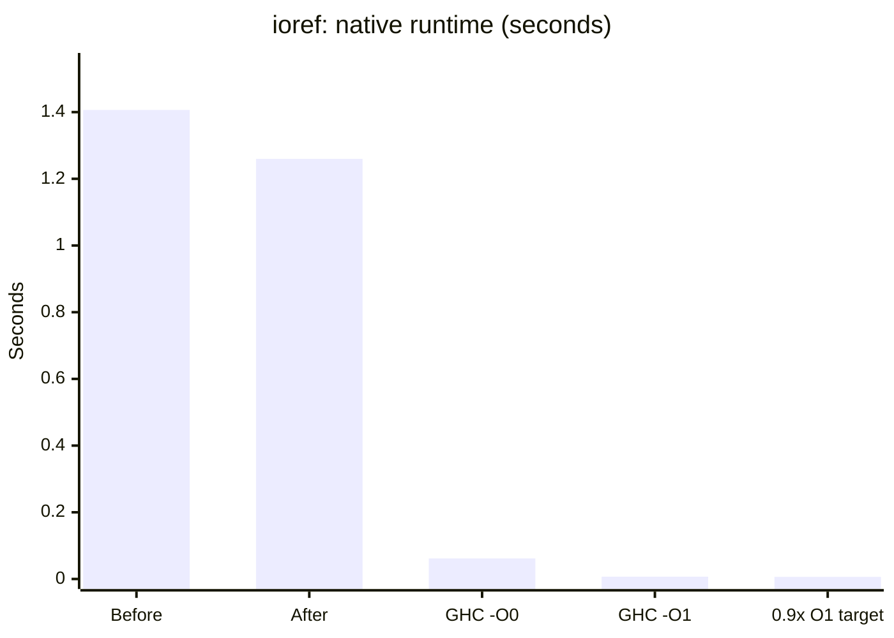
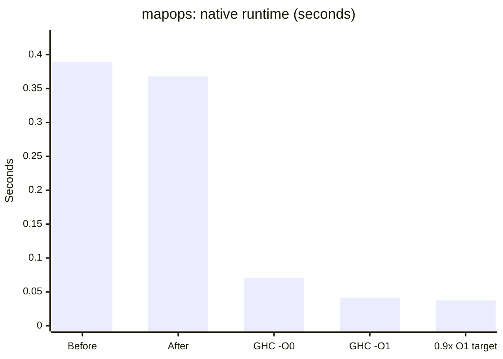
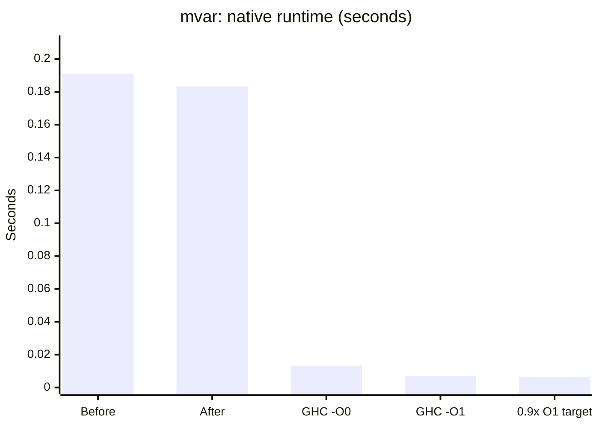
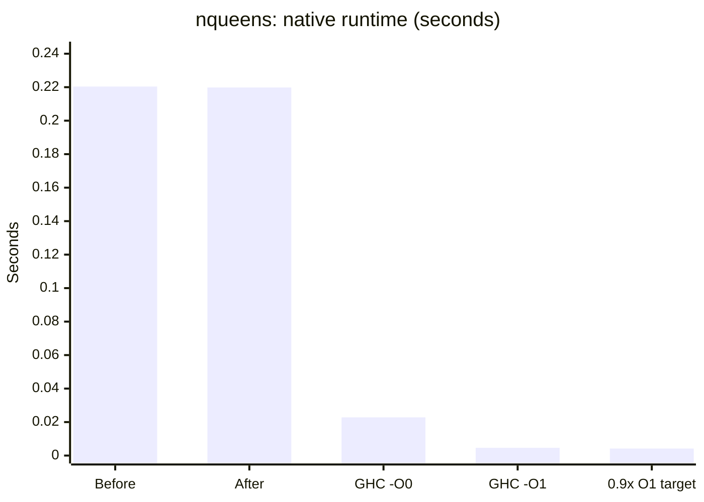
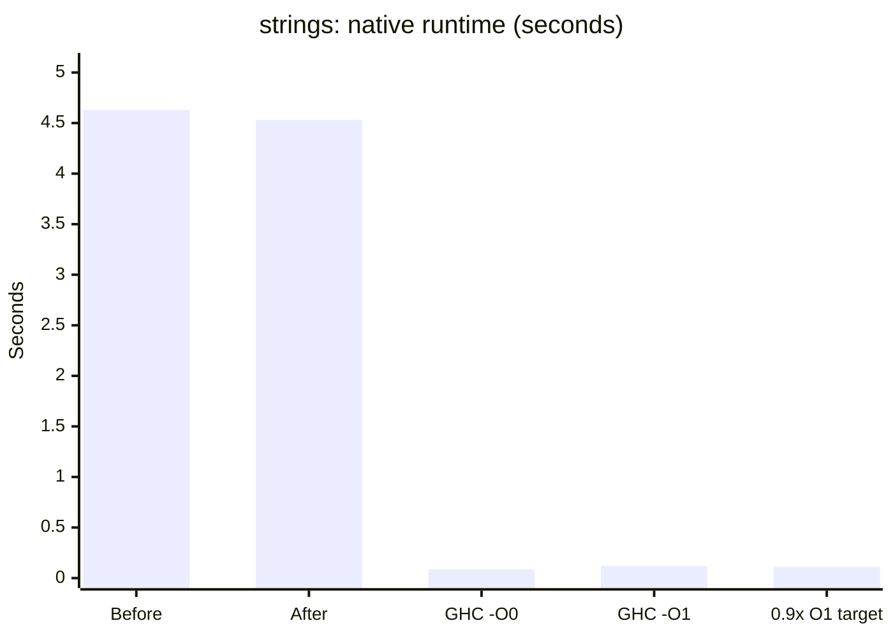
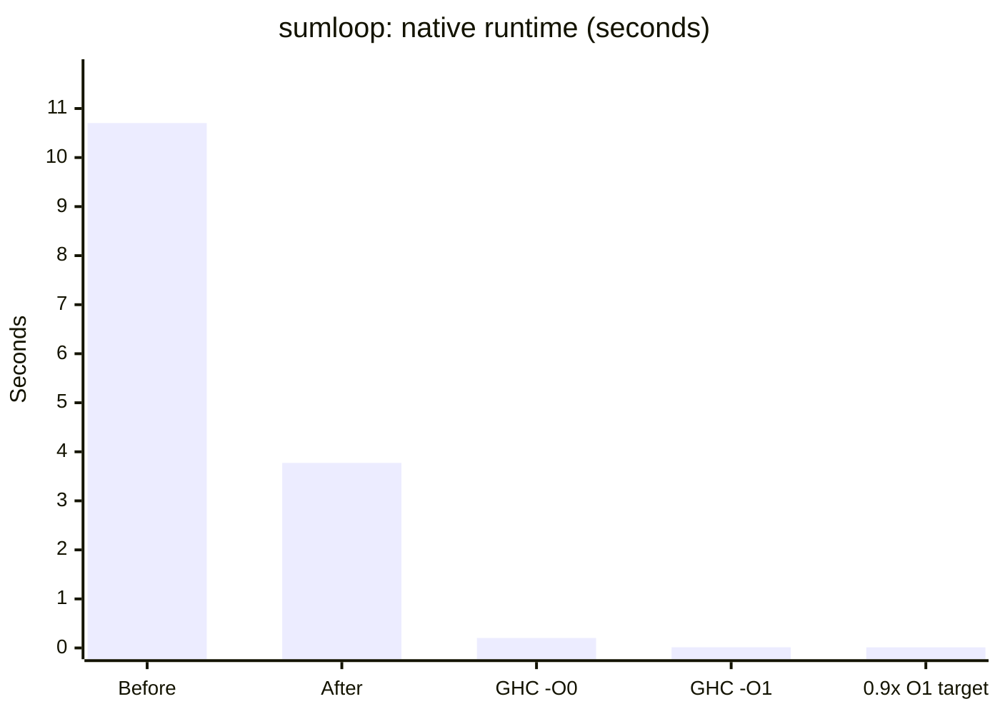

# Join points and single-use lets: native runtime

[Raw samples, commands and metadata](runtime-join-points.json).

[Hosted run](https://github.com/billyedmoore/shit-haskell/actions/runs/43832393868); AMD EPYC 9V74 80-Core Processor, CPU 0, Rust 1.92.0 release, GHC 9.12.2.
Before `3de863db6f96bb3ed2531a7af4a2b2a327c4519b`, after `6a0ef289f17040704869749bf5ac84ef752f5642`.

Native runtime; median of 3 alternating samples, 1 untimed correctness warmups per build.
Builds excluded; process startup included. Every stdout/stderr/exit result agrees.
CPU affinity: 0. GHC uses default RTS settings.

| Program | Before ms | After ms | GHC -O0 ms | GHC -O1 ms | 0.9×O1 ms |
|---|---:|---:|---:|---:|---:|
| fib | 120.184 | 119.010 | 21.588 | 4.112 | 3.701 |
| integer | 77.959 | 78.843 | 7.815 | 6.967 | 6.270 |
| ioref | 1406.420 | 1259.790 | 61.649 | 6.919 | 6.227 |
| mapops | 389.329 | 367.844 | 70.805 | 41.690 | 37.521 |
| mvar | 191.089 | 183.261 | 13.301 | 7.025 | 6.322 |
| nqueens | 220.391 | 219.803 | 22.802 | 4.648 | 4.183 |
| strings | 4631.147 | 4530.547 | 85.810 | 121.053 | 108.948 |
| sumloop | 10703.219 | 3773.815 | 202.624 | 13.999 | 12.599 |

