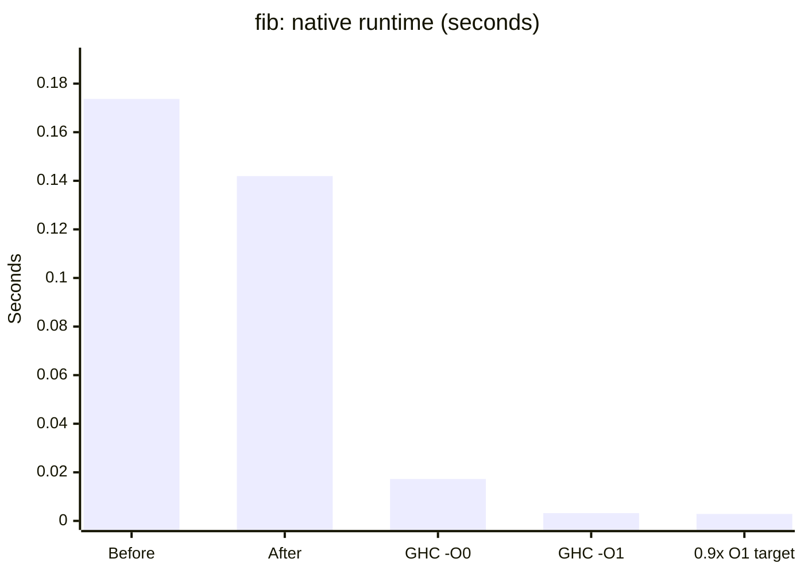
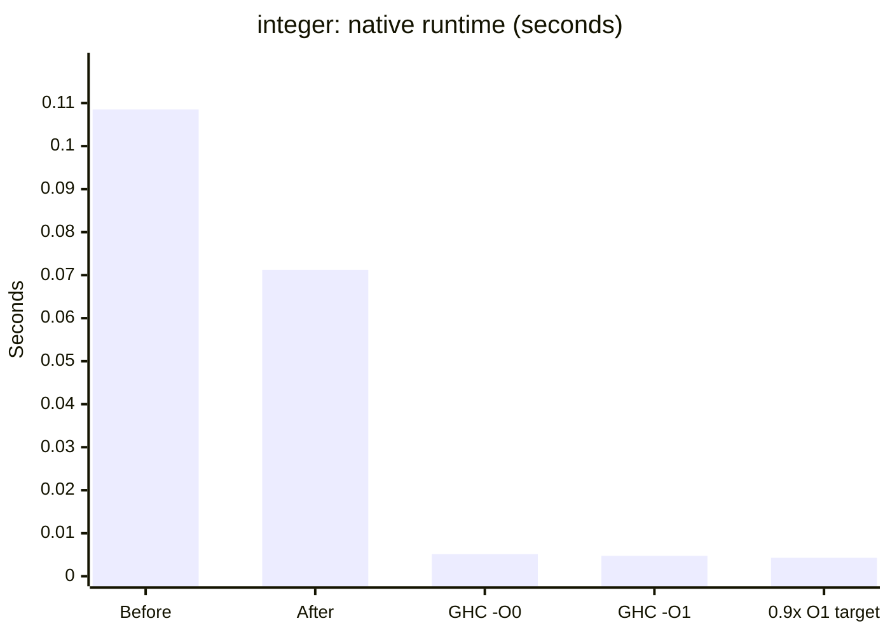
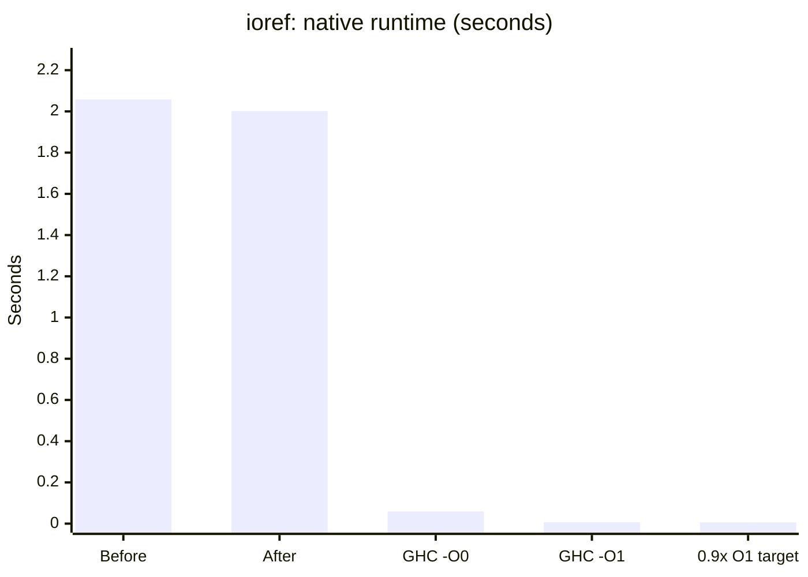
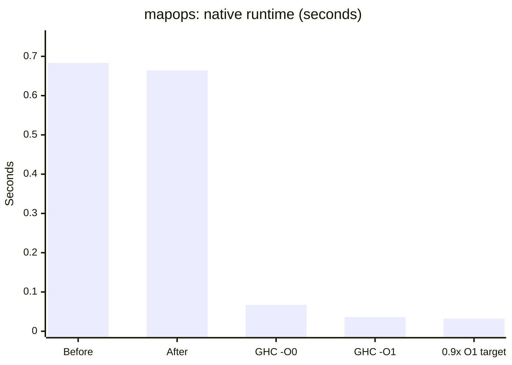
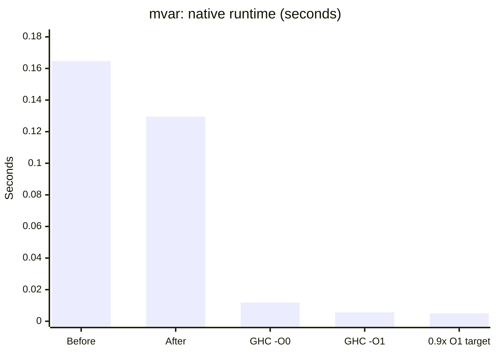
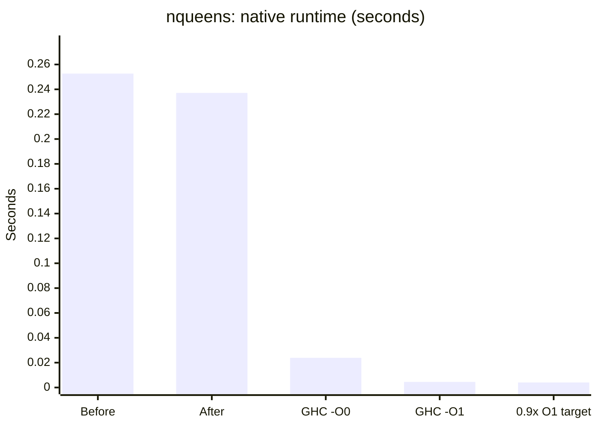
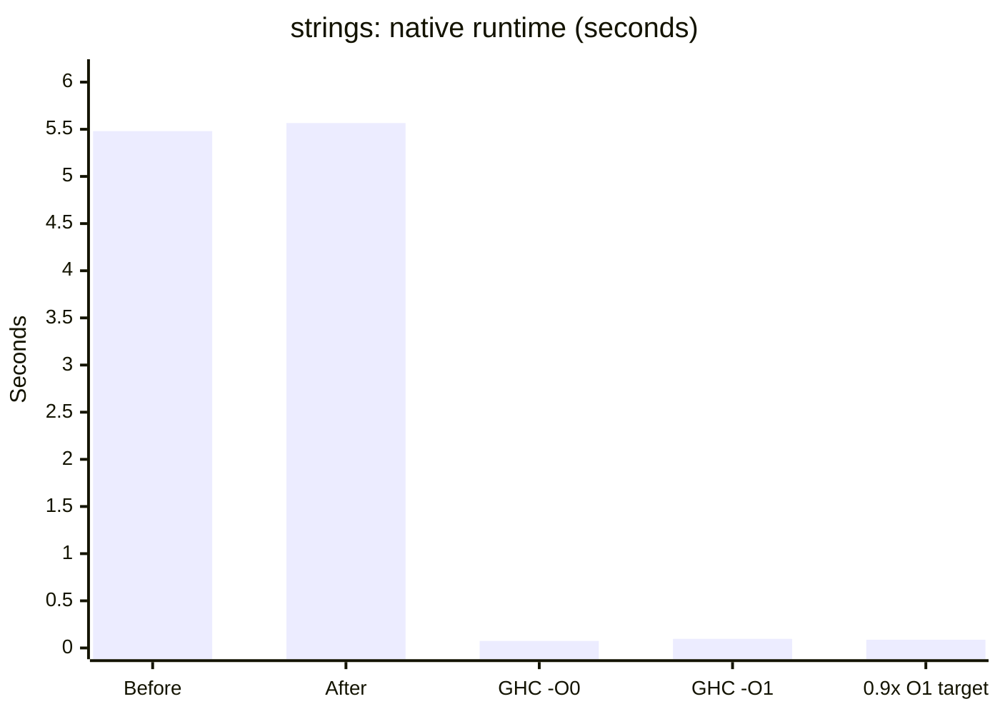
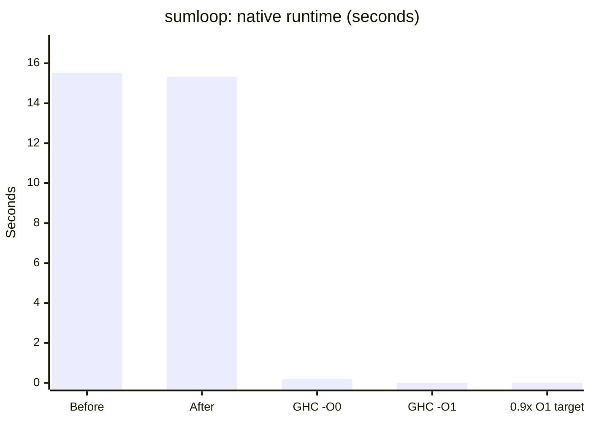

# Lazy native diagnostic names: native runtime

Raw samples, commands and runner metadata: [runtime-lazy-names.json](runtime-lazy-names.json).

[Hosted run](https://github.com/billyedmoore/shit-haskell/actions/runs/43729922863); Intel(R) Xeon(R) 6973P-C, CPU 0, Rust 1.92.0 release, GHC 9.12.2.
Before `c7ad614a96129ec7564cbbe410e0a7e7bf93452c`, after `6ae25bbf48b3e1031ad4d546a0d395053230ae6c`.

Native runtime; median of 3 alternating samples, 1 untimed correctness warmups per build.
Builds excluded; process startup included. Every stdout/stderr/exit result agrees.
CPU affinity: 0. GHC uses default RTS settings.

| Program | Before ms | After ms | GHC -O0 ms | GHC -O1 ms | 0.9×O1 ms |
|---|---:|---:|---:|---:|---:|
| fib | 173.691 | 141.925 | 17.243 | 3.186 | 2.868 |
| integer | 108.523 | 71.245 | 5.150 | 4.757 | 4.281 |
| ioref | 2057.943 | 2001.596 | 58.872 | 6.871 | 6.184 |
| mapops | 683.301 | 664.362 | 67.217 | 36.002 | 32.401 |
| mvar | 164.714 | 129.568 | 11.816 | 5.628 | 5.065 |
| nqueens | 252.662 | 237.139 | 23.928 | 4.520 | 4.068 |
| strings | 5480.905 | 5565.834 | 74.230 | 96.535 | 86.882 |
| sumloop | 15525.695 | 15308.135 | 191.027 | 15.403 | 13.862 |

Eight-program geometric-mean speedup: 1.130438×. The 0.9× GHC -O1 target remains unmet.
Strings measured 1.5% slower; long-program changes are small. No universal gain is claimed.

These are independent paired runs on different hosted CPU models; compare each Before/After pair, rather than chaining their absolute times.

Reproduce with `tools/runtimebench.py --before /path/to/before/hsc --after /path/to/after/hsc --ghc ghc --cpu 0 --runs 3`. Use a common vendored library tree through `HSC_LIBDIR`; builds and the correctness warmup are untimed. Hosted CI records the exact revisions and saves reports and output checks, without archiving executables.
