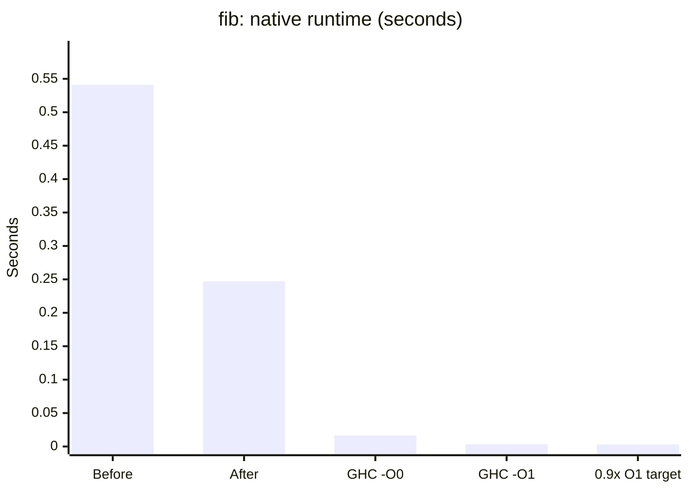
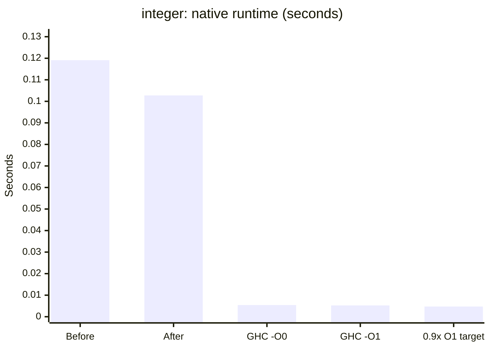
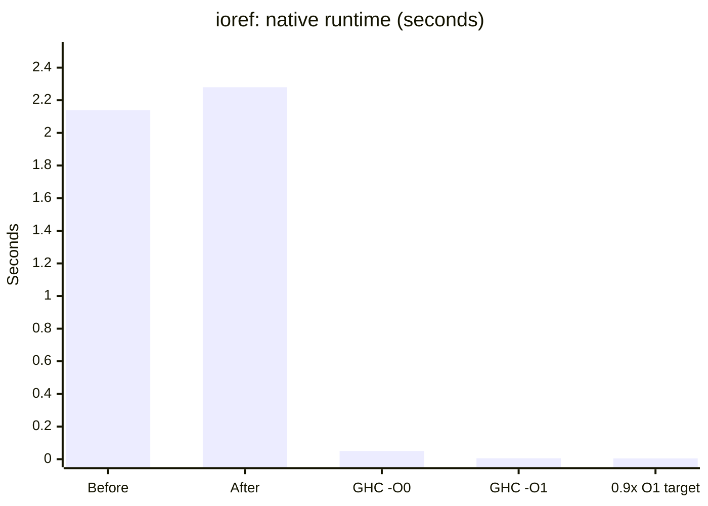
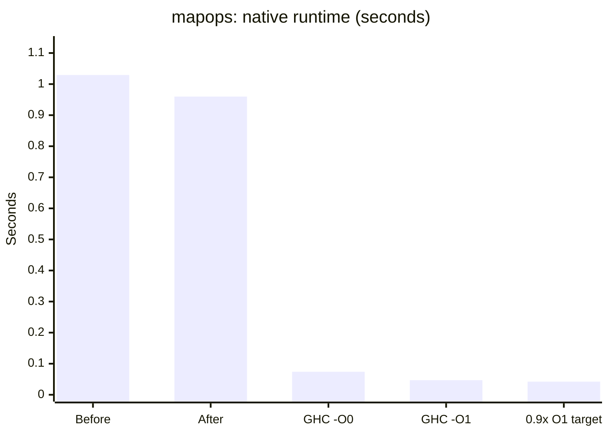
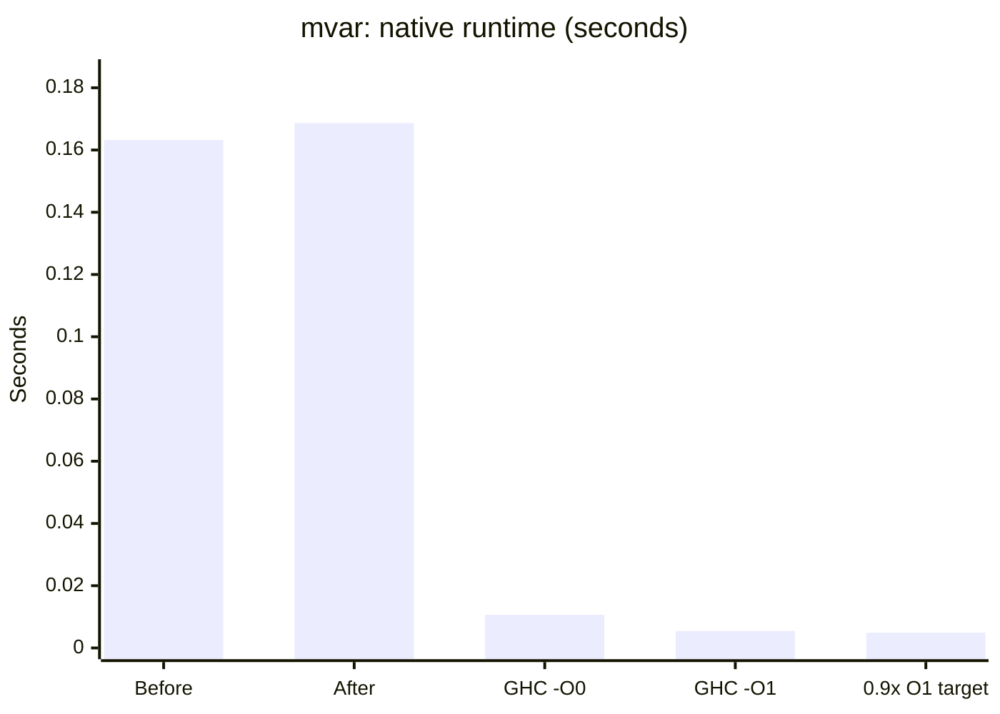
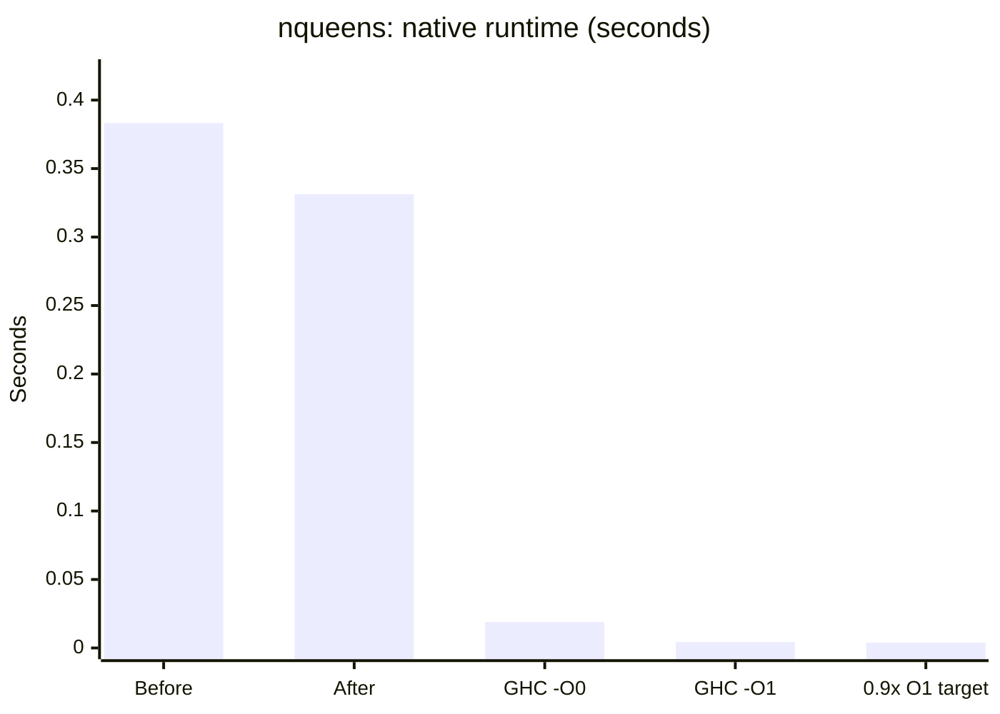
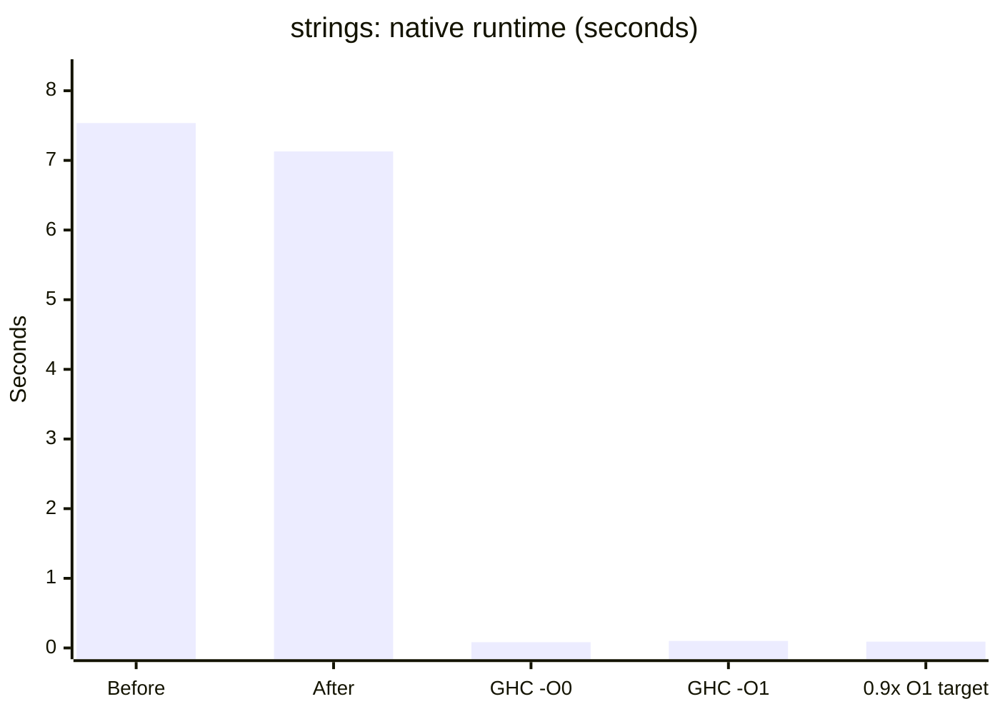
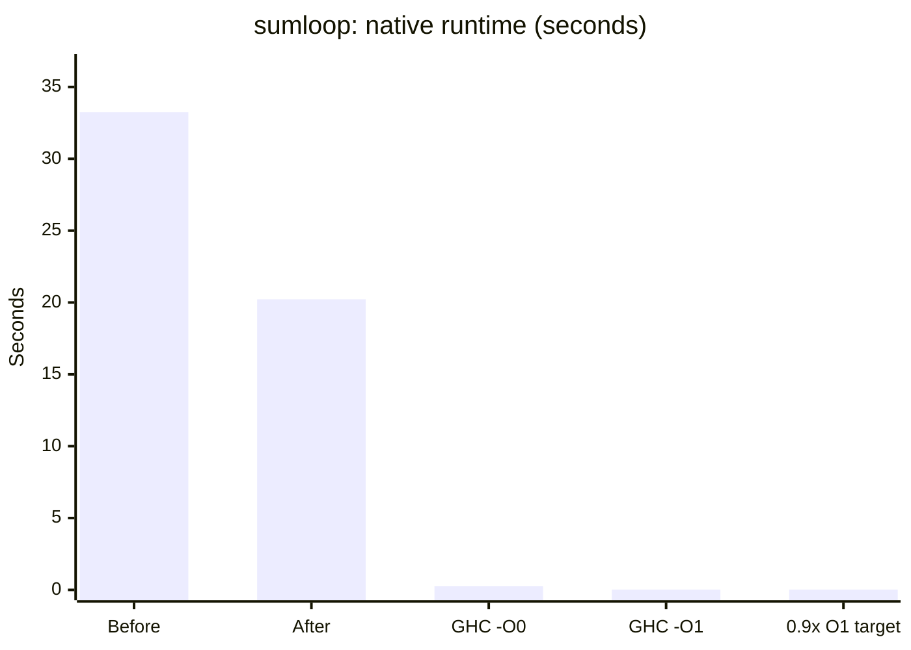

# Numeric literal runtime measurements

Raw samples and normalized commands: [runtime-literals.json](runtime-literals.json).

Native runtime; median of 3 alternating samples, 1 untimed correctness warmups per build.
Builds excluded; process startup included. Every stdout/stderr/exit result agrees.
CPU affinity: 0. GHC uses default RTS settings.

| Program | Before ms | After ms | GHC -O0 ms | GHC -O1 ms | 0.9×O1 ms |
|---|---:|---:|---:|---:|---:|
| fib | 541.072 | 247.086 | 16.560 | 3.471 | 3.124 |
| integer | 119.116 | 102.735 | 5.429 | 5.246 | 4.722 |
| ioref | 2139.022 | 2279.883 | 50.576 | 5.464 | 4.918 |
| mapops | 1029.347 | 959.790 | 74.079 | 46.954 | 42.258 |
| mvar | 163.243 | 168.658 | 10.682 | 5.462 | 4.916 |
| nqueens | 383.228 | 331.353 | 18.948 | 4.252 | 3.827 |
| strings | 7535.894 | 7128.742 | 82.763 | 100.507 | 90.456 |
| sumloop | 33254.132 | 20223.921 | 251.093 | 16.620 | 14.958 |

Follow-up checks reuse the same binaries with seven alternating samples. Original three-run medians showed ioref 6.6% slower and mvar 3.3% slower. Follow-up medians were:

| Program | Before ms | After ms | Change |
|---|---:|---:|---:|
| ioref | 2035.292 | 2057.569 | +1.1% |
| mvar | 163.400 | 165.004 | +1.0% |
