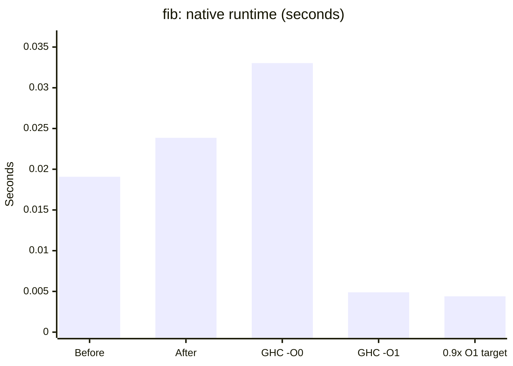
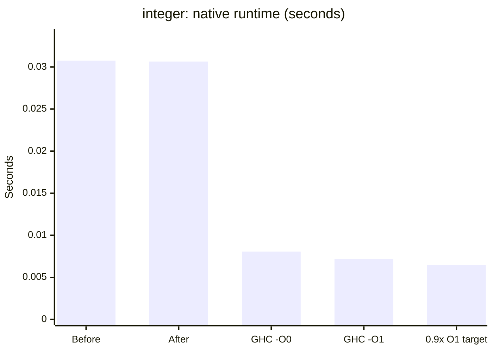
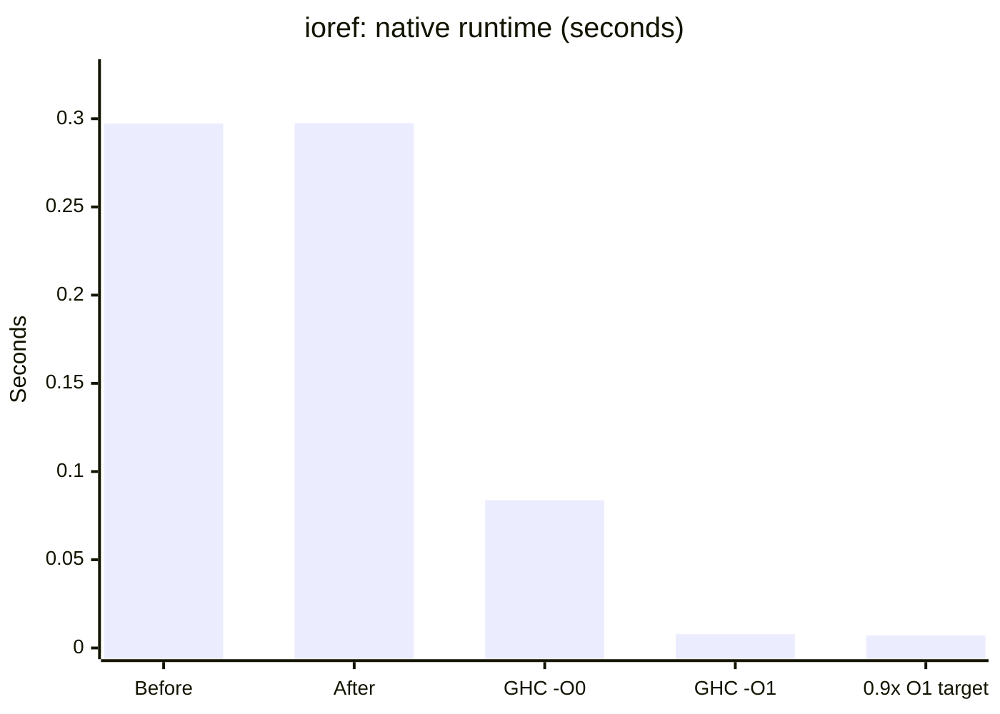
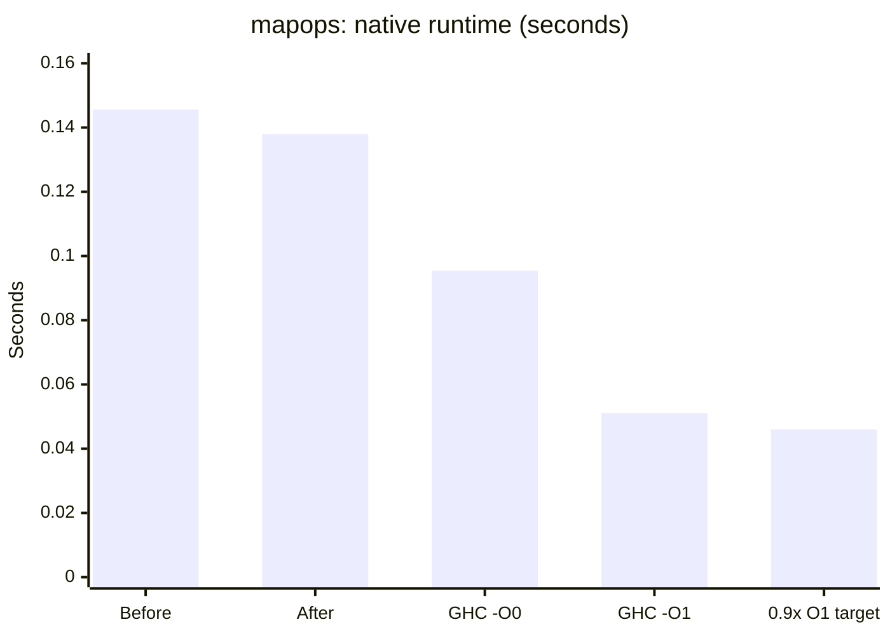
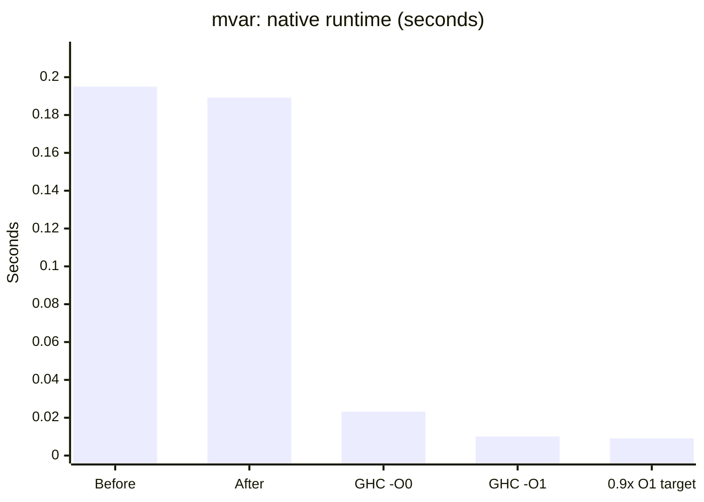
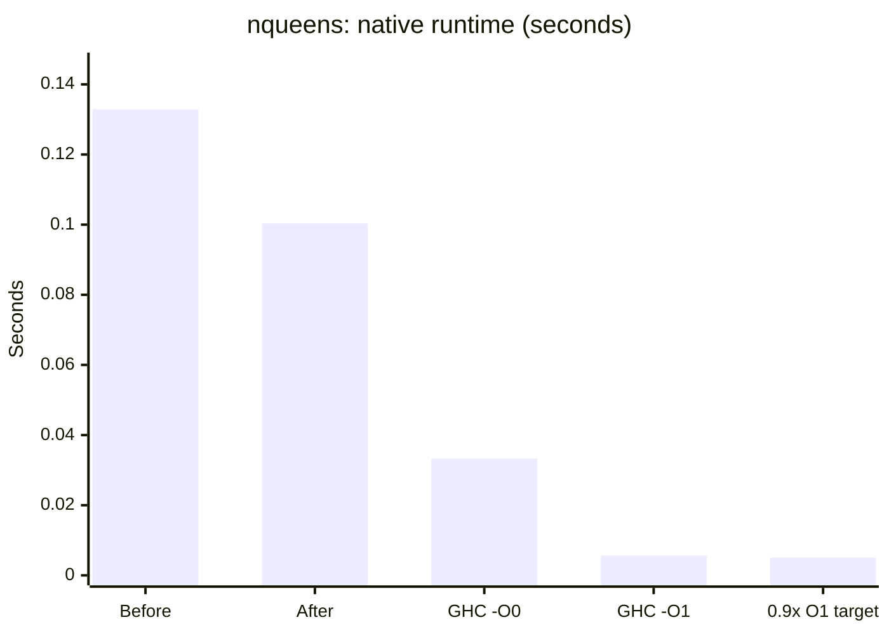
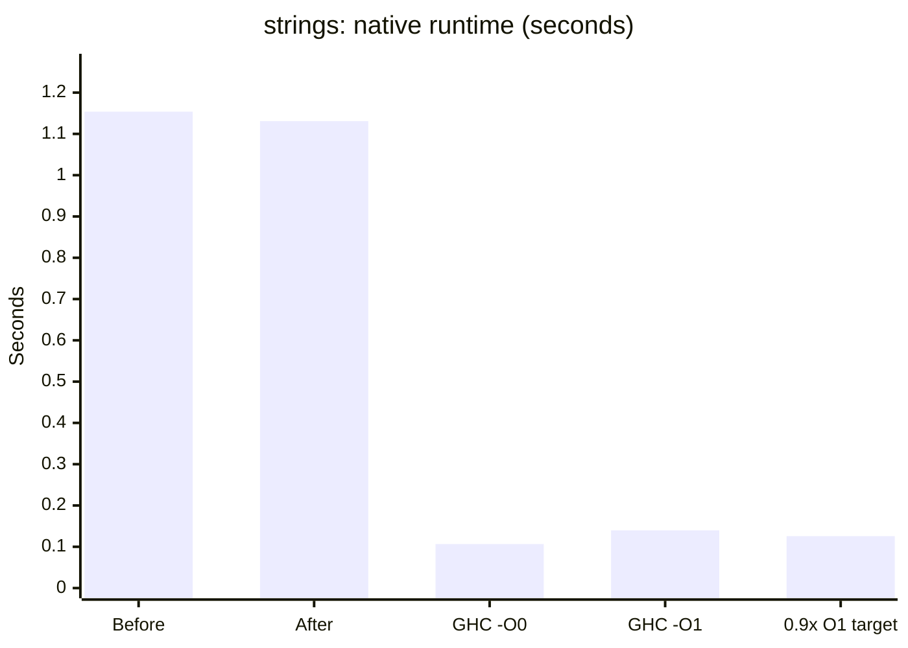
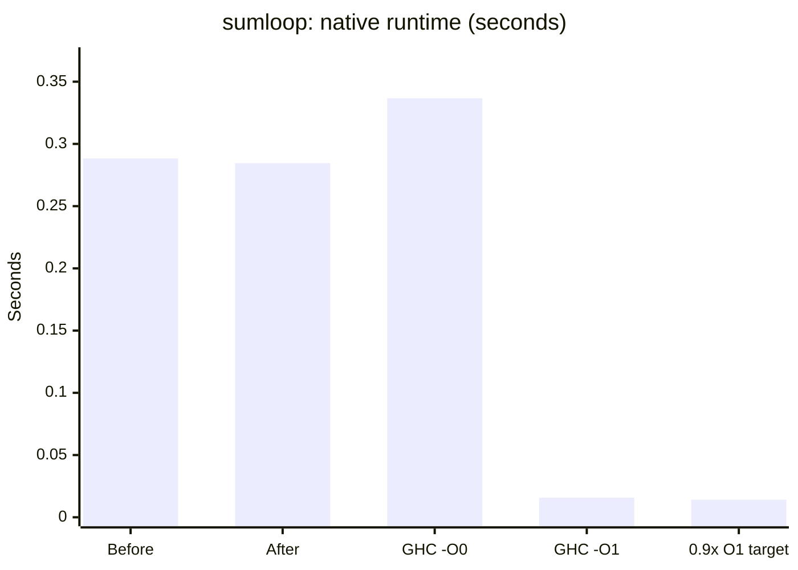

# Specialising local functions at constant dictionaries: native runtime

[Raw samples, commands and metadata](runtime-local-specialisation.json).

[Hosted run](https://github.com/billyedmoore/shit-haskell/actions/runs/43884638611); AMD EPYC 7763 64-Core Processor, CPU 0, Rust 1.92.0 release, GHC 9.12.2.
Before `847afc77d2980aa3a5afcc1bd893719df9bb82d1`, after `fc54172e25b6f6c6bb98fb03f29d7719d2ca6890`.

Native runtime; median of 3 alternating samples, 1 untimed correctness warmups per build.
Builds excluded; process startup included. Every stdout/stderr/exit result agrees.
CPU affinity: 0. GHC uses default RTS settings.

| Program | Before ms | After ms | GHC -O0 ms | GHC -O1 ms | 0.9×O1 ms |
|---|---:|---:|---:|---:|---:|
| fib | 19.079 | 23.858 | 33.031 | 4.892 | 4.403 |
| integer | 30.747 | 30.647 | 8.064 | 7.175 | 6.457 |
| ioref | 297.297 | 297.535 | 83.763 | 7.807 | 7.026 |
| mapops | 145.577 | 137.887 | 95.449 | 51.108 | 45.997 |
| mvar | 195.057 | 189.183 | 23.201 | 10.097 | 9.087 |
| nqueens | 132.896 | 100.374 | 33.307 | 5.637 | 5.073 |
| strings | 1153.769 | 1130.950 | 106.718 | 139.725 | 125.752 |
| sumloop | 288.320 | 284.541 | 336.688 | 15.741 | 14.167 |

