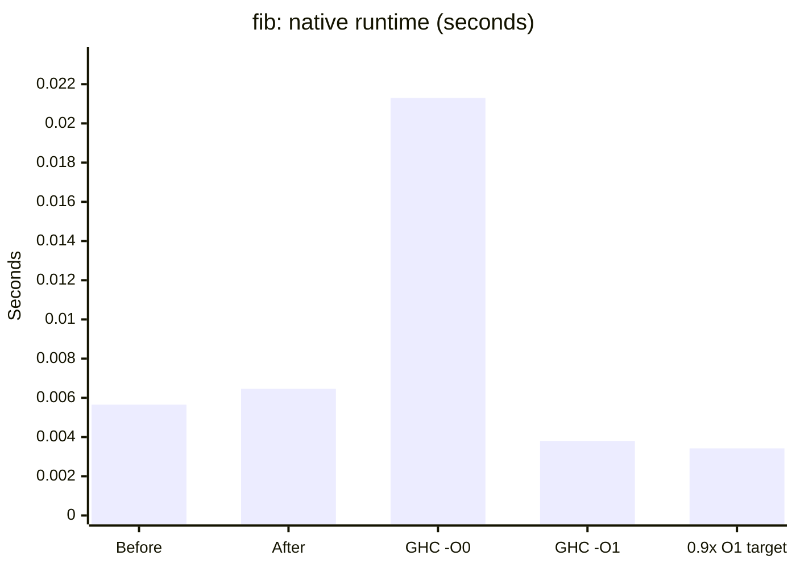
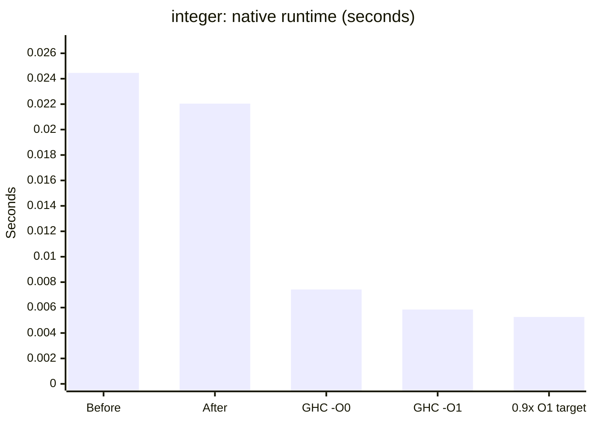
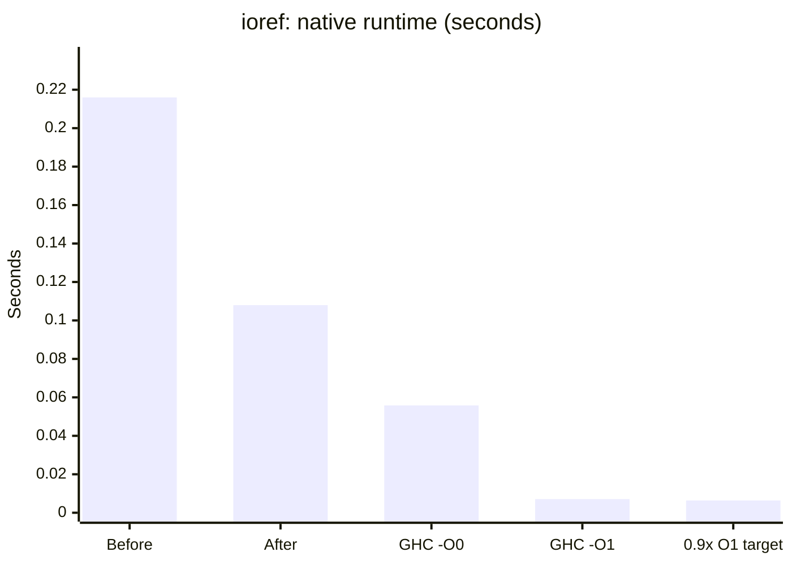
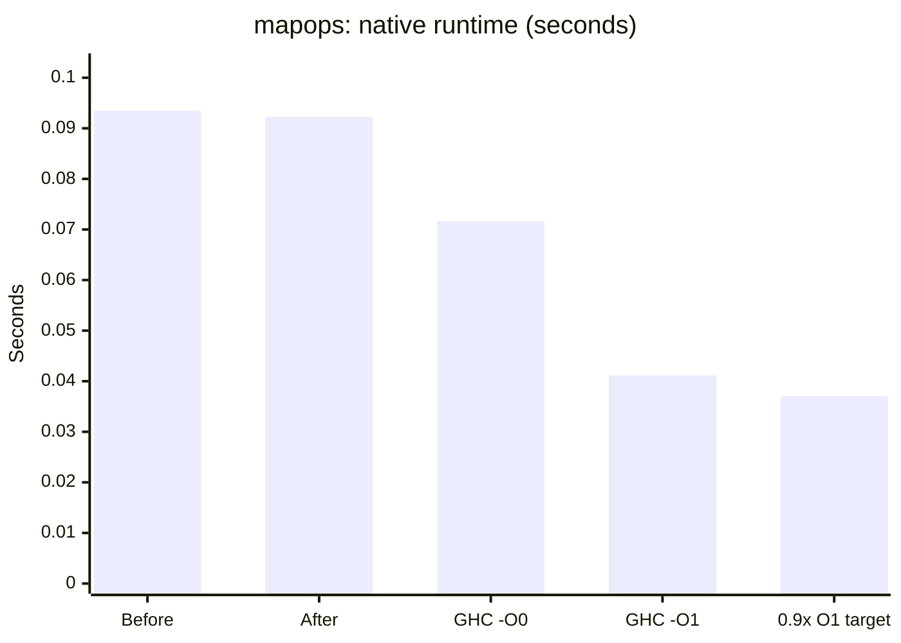
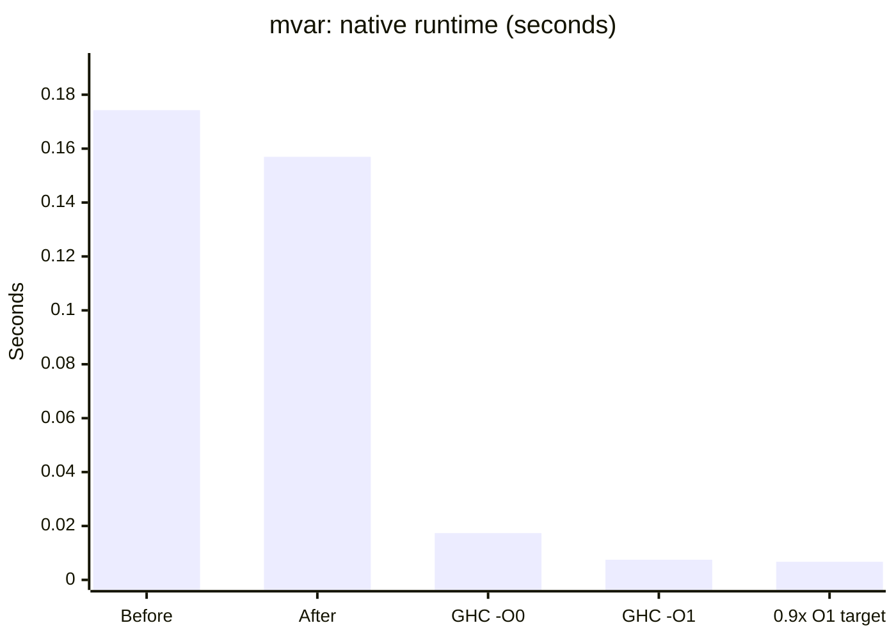
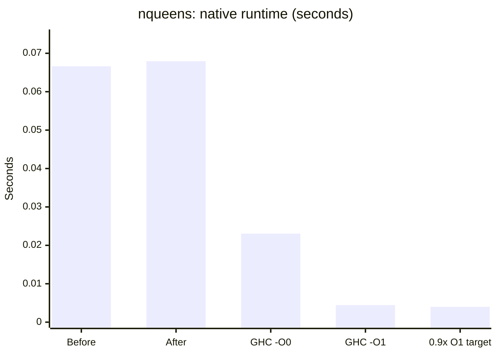
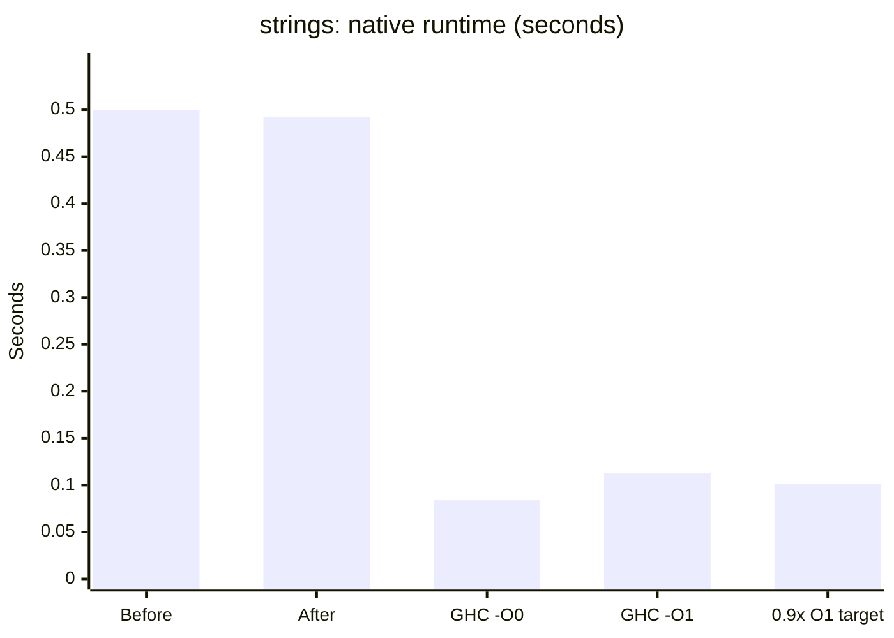
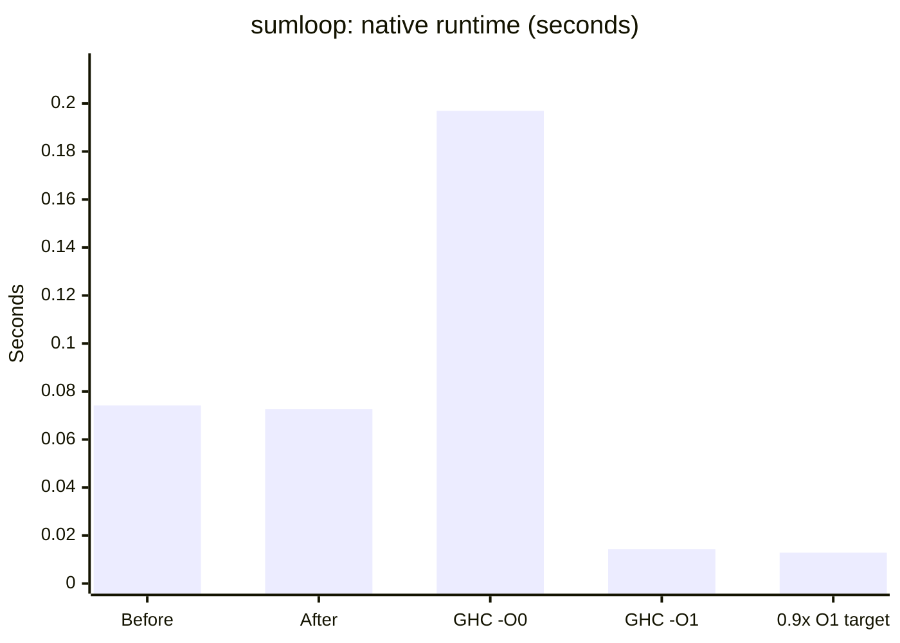

# Inline MutVar reads/writes; cheaper primitive dispatch: native runtime

[Raw samples, commands and metadata](runtime-mutvar-dispatch.json).

[Hosted run](https://github.com/billyedmoore/shit-haskell/actions/runs/43951984448); AMD EPYC 9V74 80-Core Processor, CPU 0, Rust 1.92.0 release, GHC 9.12.2.
Before `0c289712f04b49f02207e62a387bc23262282f6a`, after `9762d039d274f6242a5f82f2da01cbe29f8e1cc6`.

Native runtime; median of 3 alternating samples, 1 untimed correctness warmups per build.
Builds excluded; process startup included. Every stdout/stderr/exit result agrees.
CPU affinity: 0. GHC uses default RTS settings.

| Program | Before ms | After ms | GHC -O0 ms | GHC -O1 ms | 0.9×O1 ms |
|---|---:|---:|---:|---:|---:|
| fib | 5.653 | 6.459 | 21.301 | 3.802 | 3.422 |
| integer | 24.456 | 22.043 | 7.423 | 5.847 | 5.262 |
| ioref | 216.001 | 107.957 | 55.816 | 7.108 | 6.397 |
| mapops | 93.456 | 92.267 | 71.659 | 41.170 | 37.053 |
| mvar | 174.277 | 156.952 | 17.354 | 7.481 | 6.732 |
| nqueens | 66.618 | 67.943 | 23.048 | 4.456 | 4.011 |
| strings | 499.797 | 492.469 | 83.872 | 112.704 | 101.434 |
| sumloop | 74.211 | 72.681 | 196.934 | 14.286 | 12.857 |

