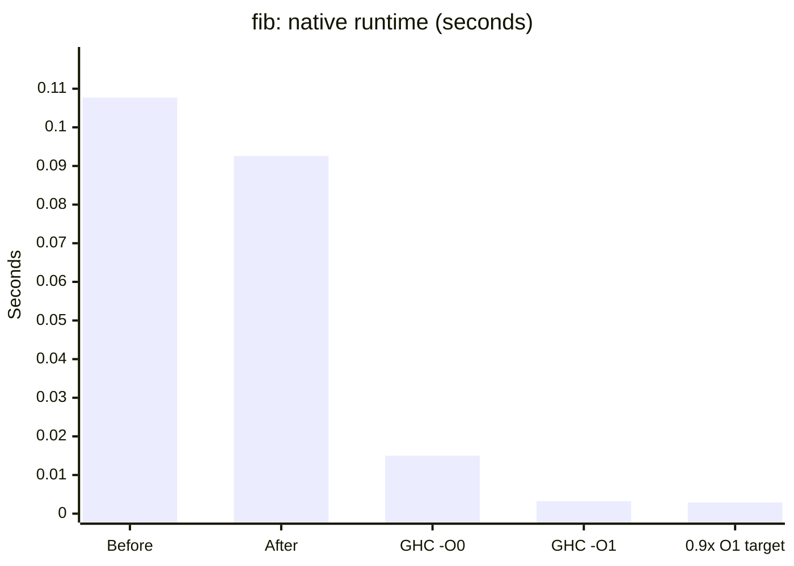
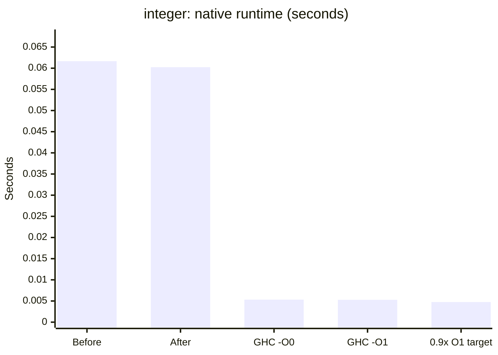
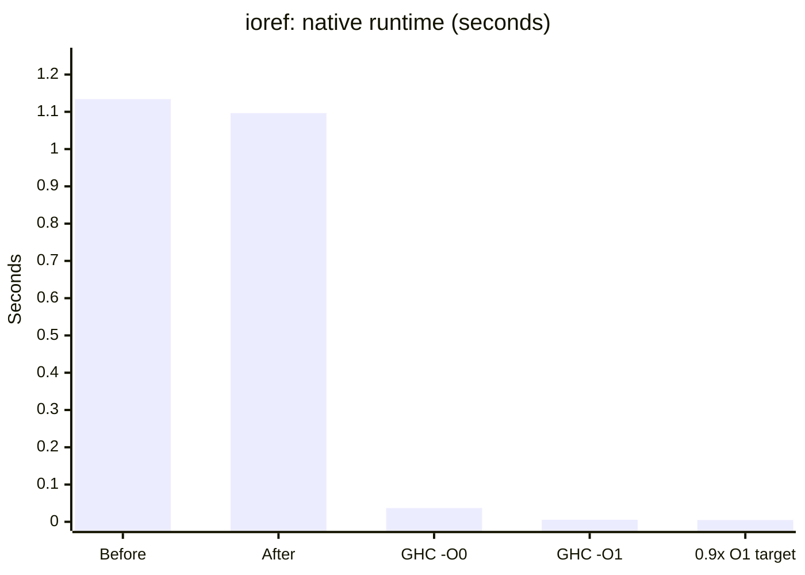
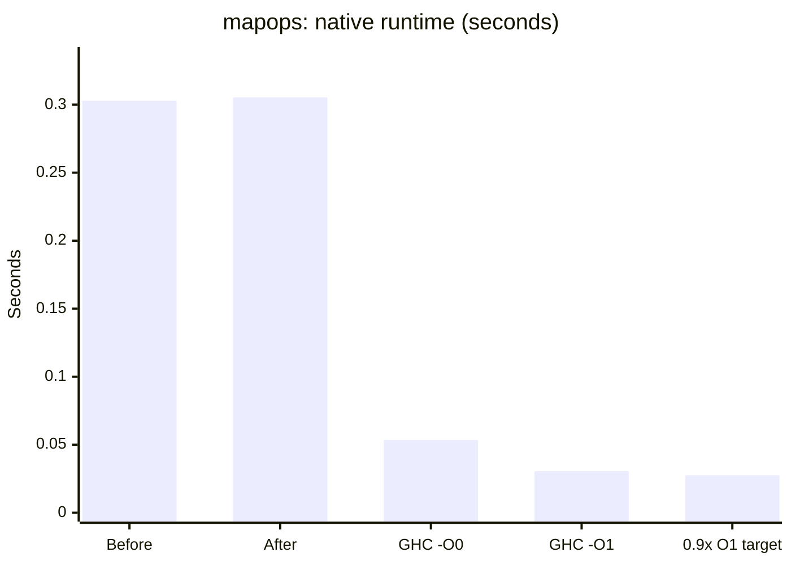
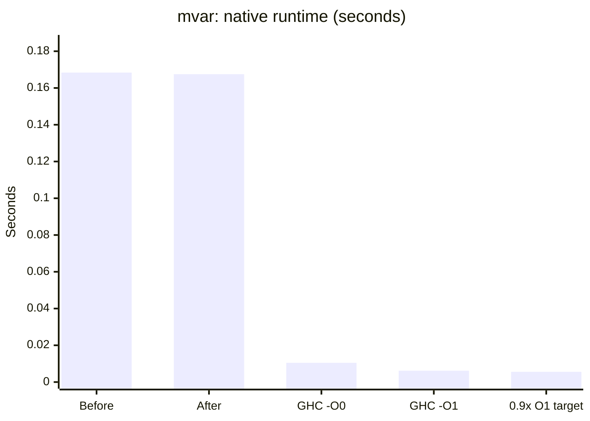
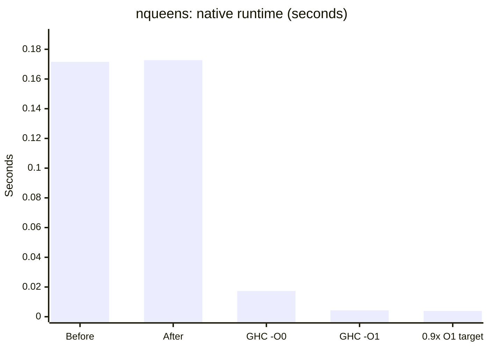
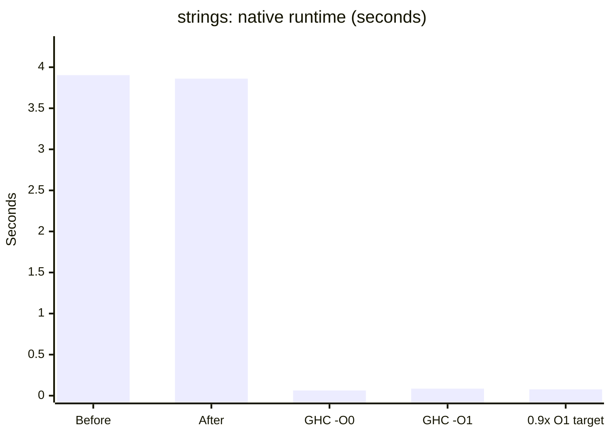
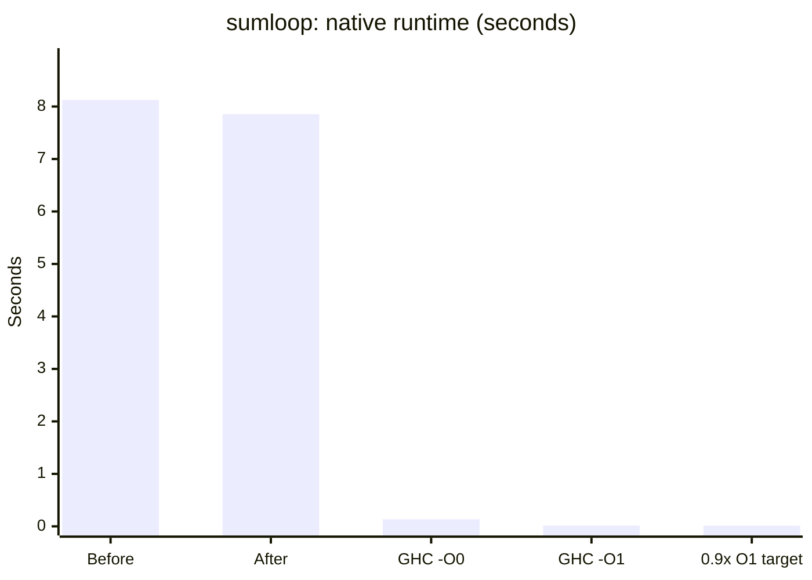

# Static zero-field constructors: native runtime

Raw samples, commands and metadata: [runtime-nullary-constructors.json](runtime-nullary-constructors.json).

[Hosted run](https://github.com/billyedmoore/shit-haskell/actions/runs/43746474090); AMD EPYC 9V45 96-Core Processor, CPU 0, Rust 1.92.0 release, GHC 9.12.2.
Before `d17bc87fa0cd7d01a5515becad2ffac344b7d5a6`, after `4ebe76029dd6bda85477758d4f9bdc43b086e722`.

Native runtime; median of 3 alternating samples, 1 untimed correctness warmups per build.
Builds excluded; process startup included. Every stdout/stderr/exit result agrees.
CPU affinity: 0. GHC uses default RTS settings.

| Program | Before ms | After ms | GHC -O0 ms | GHC -O1 ms | 0.9×O1 ms |
|---|---:|---:|---:|---:|---:|
| fib | 107.710 | 92.605 | 15.013 | 3.226 | 2.904 |
| integer | 61.658 | 60.242 | 5.325 | 5.274 | 4.747 |
| ioref | 1134.077 | 1096.582 | 36.940 | 5.398 | 4.858 |
| mapops | 302.871 | 305.348 | 53.384 | 30.552 | 27.497 |
| mvar | 168.389 | 167.519 | 10.480 | 6.185 | 5.567 |
| nqueens | 171.541 | 172.681 | 17.310 | 4.294 | 3.865 |
| strings | 3903.332 | 3860.743 | 63.345 | 85.318 | 76.786 |
| sumloop | 8124.657 | 7853.504 | 135.956 | 14.145 | 12.730 |

Eight-program geometric-mean speedup: 1.030875×. Fib improved by 14.0%; mapops and nqueens measured less than 1% slower. The 0.9× GHC -O1 target remains unmet.

These are primary paired measurements of the code change; subsequent report/PLAN changes leave runtime source unchanged. Different hosted runs can use different CPUs, so absolute times are not chained across reports.

Reproduce with `tools/runtimebench.py --before /path/to/before/hsc --after /path/to/after/hsc --ghc ghc --cpu 0 --runs 3`, using common vendored sources through `HSC_LIBDIR`. Builds and correctness warmups are excluded, startup is included, and every sample checks stdout, stderr and exit status.
