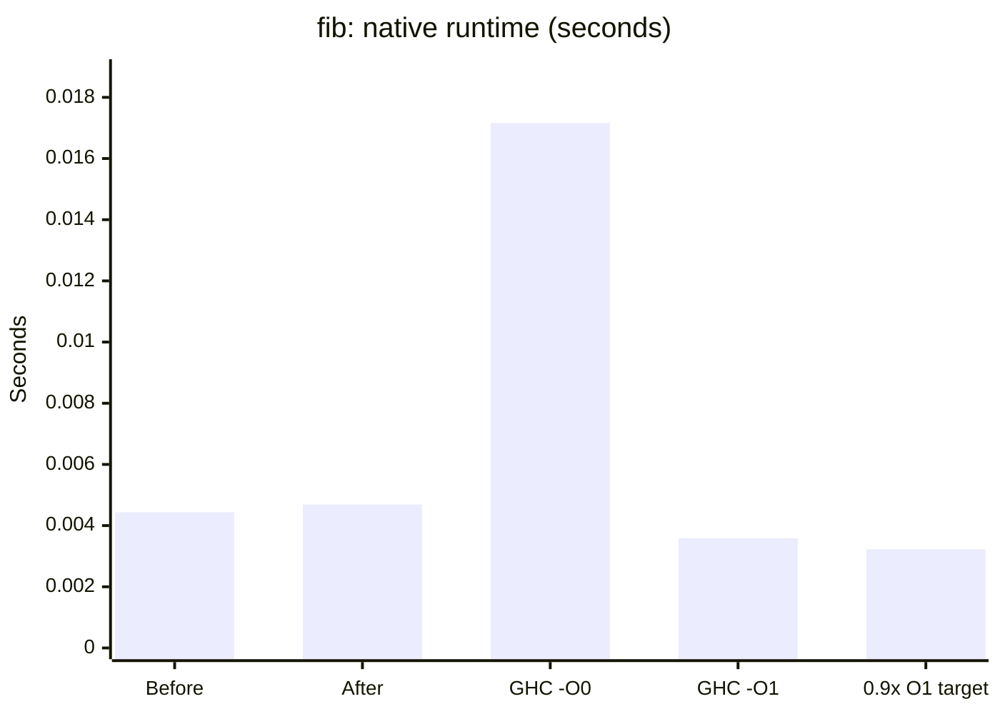
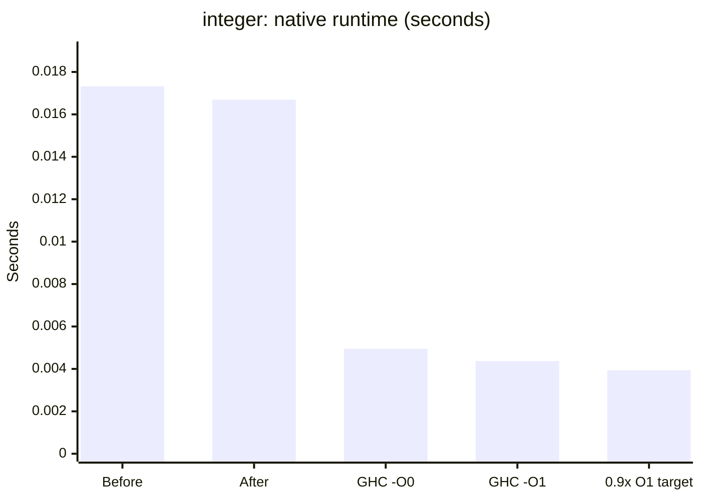
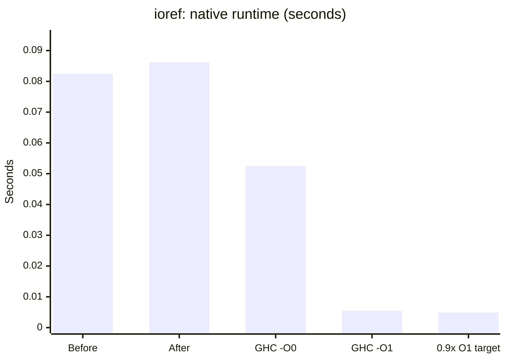
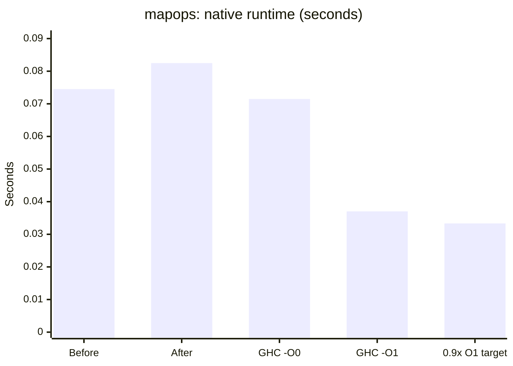
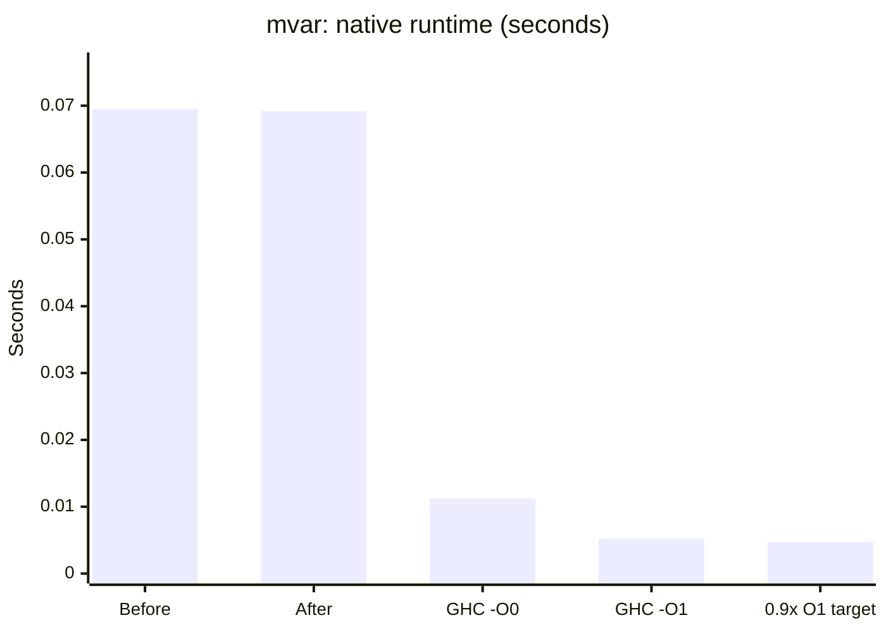
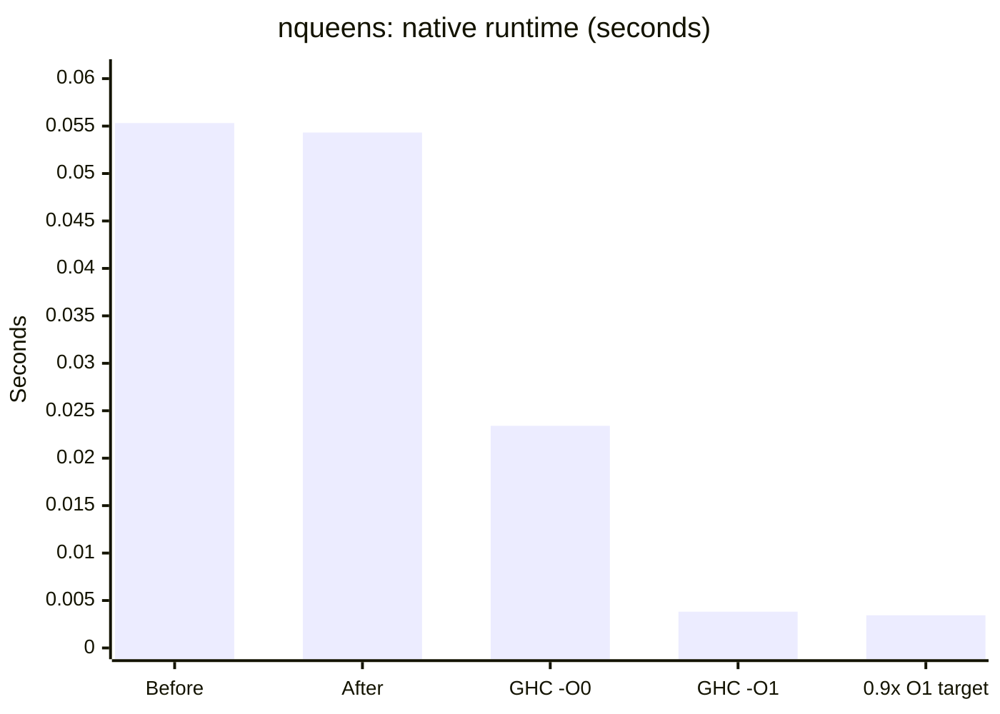
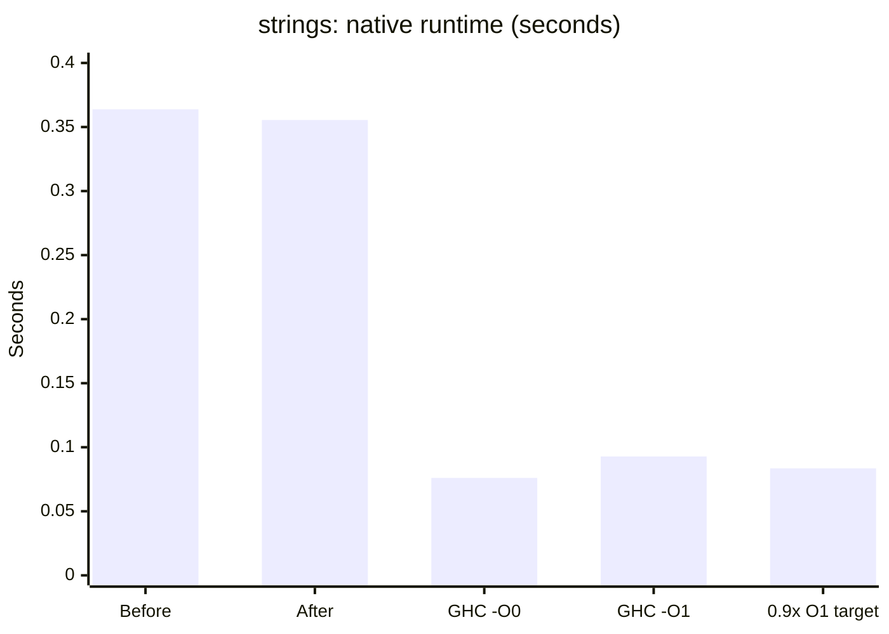
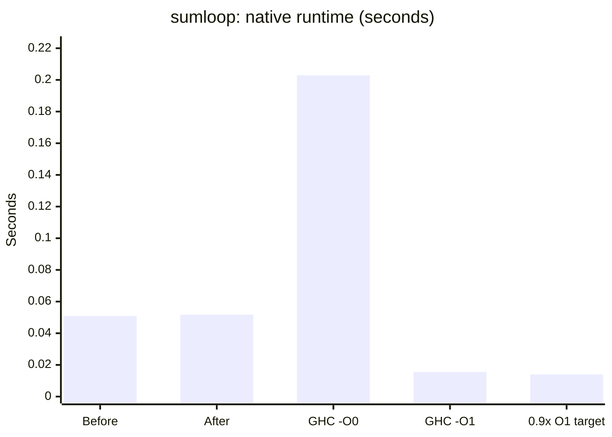

# Fused foldl loops take their accumulator directly (oneShot): native runtime

[Raw samples, commands and metadata](runtime-one-shot.json).

[Hosted run](https://github.com/billyedmoore/shit-haskell/actions/runs/43996144741); Intel(R) Xeon(R) 6975P-C, CPU 0, Rust 1.92.0 release, GHC 9.12.2.
Before `87117b9d4240c6730f7173e03373759e5333a9c3`, after `038e9aa7f82109ef98eeaf0941789383c948d74f`.

Native runtime; median of 3 alternating samples, 1 untimed correctness warmups per build.
Builds excluded; process startup included. Every stdout/stderr/exit result agrees.
CPU affinity: 0. GHC uses default RTS settings.

| Program | Before ms | After ms | GHC -O0 ms | GHC -O1 ms | 0.9×O1 ms |
|---|---:|---:|---:|---:|---:|
| fib | 4.435 | 4.690 | 17.159 | 3.585 | 3.227 |
| integer | 17.329 | 16.695 | 4.948 | 4.372 | 3.935 |
| ioref | 82.481 | 86.213 | 52.497 | 5.445 | 4.900 |
| mapops | 74.519 | 82.486 | 71.472 | 37.032 | 33.329 |
| mvar | 69.517 | 69.195 | 11.234 | 5.246 | 4.721 |
| nqueens | 55.317 | 54.320 | 23.409 | 3.826 | 3.443 |
| strings | 363.842 | 355.478 | 76.083 | 92.836 | 83.552 |
| sumloop | 50.920 | 51.770 | 202.890 | 15.532 | 13.979 |

