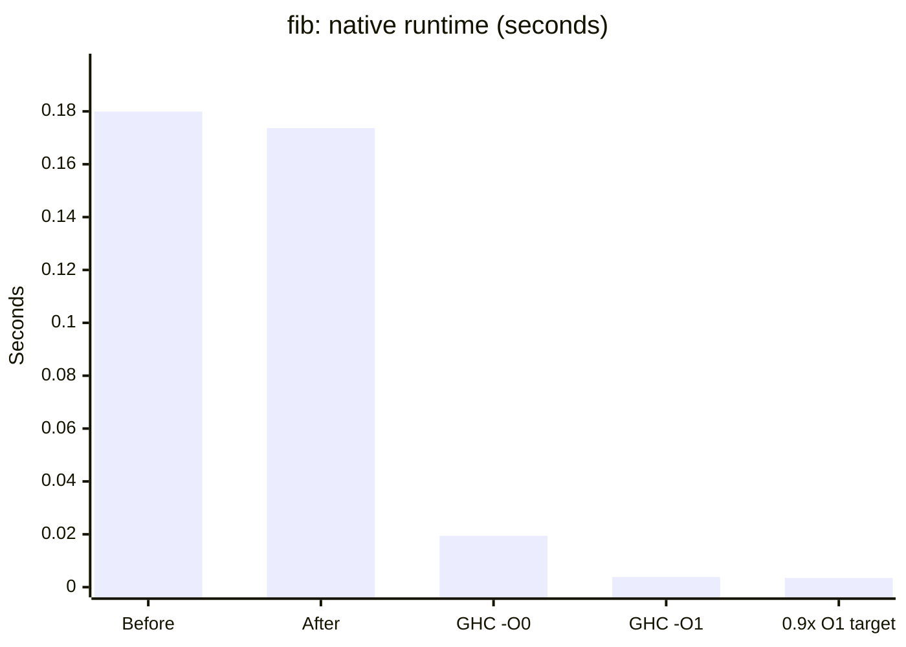
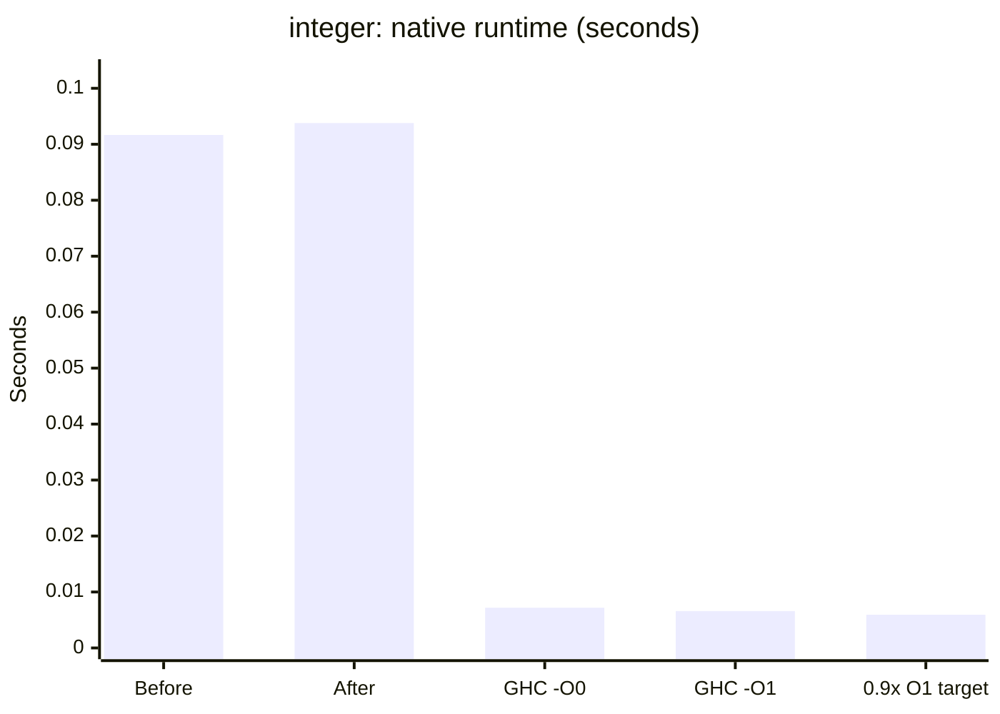
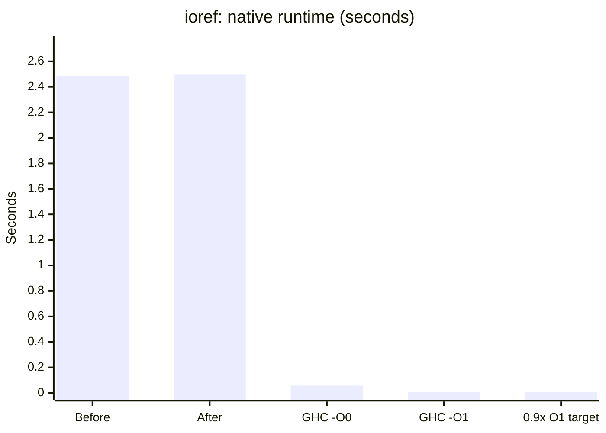
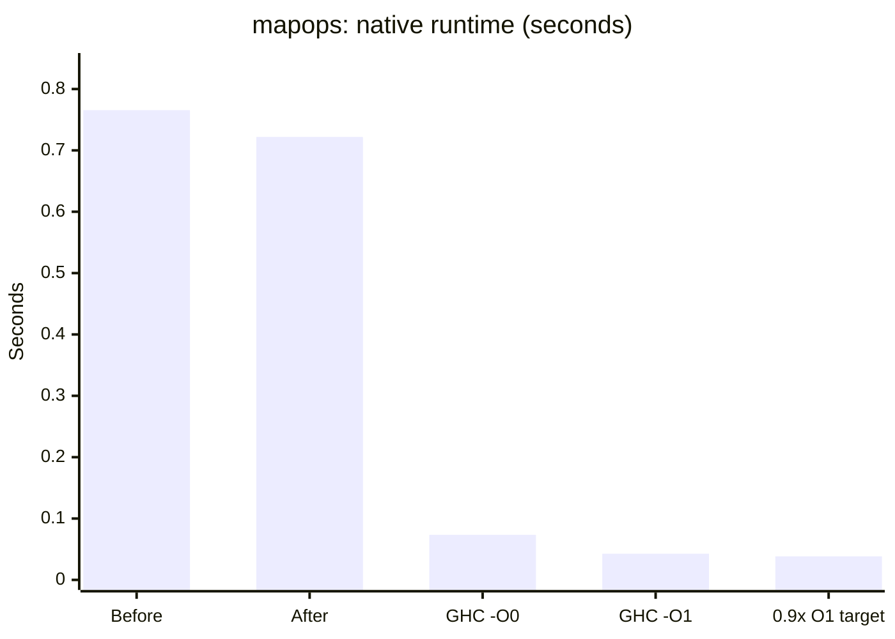
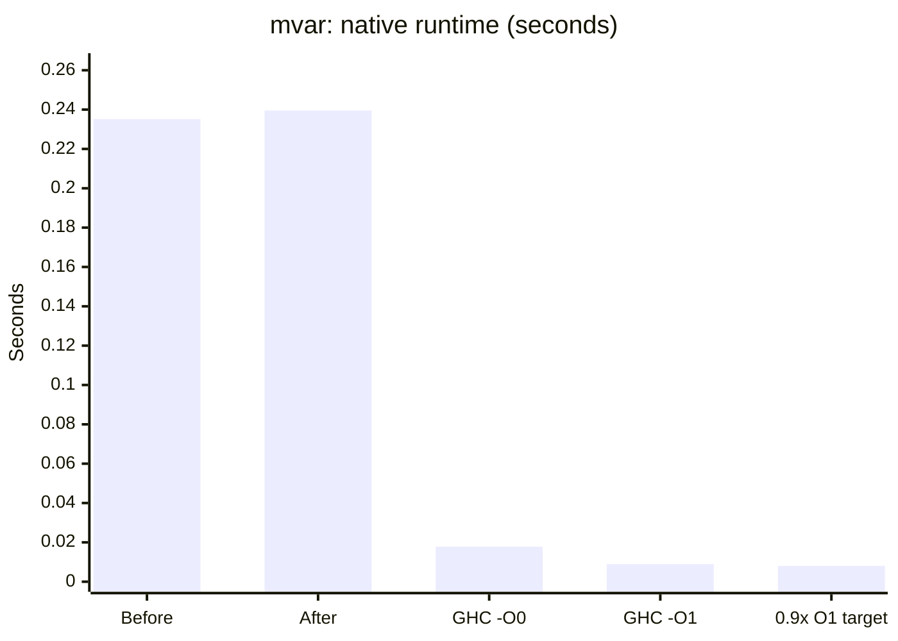
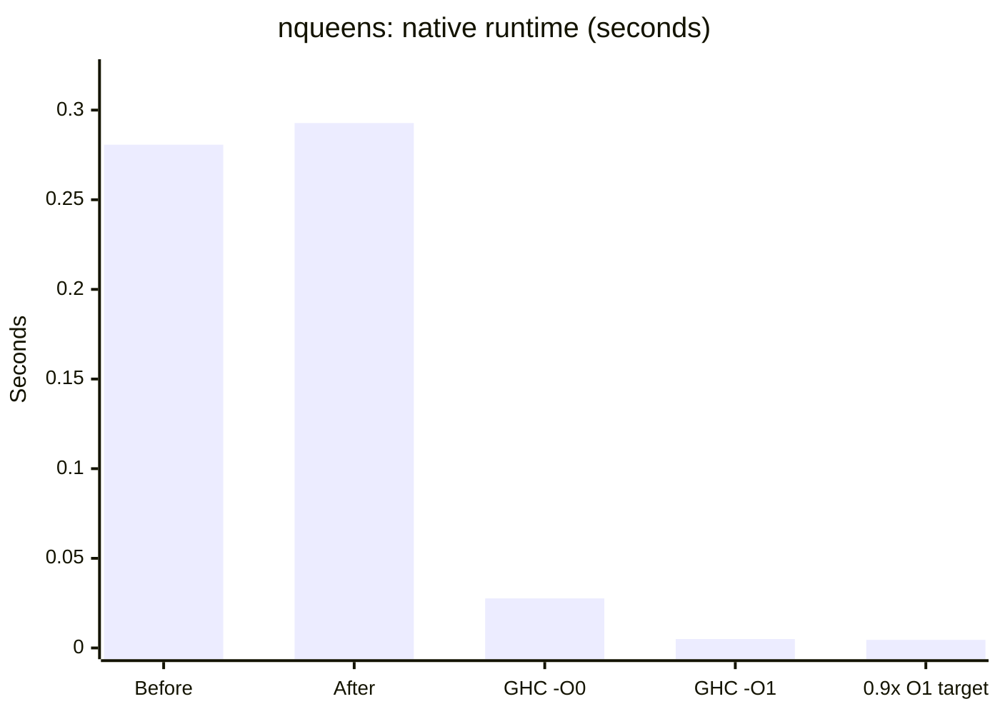
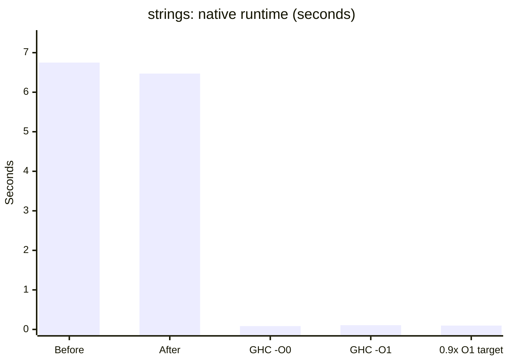
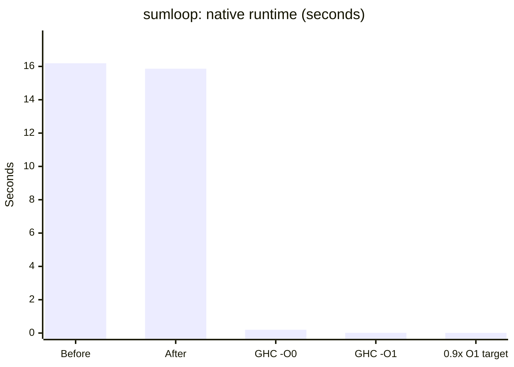

# Partial dictionary method selection: native runtime

Raw samples, commands and runner metadata: [runtime-partial-dictionaries.json](runtime-partial-dictionaries.json).

[Hosted run](https://github.com/billyedmoore/shit-haskell/actions/runs/43730347173); AMD EPYC 9V74 80-Core Processor, CPU 0, Rust 1.92.0 release, GHC 9.12.2.
Before `6ae25bbf48b3e1031ad4d546a0d395053230ae6c`, after `5e9eb7405c964ab75b30a5a7ffd7b88054407b7f`.

Native runtime; median of 3 alternating samples, 1 untimed correctness warmups per build.
Builds excluded; process startup included. Every stdout/stderr/exit result agrees.
CPU affinity: 0. GHC uses default RTS settings.

| Program | Before ms | After ms | GHC -O0 ms | GHC -O1 ms | 0.9×O1 ms |
|---|---:|---:|---:|---:|---:|
| fib | 179.939 | 173.647 | 19.419 | 3.849 | 3.464 |
| integer | 91.660 | 93.787 | 7.189 | 6.594 | 5.934 |
| ioref | 2485.037 | 2496.150 | 58.018 | 6.616 | 5.954 |
| mapops | 765.572 | 721.913 | 73.502 | 42.684 | 38.415 |
| mvar | 235.171 | 239.541 | 17.821 | 8.928 | 8.035 |
| nqueens | 280.713 | 292.761 | 27.653 | 4.995 | 4.495 |
| strings | 6749.721 | 6471.050 | 83.345 | 107.812 | 97.030 |
| sumloop | 16189.803 | 15862.293 | 197.906 | 14.075 | 12.668 |

Eight-program geometric-mean speedup: 1.008671×. The 0.9× GHC -O1 target remains unmet.
The 1.009× result is within variation; no consistent overall speedup is claimed.

These are independent paired runs on different hosted CPU models; compare each Before/After pair, rather than chaining their absolute times.

Reproduce with `tools/runtimebench.py --before /path/to/before/hsc --after /path/to/after/hsc --ghc ghc --cpu 0 --runs 3`. Use a common vendored library tree through `HSC_LIBDIR`; builds and the correctness warmup are untimed. Hosted CI records the exact revisions and saves reports and output checks, without archiving executables.
