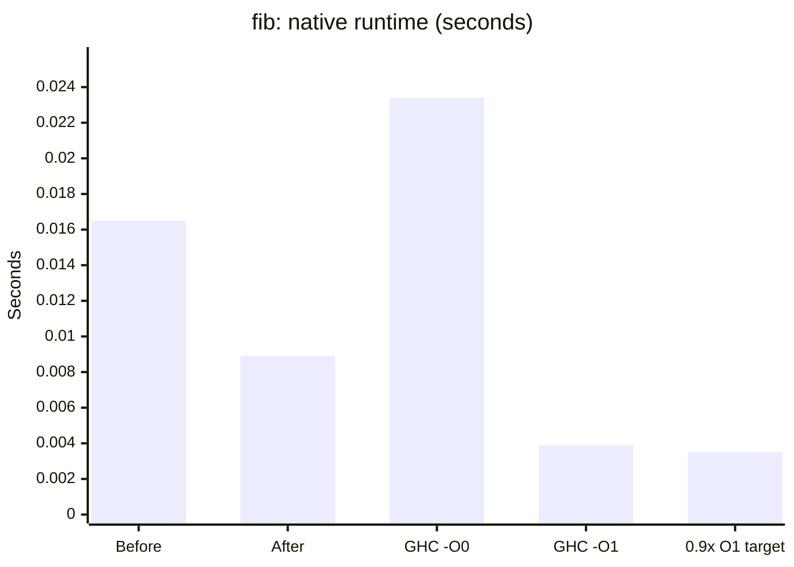
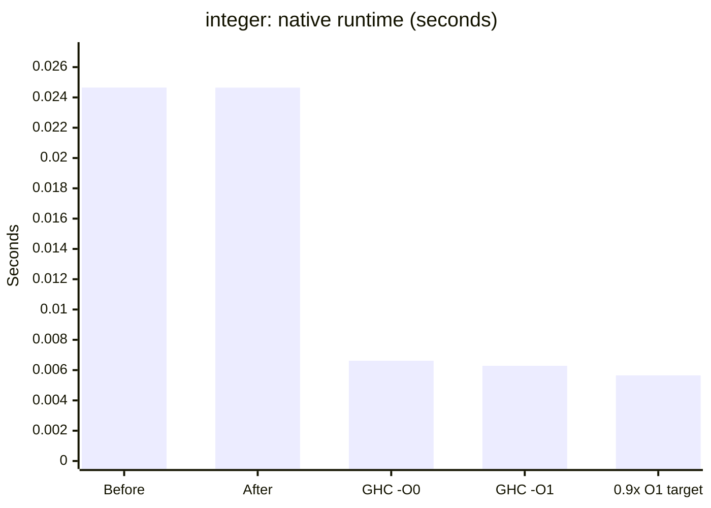
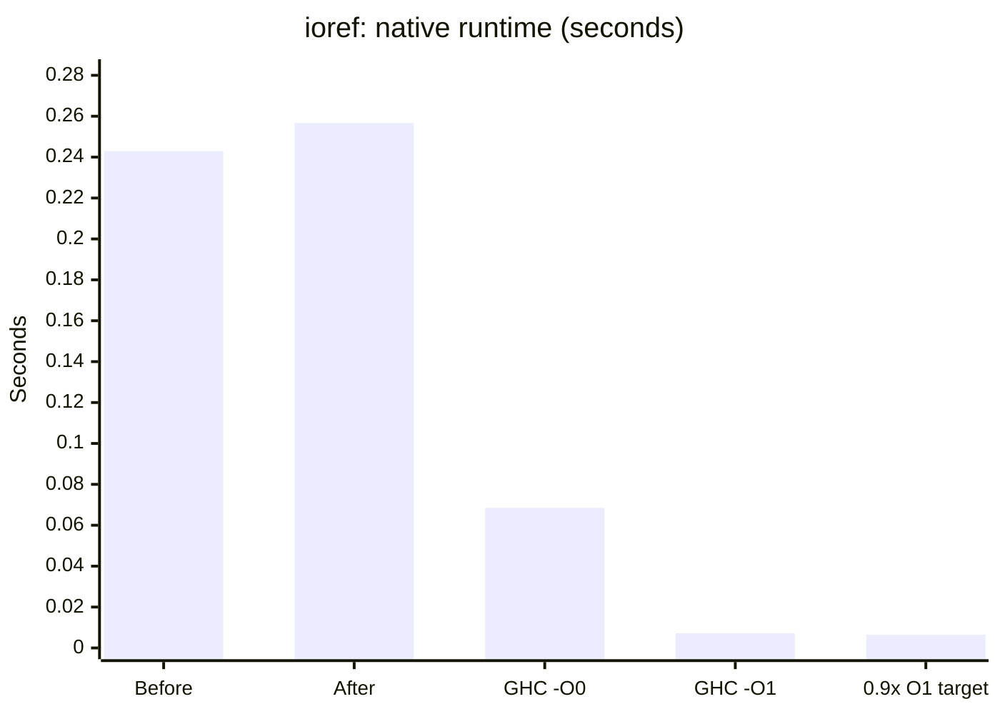
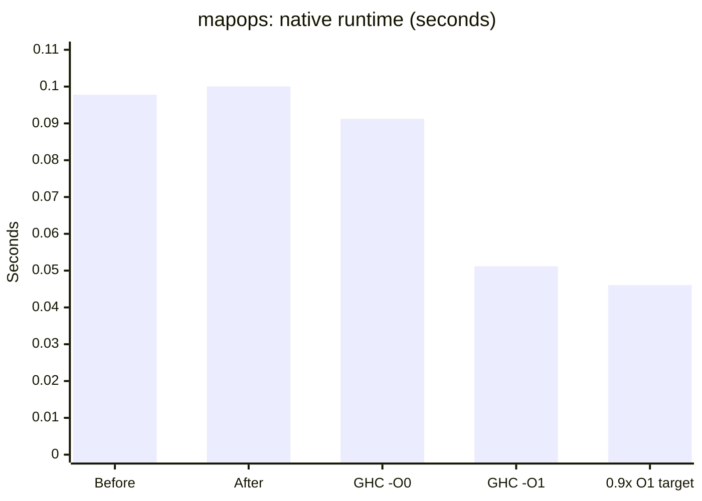
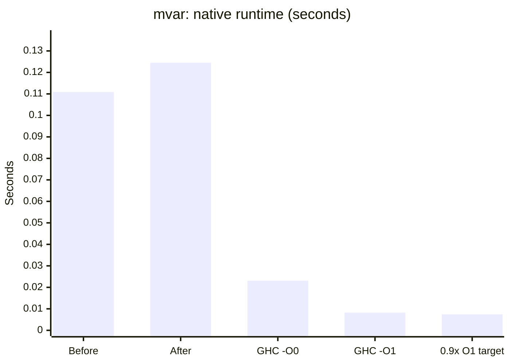
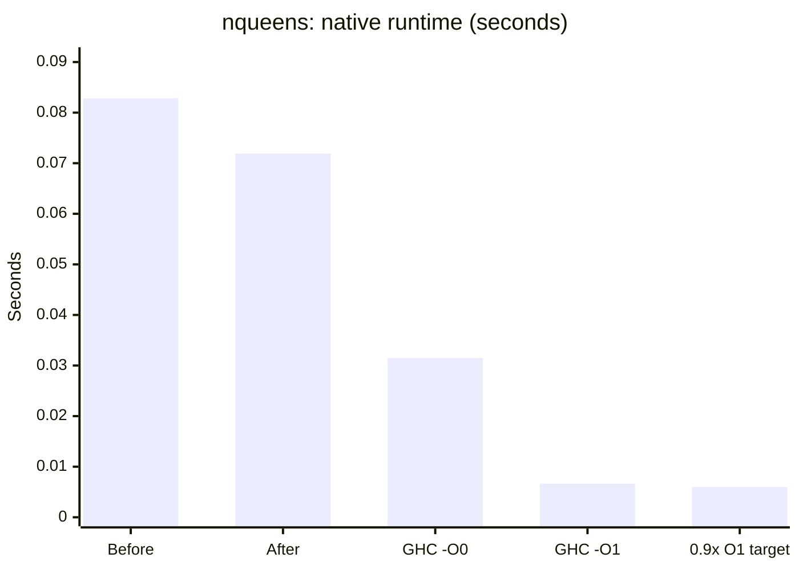
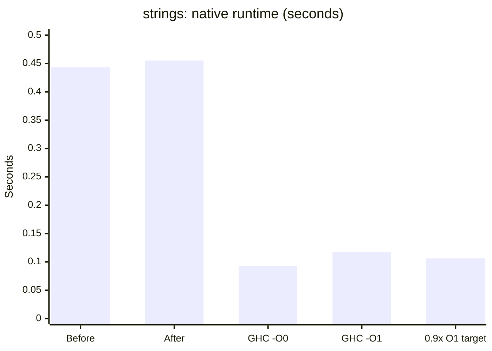
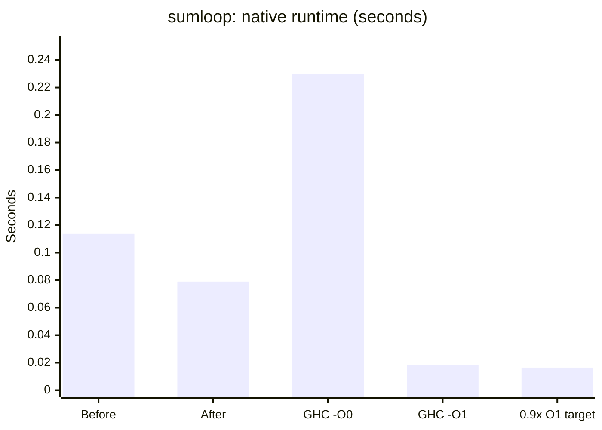

# Workers with numeric results return them raw: native runtime

[Raw samples, commands and metadata](runtime-raw-returns.json).

[Hosted run](https://github.com/billyedmoore/shit-haskell/actions/runs/43944860185); Intel(R) Xeon(R) Platinum 8370C CPU @ 2.80GHz, CPU 0, Rust 1.92.0 release, GHC 9.12.2.
Before `d3258c5df27f2d24653e2eb3b61017ca3ea73bb0`, after `63f72e613bd55aff72eaf24fc10db690c59e71b4`.

Native runtime; median of 3 alternating samples, 1 untimed correctness warmups per build.
Builds excluded; process startup included. Every stdout/stderr/exit result agrees.
CPU affinity: 0. GHC uses default RTS settings.

| Program | Before ms | After ms | GHC -O0 ms | GHC -O1 ms | 0.9×O1 ms |
|---|---:|---:|---:|---:|---:|
| fib | 16.507 | 8.922 | 23.403 | 3.898 | 3.508 |
| integer | 24.651 | 24.648 | 6.619 | 6.284 | 5.655 |
| ioref | 242.995 | 256.649 | 68.487 | 7.206 | 6.485 |
| mapops | 97.793 | 100.062 | 91.220 | 51.185 | 46.067 |
| mvar | 110.908 | 124.499 | 23.083 | 8.261 | 7.435 |
| nqueens | 82.842 | 71.904 | 31.492 | 6.646 | 5.981 |
| strings | 443.522 | 455.320 | 92.948 | 117.868 | 106.081 |
| sumloop | 113.659 | 78.963 | 229.752 | 18.263 | 16.437 |

