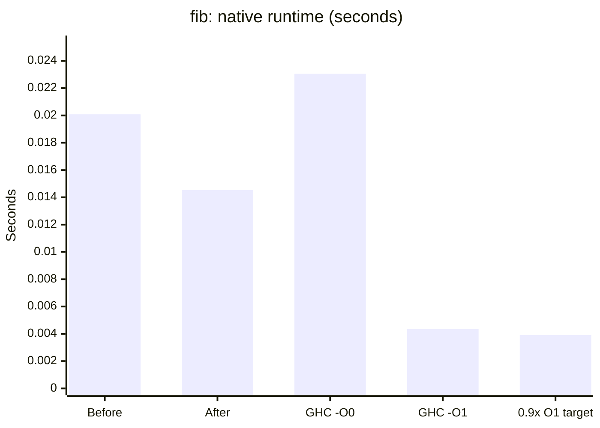
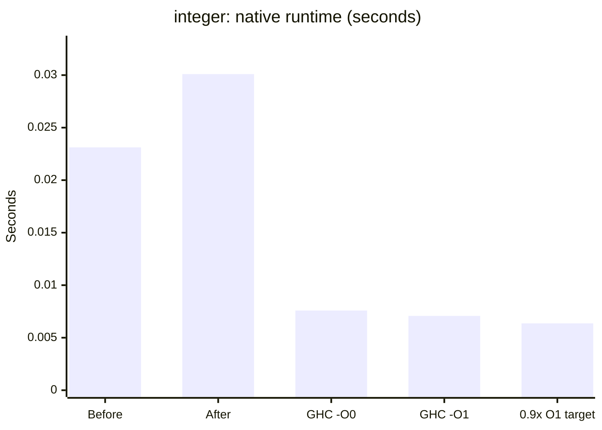
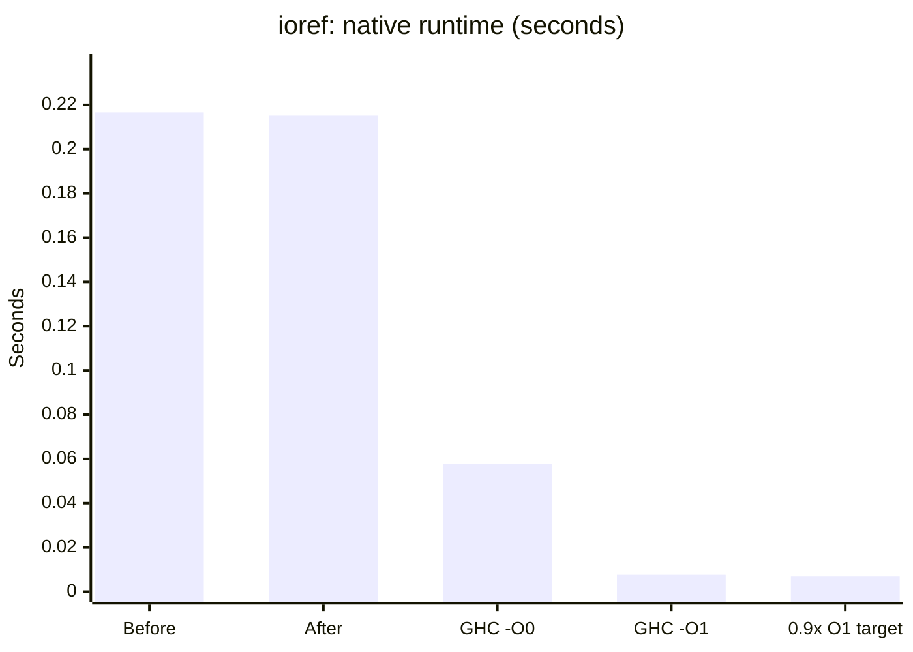
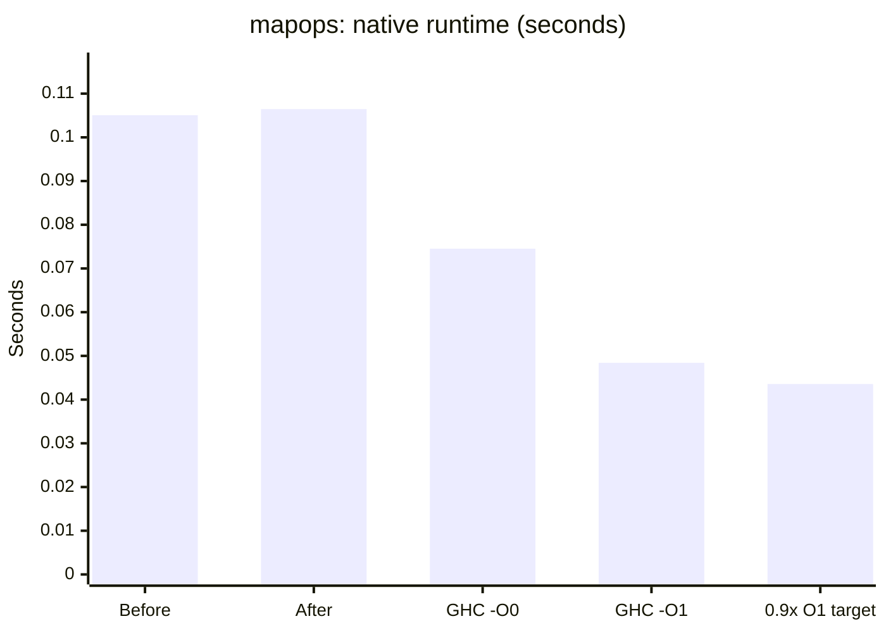
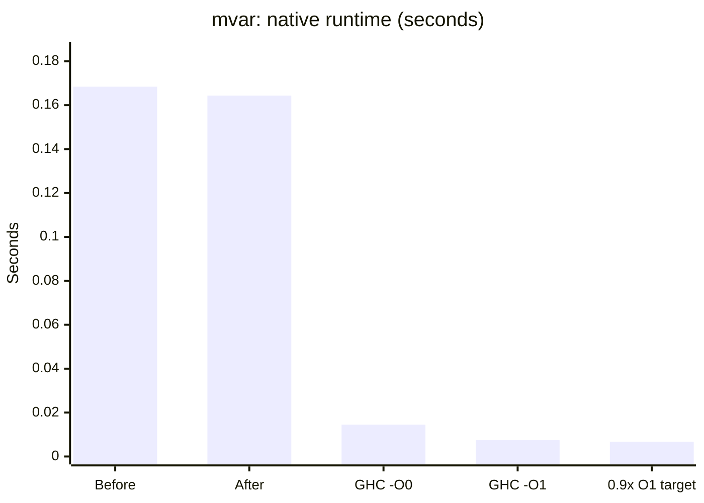
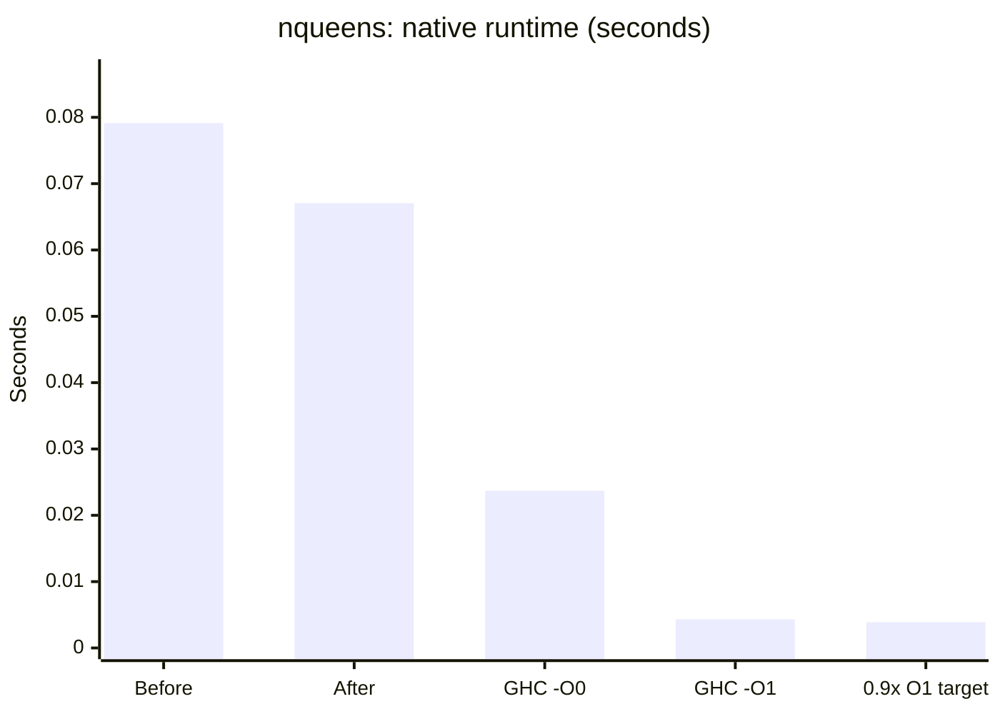
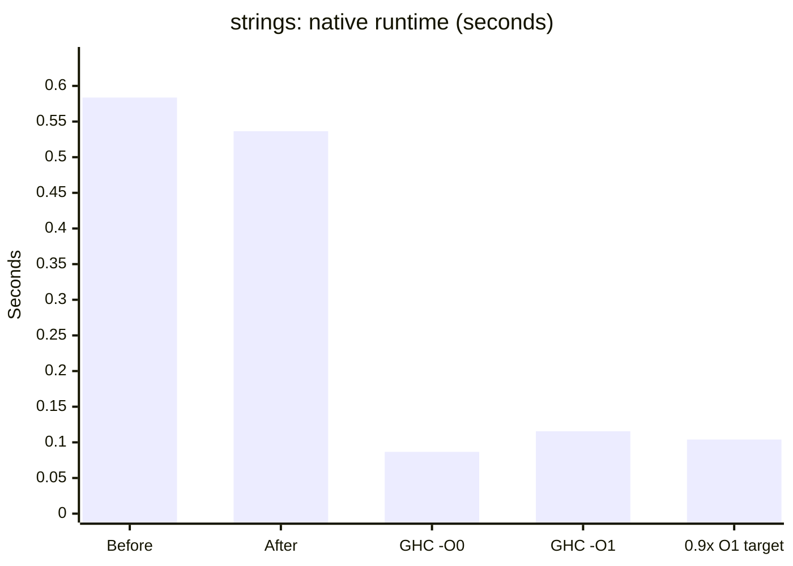
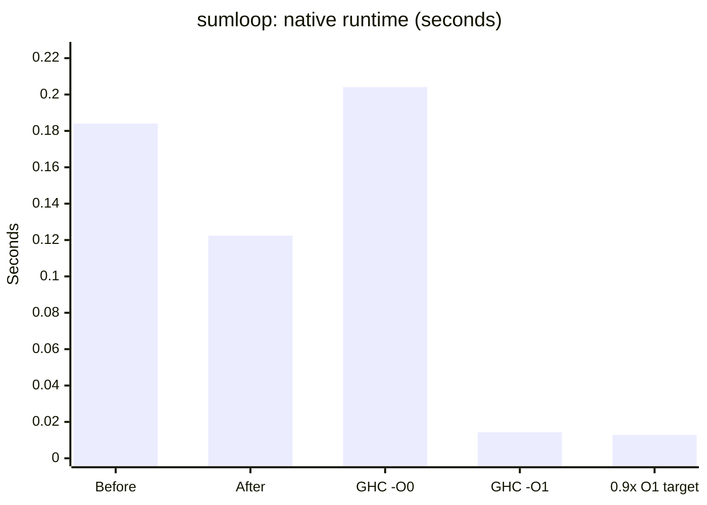

# Raw (unboxed) frame slots for inline primitive results: native runtime

[Raw samples, commands and metadata](runtime-raw-slots.json).

[Hosted run](https://github.com/billyedmoore/shit-haskell/actions/runs/43913824249); AMD EPYC 9V74 80-Core Processor, CPU 0, Rust 1.92.0 release, GHC 9.12.2.
Before `f82fa4a826c12de5749b851854b0e9c85484ba16`, after `7e042dc3c7b03d0a43356a091865737281cdefaa`.

Native runtime; median of 3 alternating samples, 1 untimed correctness warmups per build.
Builds excluded; process startup included. Every stdout/stderr/exit result agrees.
CPU affinity: 0. GHC uses default RTS settings.

| Program | Before ms | After ms | GHC -O0 ms | GHC -O1 ms | 0.9×O1 ms |
|---|---:|---:|---:|---:|---:|
| fib | 20.081 | 14.542 | 23.053 | 4.345 | 3.910 |
| integer | 23.125 | 30.095 | 7.587 | 7.074 | 6.367 |
| ioref | 216.614 | 215.121 | 57.691 | 7.616 | 6.855 |
| mapops | 105.055 | 106.457 | 74.533 | 48.416 | 43.574 |
| mvar | 168.426 | 164.390 | 14.467 | 7.418 | 6.676 |
| nqueens | 79.134 | 67.054 | 23.702 | 4.319 | 3.887 |
| strings | 583.644 | 536.476 | 86.651 | 115.540 | 103.986 |
| sumloop | 184.022 | 122.397 | 204.114 | 14.247 | 12.823 |

