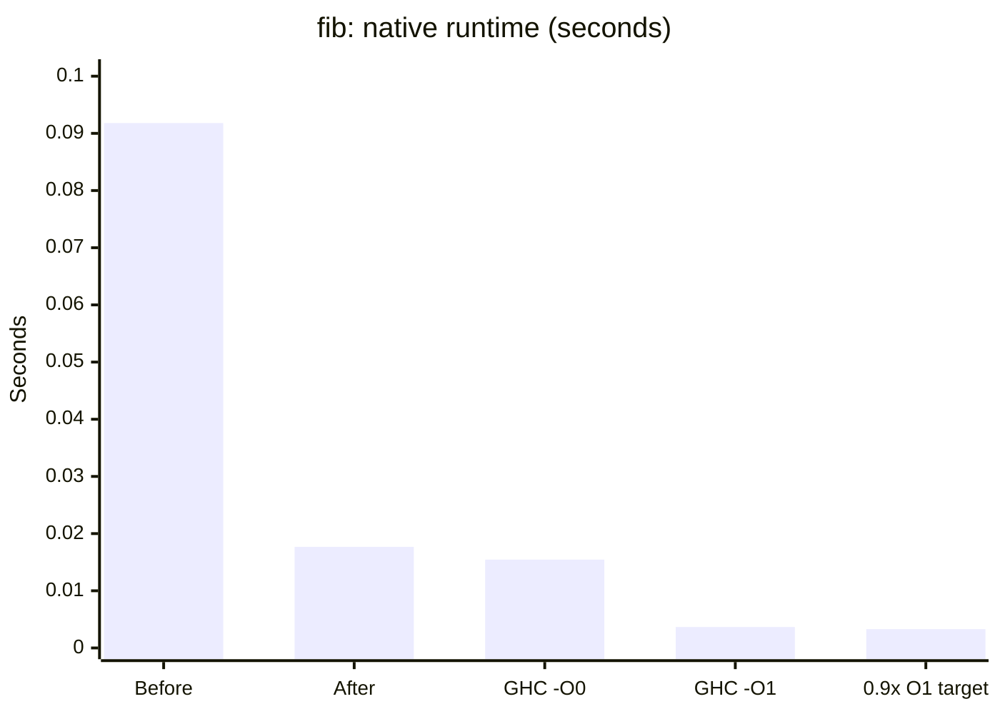
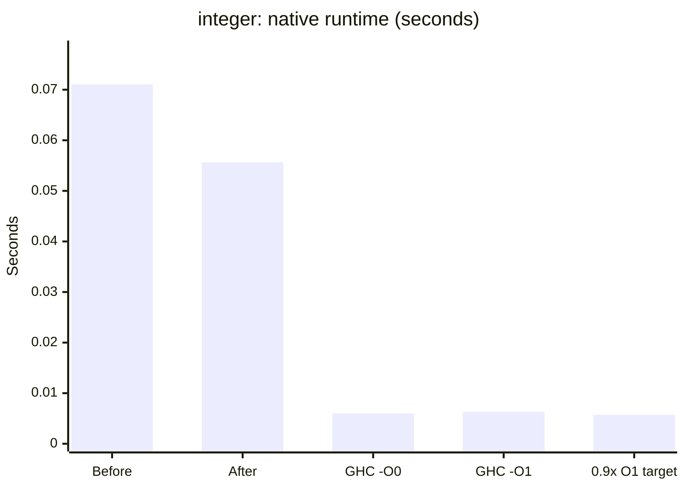
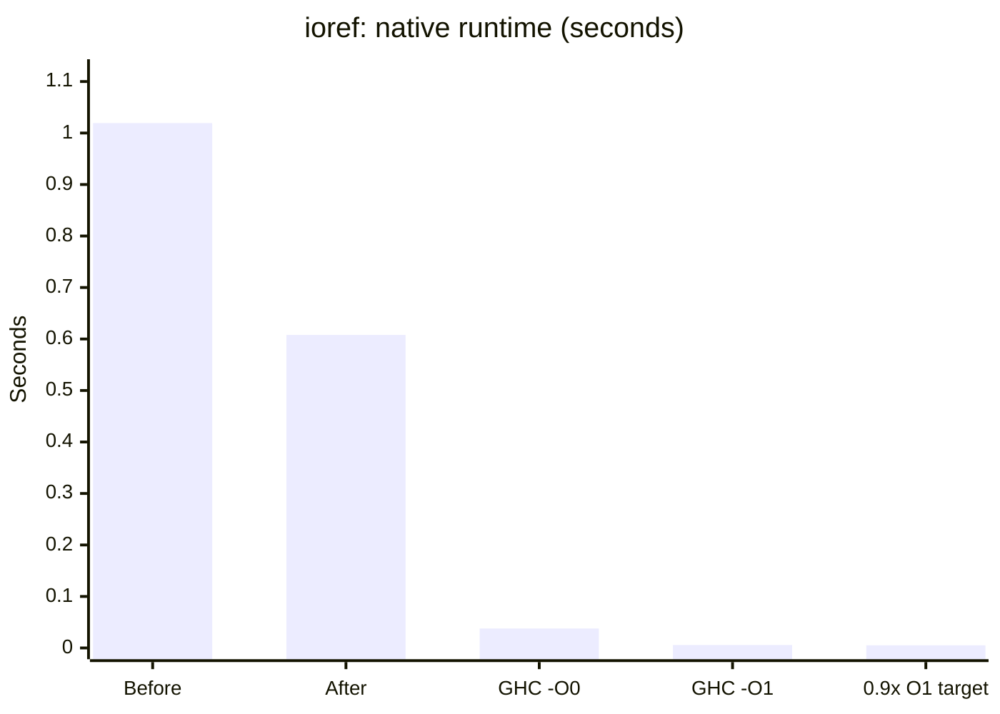
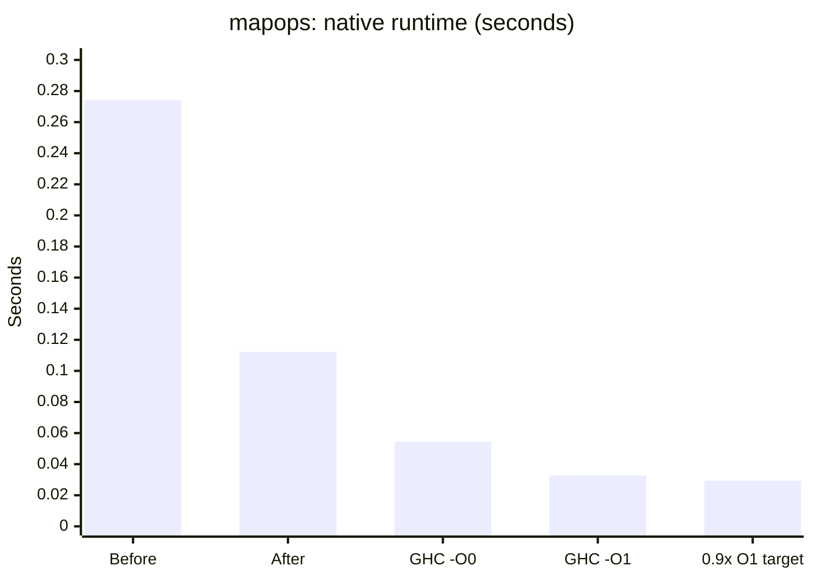
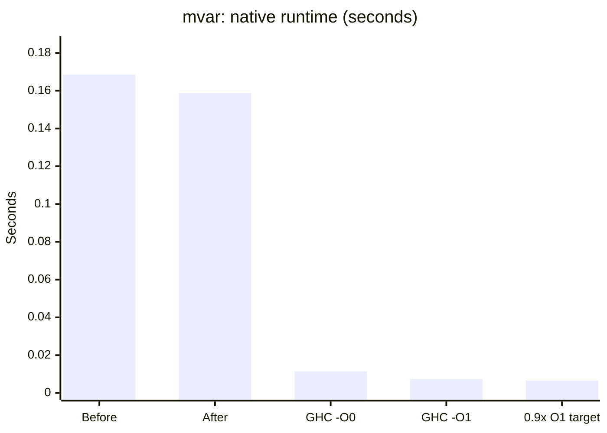
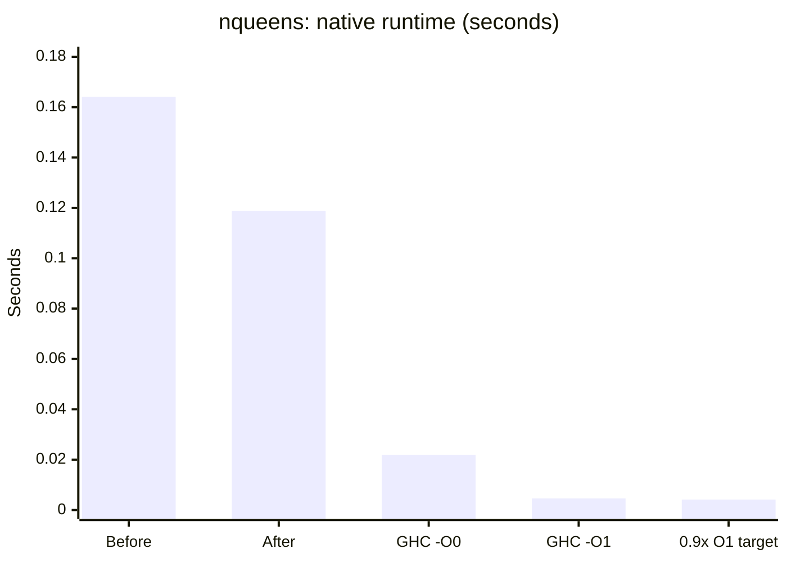
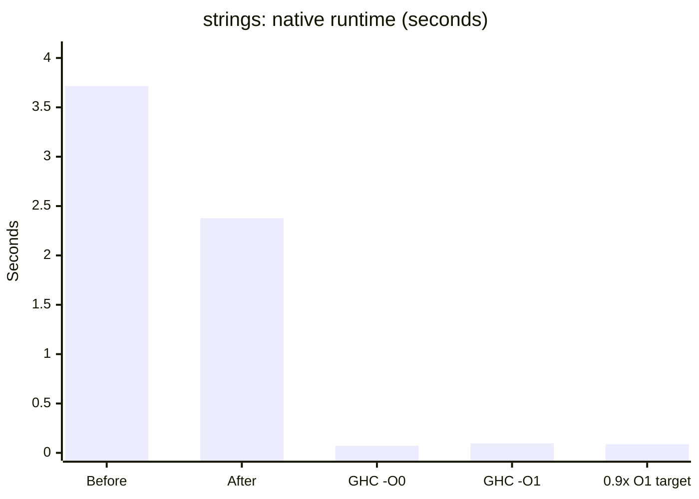
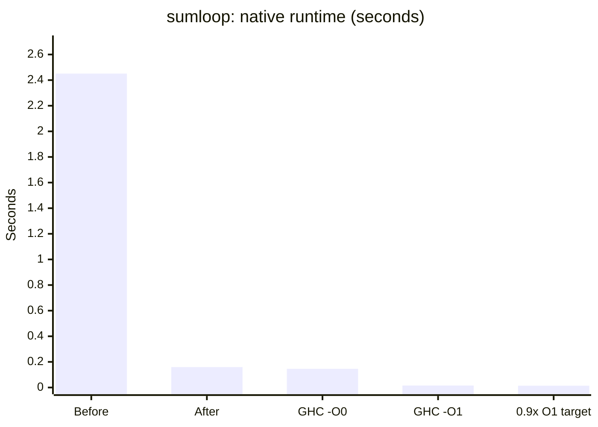

# Core simplifier, call by value and inline Int#: native runtime

[Raw samples, commands and metadata](runtime-simplifier.json).

[Hosted run](https://github.com/billyedmoore/shit-haskell/actions/runs/43842654750); AMD EPYC 9V45 96-Core Processor, CPU 0, Rust 1.92.0 release, GHC 9.12.2.
Before `5101474532680fc1fd8d50550042c5d511e40ee4`, after `8b7694f08d071e14a7a8b65e6b857681f9feb1d3`.

Native runtime; median of 3 alternating samples, 1 untimed correctness warmups per build.
Builds excluded; process startup included. Every stdout/stderr/exit result agrees.
CPU affinity: 0. GHC uses default RTS settings.

| Program | Before ms | After ms | GHC -O0 ms | GHC -O1 ms | 0.9×O1 ms |
|---|---:|---:|---:|---:|---:|
| fib | 91.800 | 17.685 | 15.453 | 3.661 | 3.295 |
| integer | 71.070 | 55.626 | 6.001 | 6.356 | 5.721 |
| ioref | 1019.325 | 607.940 | 37.824 | 5.711 | 5.140 |
| mapops | 274.249 | 112.281 | 54.466 | 32.708 | 29.437 |
| mvar | 168.512 | 158.687 | 11.428 | 7.237 | 6.513 |
| nqueens | 164.087 | 118.837 | 21.860 | 4.627 | 4.164 |
| strings | 3716.128 | 2377.450 | 71.982 | 96.237 | 86.613 |
| sumloop | 2450.842 | 159.659 | 145.803 | 15.642 | 14.078 |

