# Small native integer cells: paired measurements

Both comparisons time the same compiler revisions. Each is paired on its own hosted runner;
different host absolute times are not combined. Raw samples and metadata: [runtime-small-integers.json](runtime-small-integers.json).

## Primary

Intel(R) Xeon(R) 6973P-C; CPU 0, Rust 1.92.0 release, GHC 9.12.2.
Before `72809f85b810a69f561fae1fc50e0e61d0003736`, after `097bc82bf244198487a7f6e515909d4afa4d8630`.
Hosted workflow run https://github.com/billyedmoore/shit-haskell/actions/runs/43742604380, attempt 1.

Native runtime; median of 3 alternating samples, 1 untimed correctness warmups per build.
Builds excluded; process startup included. Every stdout/stderr/exit result agrees.
CPU affinity: 0. GHC uses default RTS settings.

| Program | Before ms | After ms | GHC -O0 ms | GHC -O1 ms | 0.9×O1 ms |
|---|---:|---:|---:|---:|---:|
| fib | 111.758 | 105.281 | 19.585 | 3.858 | 3.472 |
| integer | 73.809 | 73.564 | 5.829 | 5.290 | 4.761 |
| ioref | 1206.387 | 1257.212 | 58.865 | 6.163 | 5.546 |
| mapops | 392.083 | 371.901 | 74.177 | 40.865 | 36.779 |
| mvar | 113.980 | 109.562 | 13.067 | 7.654 | 6.889 |
| nqueens | 208.497 | 203.787 | 23.425 | 4.357 | 3.921 |
| strings | 4354.181 | 4268.785 | 85.325 | 111.612 | 100.451 |
| sumloop | 12656.080 | 11029.756 | 215.623 | 17.356 | 15.620 |

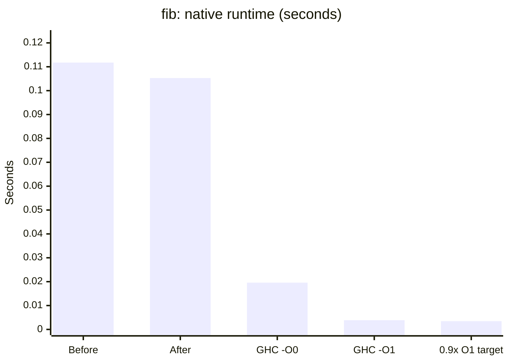

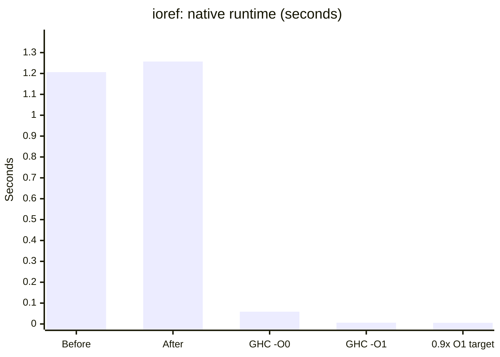

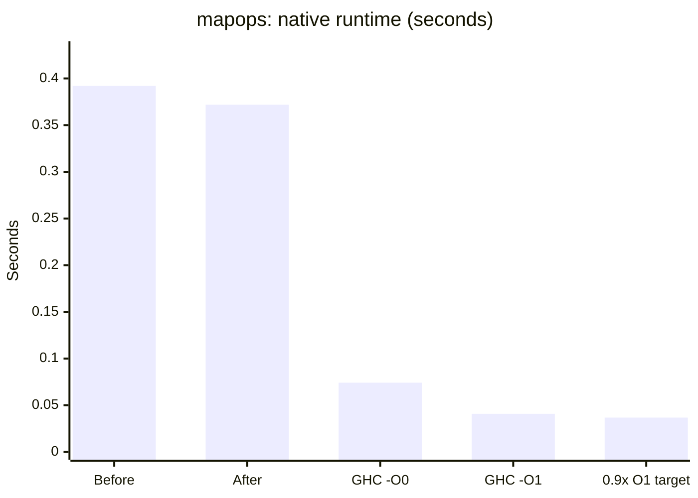

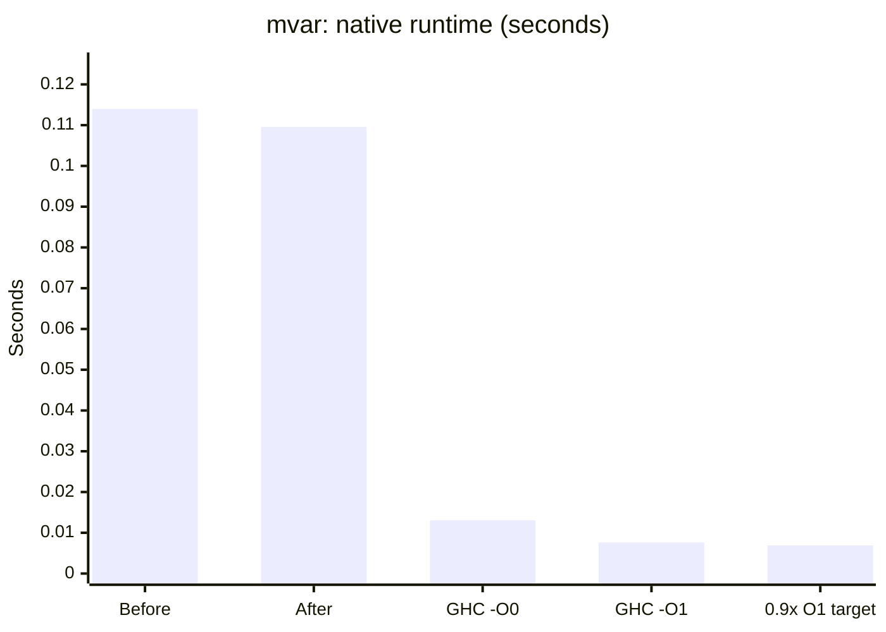

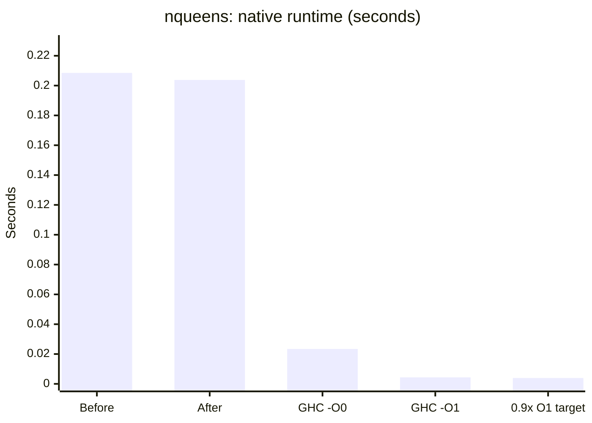

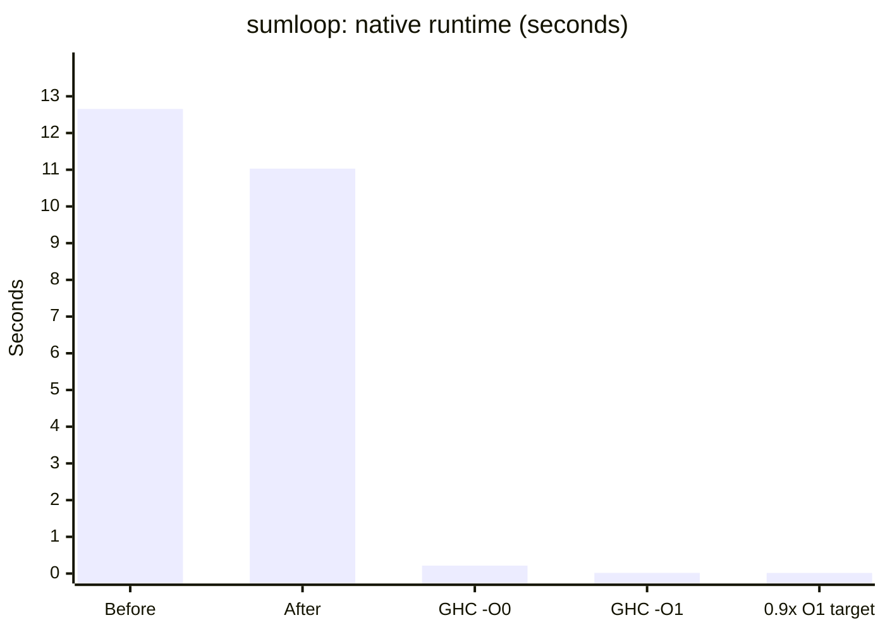

Eight-program geometric-mean speedup: 1.037477×.

## Verification

AMD EPYC 9V74 80-Core Processor; CPU 0, Rust 1.92.0 release, GHC 9.12.2.
Before `72809f85b810a69f561fae1fc50e0e61d0003736`, after `097bc82bf244198487a7f6e515909d4afa4d8630`.
Hosted workflow run https://github.com/billyedmoore/shit-haskell/actions/runs/43742604380, attempt 2.

Native runtime; median of 3 alternating samples, 1 untimed correctness warmups per build.
Builds excluded; process startup included. Every stdout/stderr/exit result agrees.
CPU affinity: 0. GHC uses default RTS settings.

| Program | Before ms | After ms | GHC -O0 ms | GHC -O1 ms | 0.9×O1 ms |
|---|---:|---:|---:|---:|---:|
| fib | 133.751 | 125.612 | 18.233 | 3.768 | 3.391 |
| integer | 80.111 | 79.558 | 6.818 | 5.982 | 5.384 |
| ioref | 1383.175 | 1374.626 | 55.885 | 6.130 | 5.517 |
| mapops | 419.739 | 409.390 | 71.379 | 45.181 | 40.663 |
| mvar | 190.813 | 188.590 | 13.427 | 6.649 | 5.984 |
| nqueens | 229.090 | 223.906 | 22.122 | 4.390 | 3.951 |
| strings | 4924.212 | 4758.718 | 81.924 | 108.686 | 97.818 |
| sumloop | 12299.421 | 10751.014 | 195.268 | 13.892 | 12.503 |

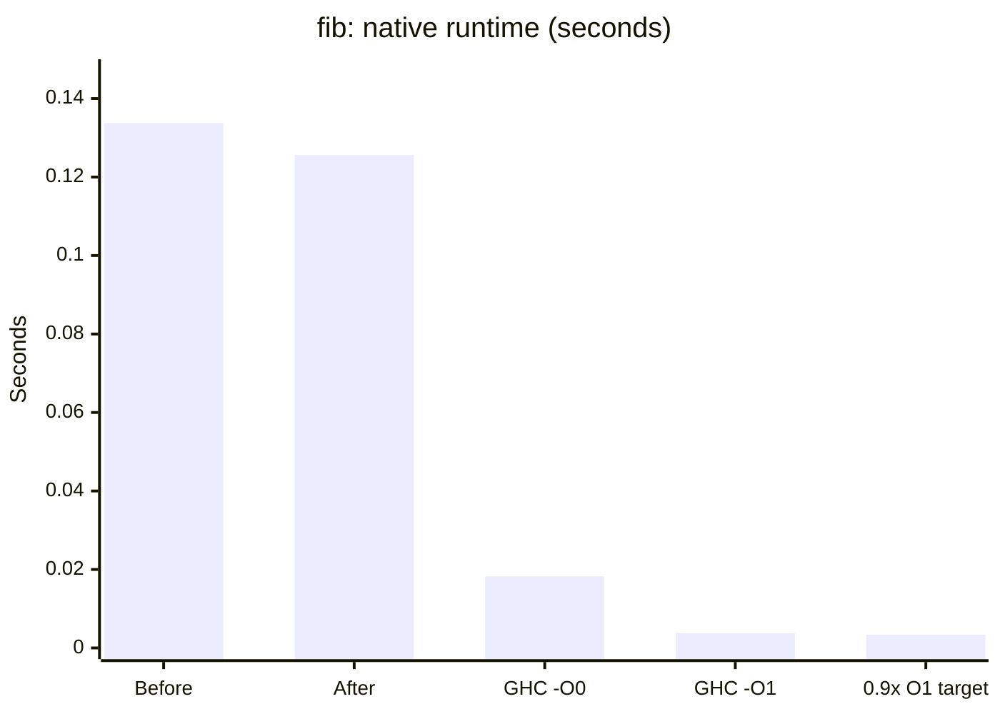

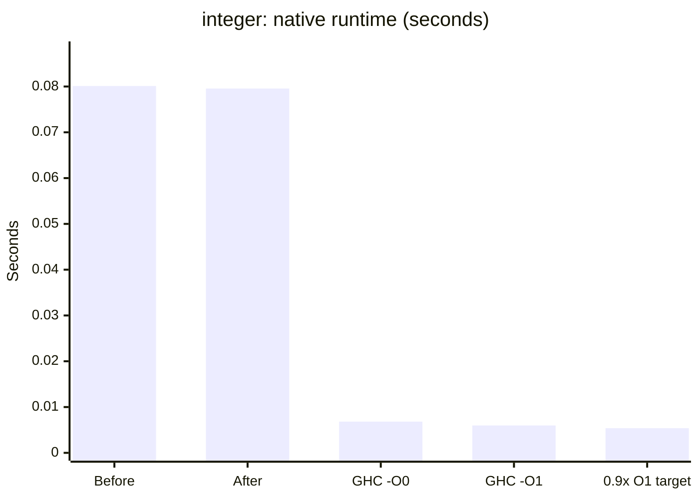

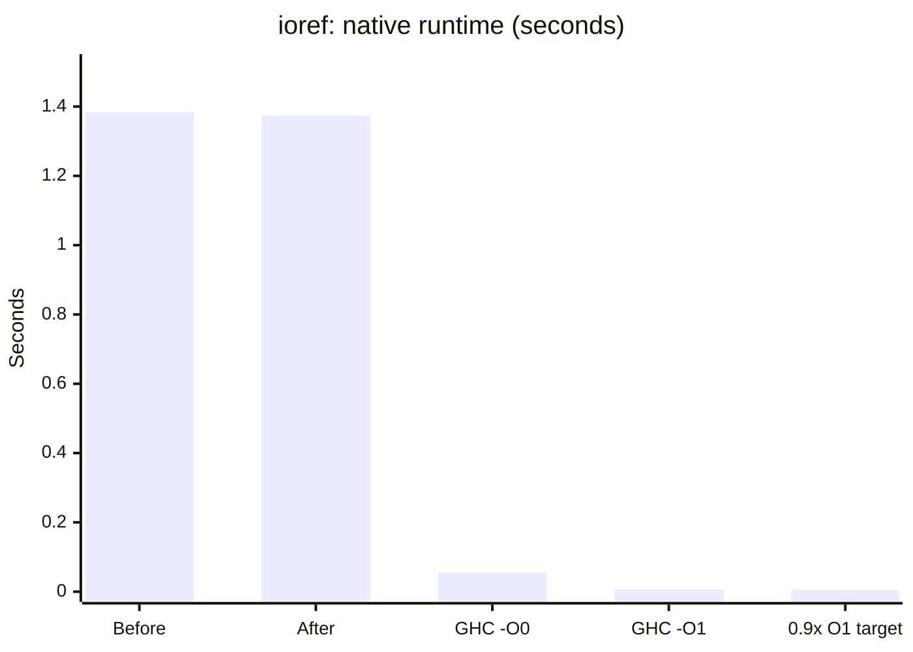

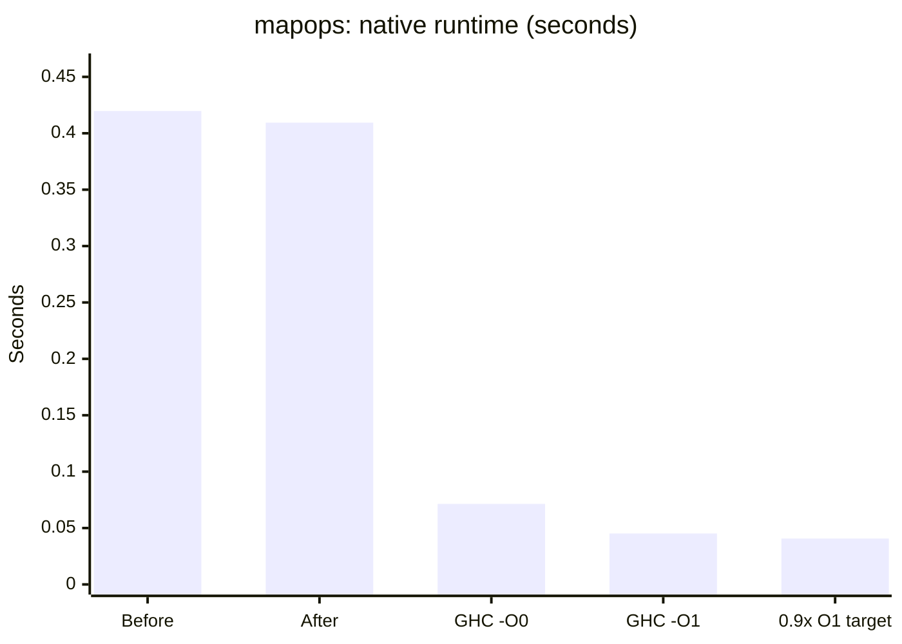

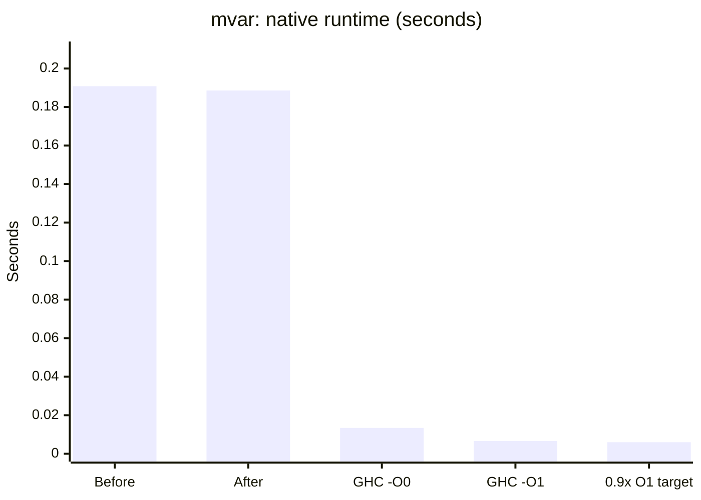

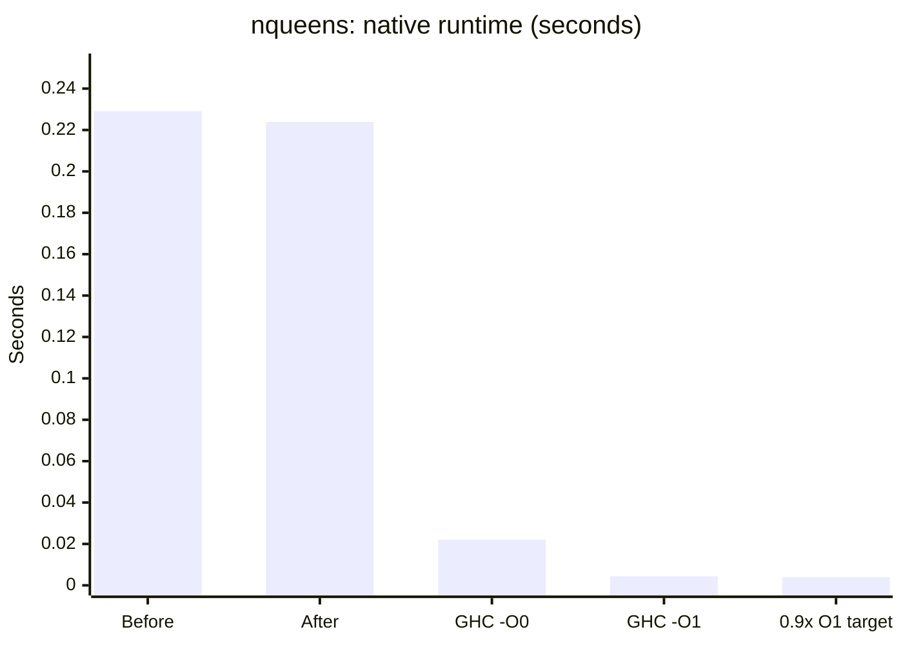

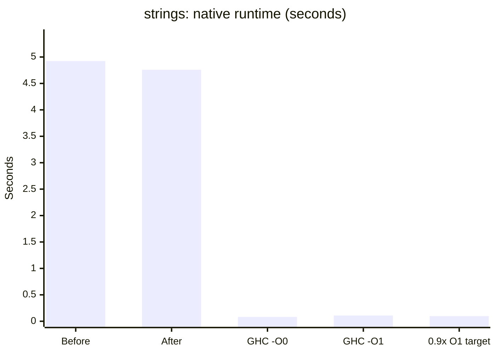

Eight-program geometric-mean speedup: 1.038760×.

Sumloop improved by 12.9% and 12.6% in the two comparisons. IORef is mixed:
4.2% slower initially and 0.6% faster on verification. No consistent IORef change is claimed.
The 0.9× GHC -O1 target remains unmet.

Reproduce with `tools/runtimebench.py --before /path/to/before/hsc --after /path/to/after/hsc --ghc ghc --cpu 0 --runs 3` and common vendored sources through `HSC_LIBDIR`. Correctness warmups and builds are excluded; each sample checks stdout, stderr and exit status.
