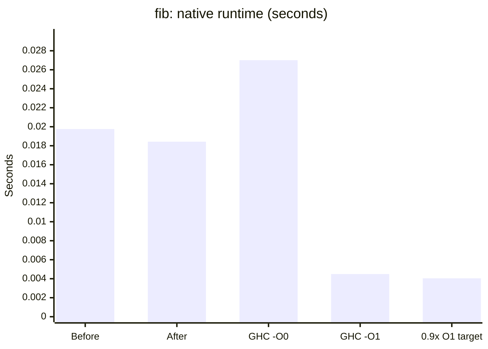
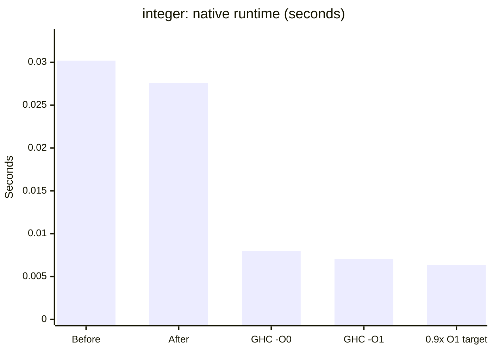
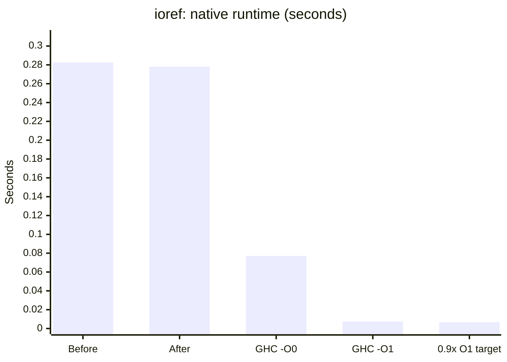
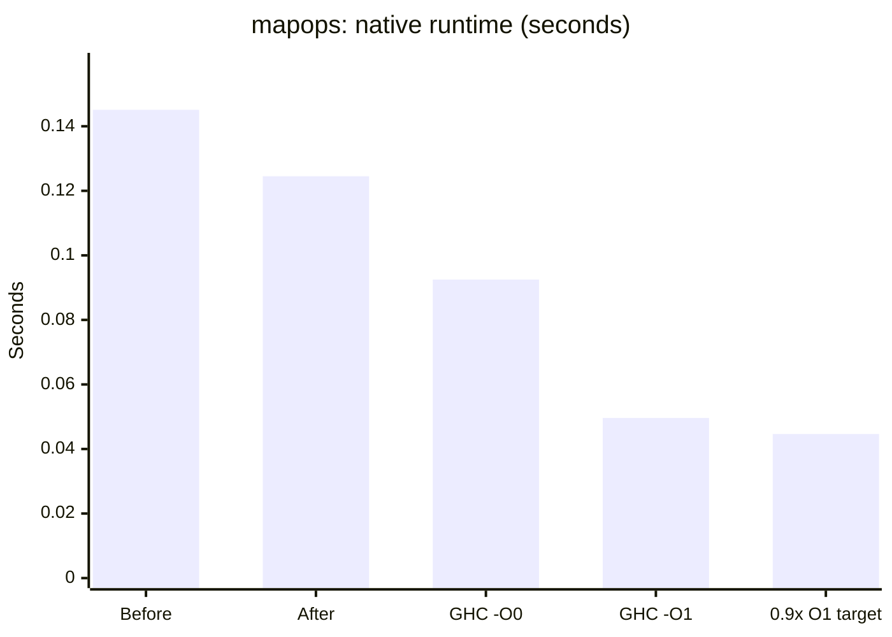
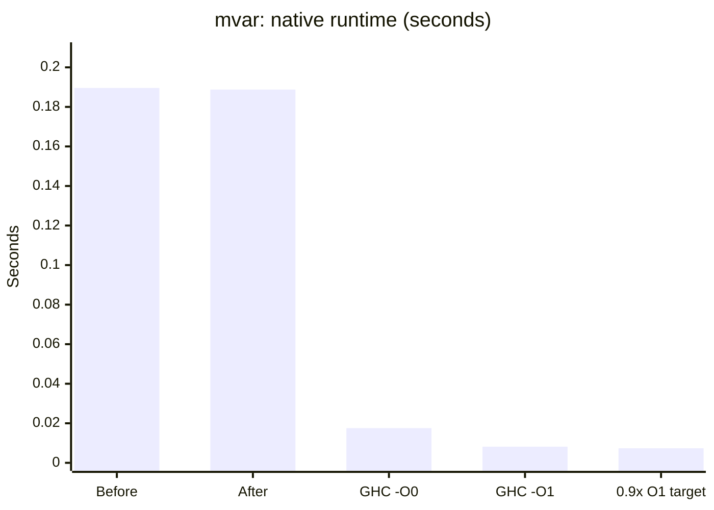
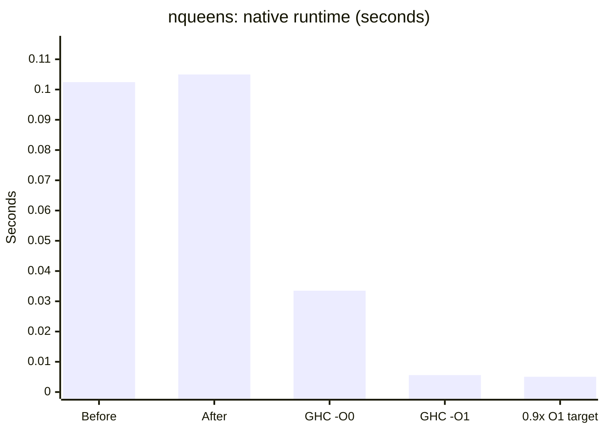
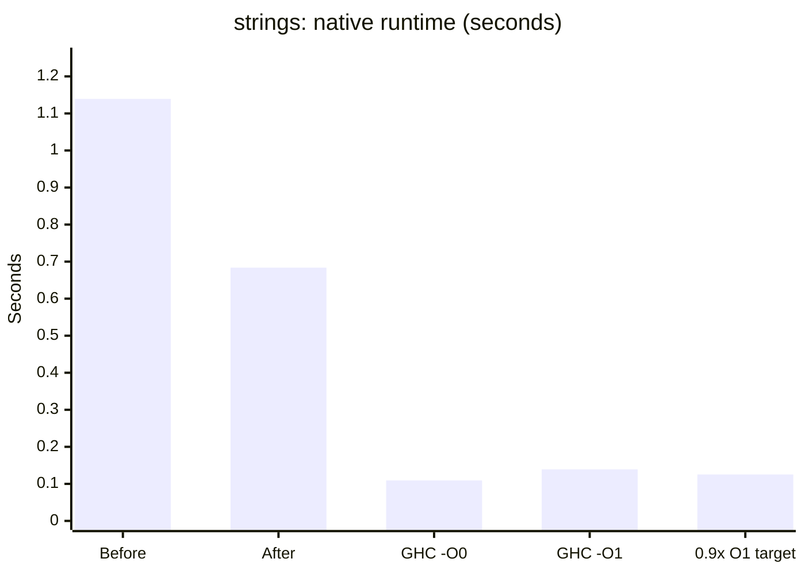
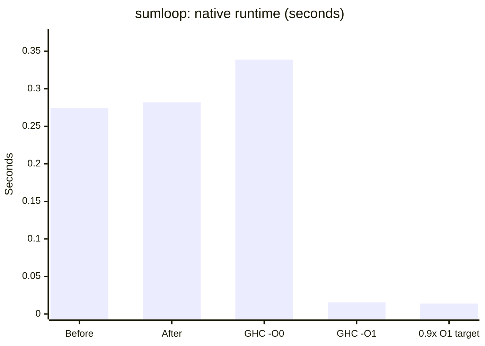

# Pattern-match failures as bottom in strictness: native runtime

[Raw samples, commands and metadata](runtime-strictness-failures.json).

[Hosted run](https://github.com/billyedmoore/shit-haskell/actions/runs/43901093479); AMD EPYC 7763 64-Core Processor, CPU 0, Rust 1.92.0 release, GHC 9.12.2.
Before `b73bcbb38d01d7330ab912d2b4d67efa5bd16683`, after `ca42d51d91093a0c09370c3c56db7ecd389818b4`.

Native runtime; median of 3 alternating samples, 1 untimed correctness warmups per build.
Builds excluded; process startup included. Every stdout/stderr/exit result agrees.
CPU affinity: 0. GHC uses default RTS settings.

| Program | Before ms | After ms | GHC -O0 ms | GHC -O1 ms | 0.9×O1 ms |
|---|---:|---:|---:|---:|---:|
| fib | 19.760 | 18.424 | 27.012 | 4.491 | 4.042 |
| integer | 30.186 | 27.596 | 7.948 | 7.061 | 6.355 |
| ioref | 282.628 | 278.139 | 77.078 | 7.499 | 6.749 |
| mapops | 145.106 | 124.520 | 92.501 | 49.603 | 44.643 |
| mvar | 189.607 | 188.752 | 17.539 | 8.157 | 7.342 |
| nqueens | 102.459 | 104.985 | 33.508 | 5.602 | 5.042 |
| strings | 1139.141 | 683.632 | 109.329 | 139.286 | 125.358 |
| sumloop | 274.096 | 281.808 | 338.746 | 15.418 | 13.876 |

