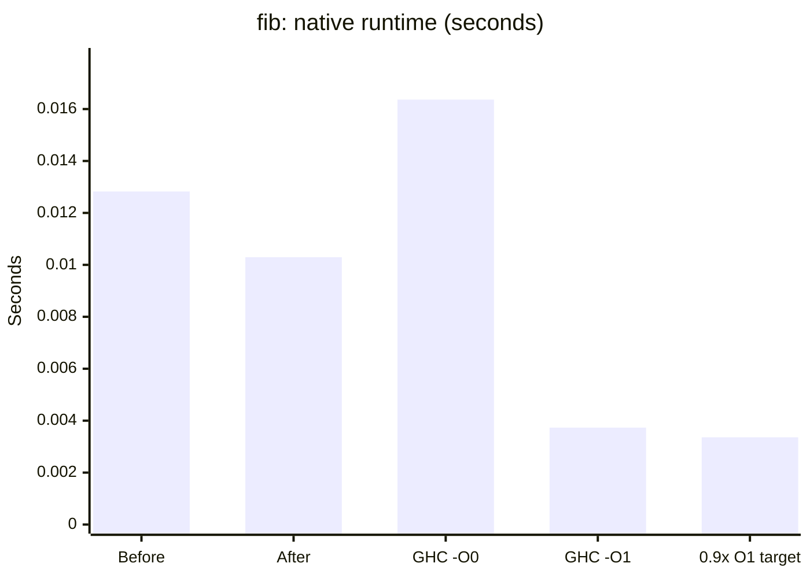
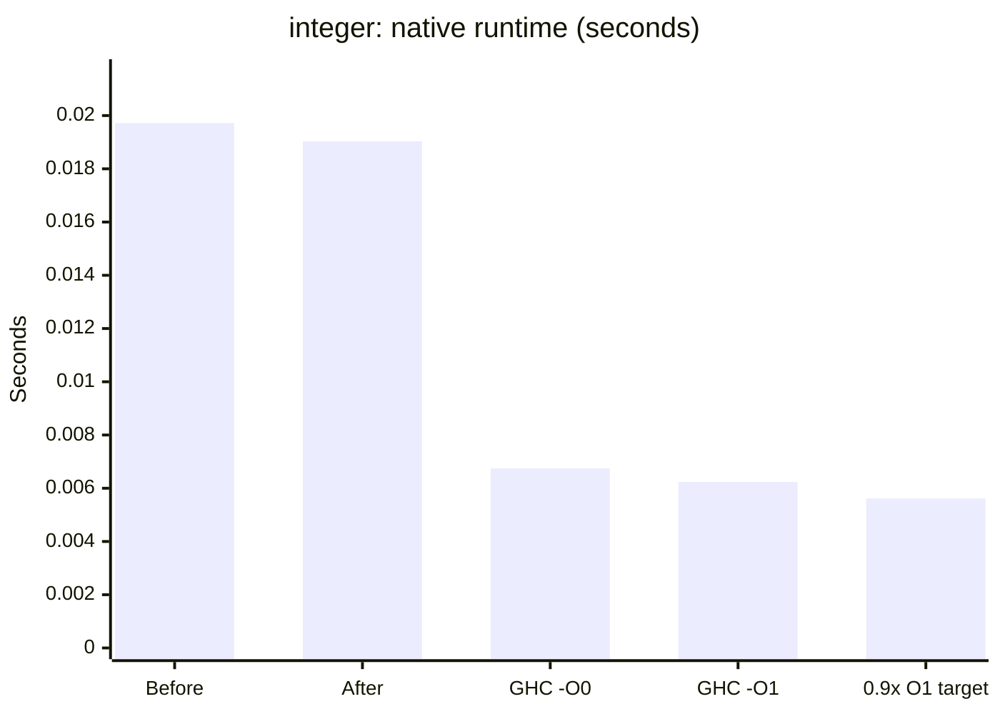
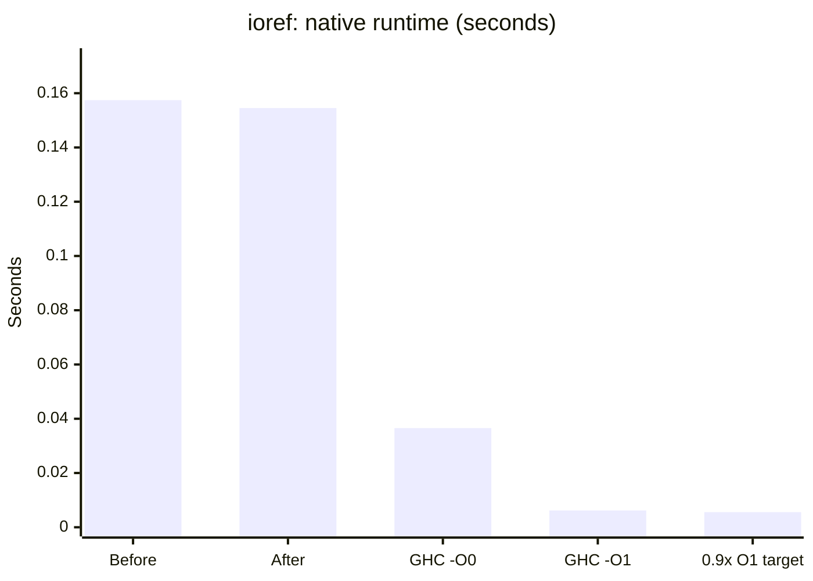
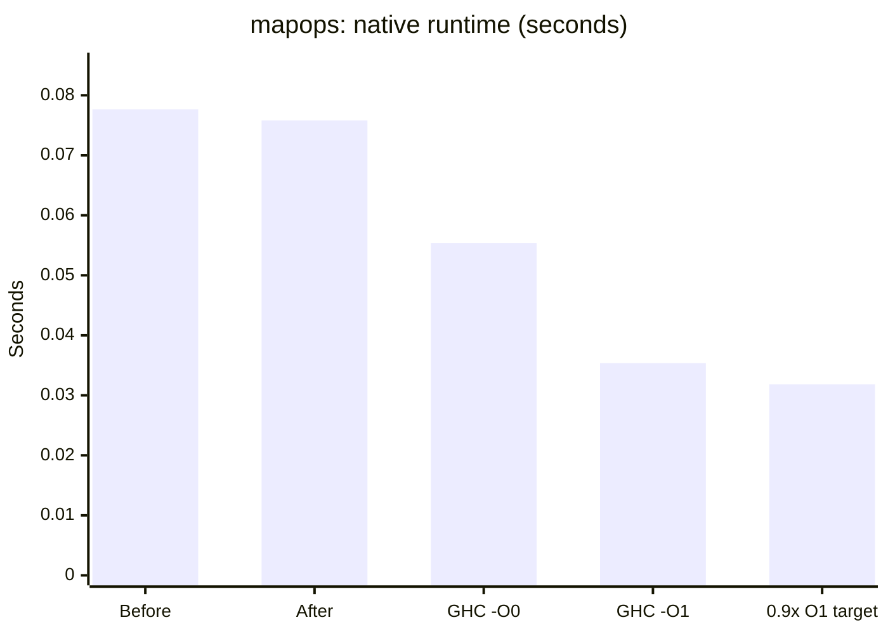
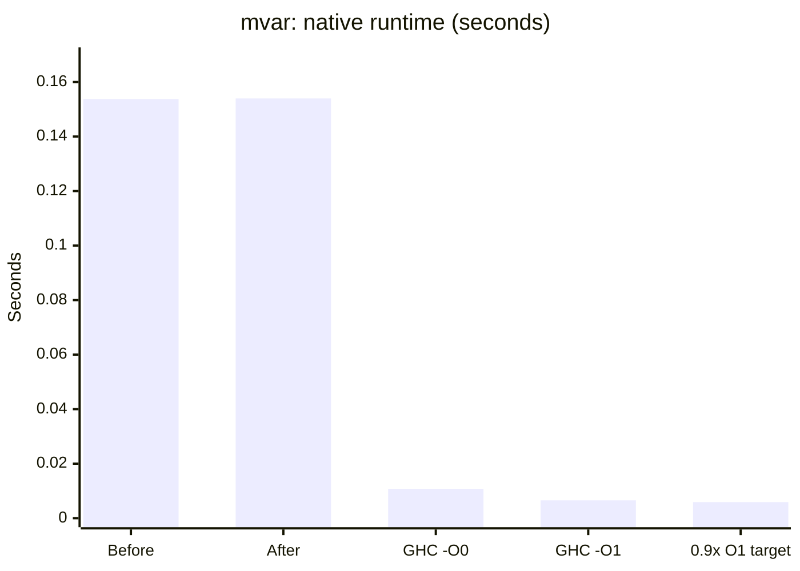
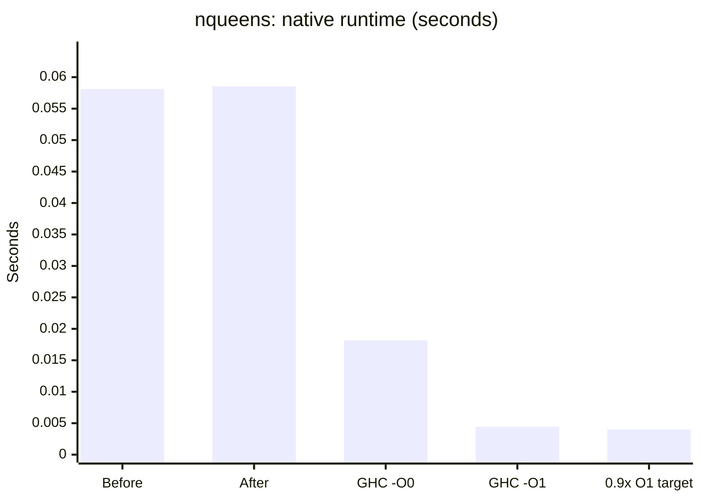
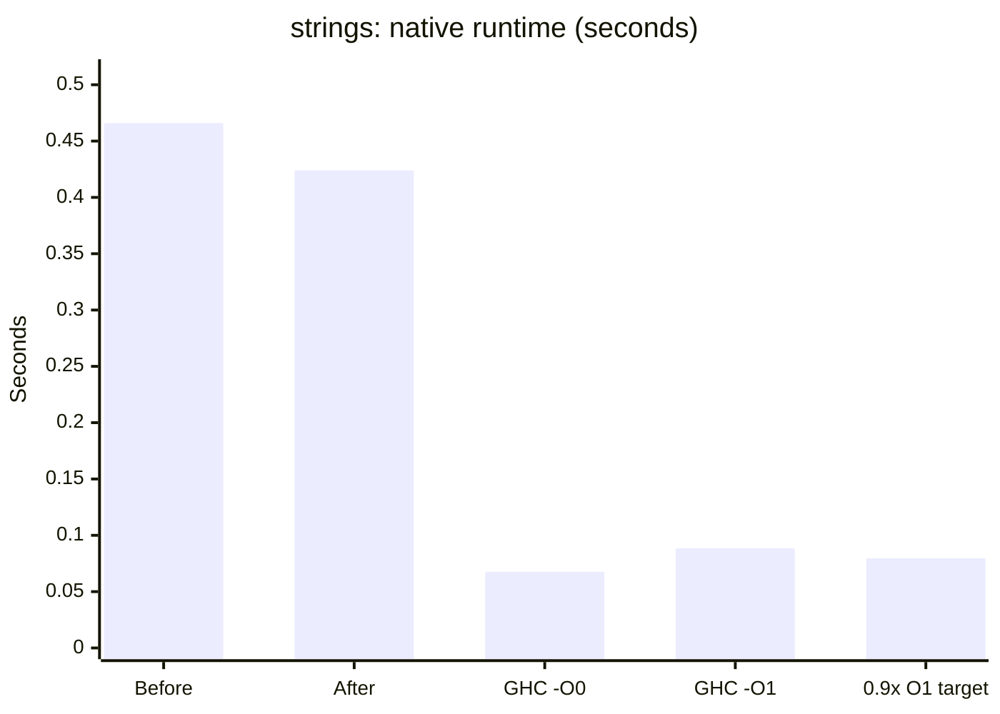
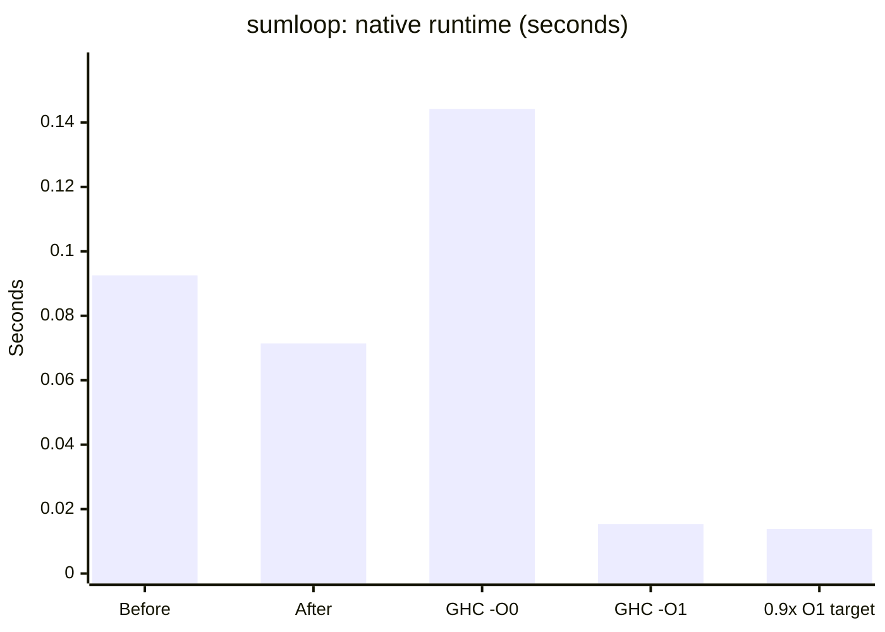

# Workers taking strict numeric parameters unboxed: native runtime

[Raw samples, commands and metadata](runtime-workers.json).

[Hosted run](https://github.com/billyedmoore/shit-haskell/actions/runs/43933362822); AMD EPYC 9V45 96-Core Processor, CPU 0, Rust 1.92.0 release, GHC 9.12.2.
Before `b2e614979969dadb46f692bf79149438914d288a`, after `a445abecc1ca2d892a1179f6c97f10b7f63abbea`.

Native runtime; median of 3 alternating samples, 1 untimed correctness warmups per build.
Builds excluded; process startup included. Every stdout/stderr/exit result agrees.
CPU affinity: 0. GHC uses default RTS settings.

| Program | Before ms | After ms | GHC -O0 ms | GHC -O1 ms | 0.9×O1 ms |
|---|---:|---:|---:|---:|---:|
| fib | 12.826 | 10.297 | 16.363 | 3.732 | 3.359 |
| integer | 19.718 | 19.035 | 6.744 | 6.237 | 5.614 |
| ioref | 157.441 | 154.550 | 36.555 | 6.183 | 5.565 |
| mapops | 77.669 | 75.804 | 55.394 | 35.354 | 31.819 |
| mvar | 153.738 | 153.981 | 10.771 | 6.545 | 5.890 |
| nqueens | 58.113 | 58.543 | 18.155 | 4.432 | 3.989 |
| strings | 465.980 | 424.038 | 67.678 | 88.450 | 79.605 |
| sumloop | 92.550 | 71.416 | 144.208 | 15.352 | 13.816 |

